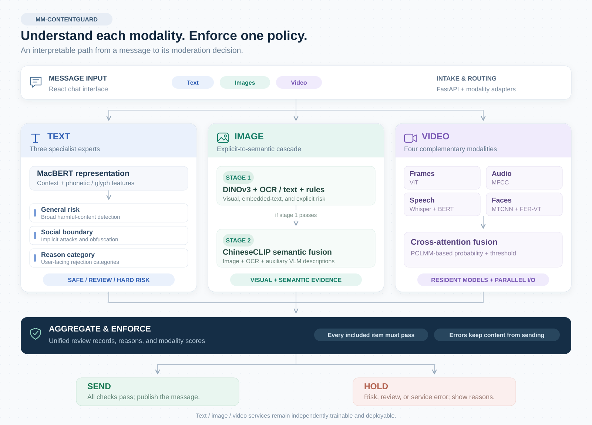
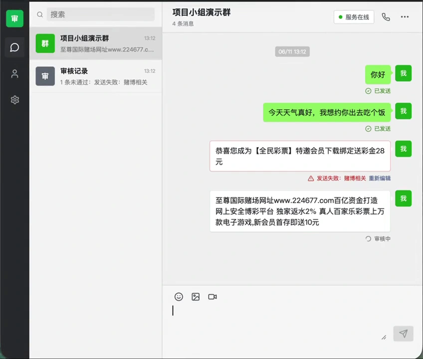
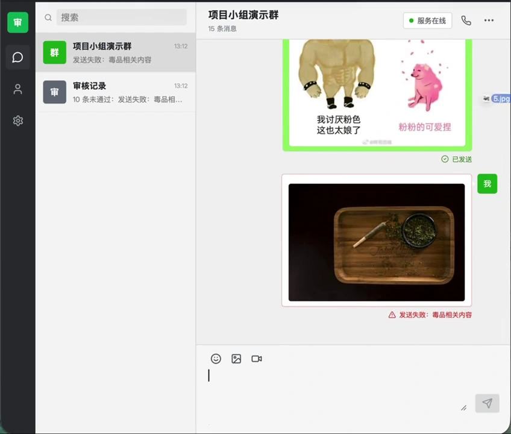
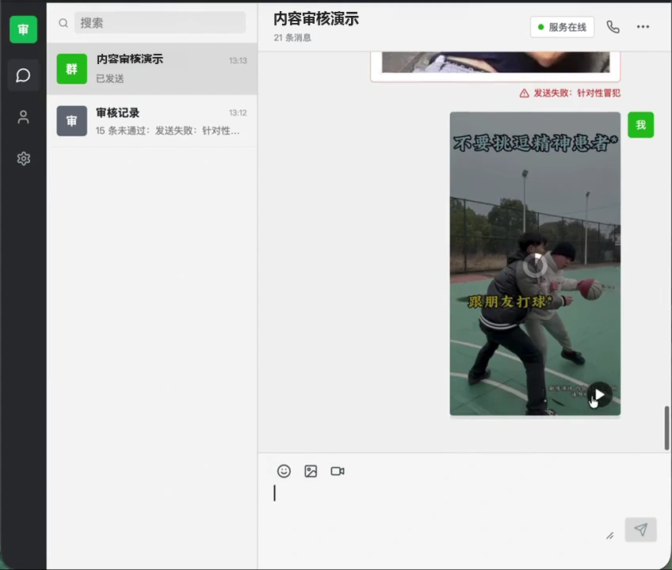
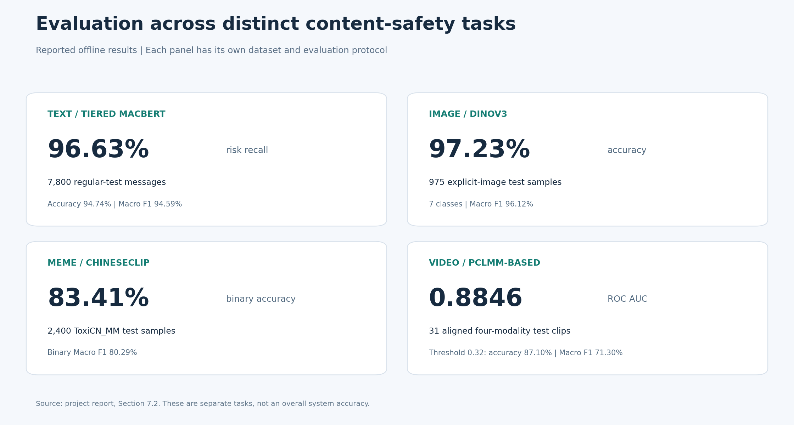
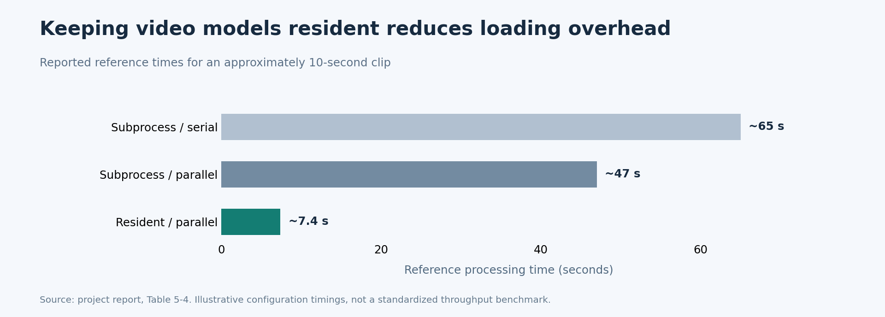

<div align="center">

# MM-ContentGuard

### Understand the content. Explain the risk. Review before sending.

A multimodal content moderation system for text, images, memes, and video in social-media messaging.

**Text · Image · Video** &nbsp; / &nbsp; **3 specialist services** &nbsp; / &nbsp; **1 unified moderation gateway**

[Overview](#project-overview) · [Architecture](#how-it-works) · [Demo](#see-it-in-action) · [Results](#evaluation-results) · [Quick Start](#quick-start)

</div>

## Project Overview

**Moderation goes beyond matching a list of blocked words.** Harmful messages can use phonetic substitutions, implicit conversational attacks, text inside images, or image-text combinations that change the meaning of a meme. Video adds speech, sound, motion, and facial expression.

MM-ContentGuard brings specialist models into a single **review-before-send workflow**. A React chat interface sends message text and attachments to a FastAPI gateway, which routes each item to its moderation service and returns structured decisions and reasons. A message is sent only after all included items pass review.

- **Robust text understanding:** three MacBERT experts combine contextual semantics with phonetic and glyph features to handle general risk, conversational boundaries, and rejection reasons.
- **Two-stage image understanding:** visual classification, OCR/text checks, and rules address explicit risk; a ChineseCLIP semantic stage uses image-text evidence and auxiliary descriptions to assess memes and implicit meaning.
- **Four-modality video analysis:** a PCLMM-based branch fuses frames, audio, speech transcripts, and facial expressions for patronizing and condescending language (PCL) detection.
- **A working application:** modality adapters, consistent result schemas, review records, and fail-closed handling connect separately evaluated models to one messaging workflow.

## How It Works



| Route | Core design | What it handles |
|---|---|---|
| **Semantic text service** | Three MacBERT experts, phonetic/glyph fusion, tiered decision policy | General harmful text, implicit conversational attacks, and four user-facing reason categories |
| **Image service** | DINOv3 + OCR + text checks + rules, followed by ChineseCLIP with description augmentation | Explicit visual risk, text embedded in images, and harmful image-text combinations |
| **Video service** | ViT frames, MFCC audio, Whisper/BERT speech text, and FER-VT facial features with cross-attention fusion | PCL classification using four complementary modalities |

**Routing and decisions.** The first image stage can stop on explicit risk; images that pass continue to the semantic stage. The online text service uses a tiered policy for hard risk, review, and safe outcomes. At the gateway, all included content must pass. Timeouts, unavailable services, and parsing failures keep a message from being sent without review.

The gateway connects the MacBERT text, two-stage image, and four-modality video services through a shared review interface.

## See It in Action

**Recorded application demo.** The recording shows ordinary messages being sent, risky text receiving rejection reasons, image attachments receiving review outcomes, and a video attachment being uploaded and previewed.

[](doc/assets/demo.mp4)

*Text moderation in the recorded application: accepted messages remain visible alongside rejected test inputs and their reasons. Click the image to open the complete 58-second demo.*

<table>
<tr>
<td width="50%"><a href="doc/assets/demo-image.webp"></a></td>
<td width="50%"><a href="doc/assets/demo-video.webp"></a></td>
</tr>
<tr>
<td><strong>Image review.</strong> Approved images and a rejected image are shown with their application feedback.</td>
<td><strong>Video workflow.</strong> A video attachment is uploaded and opened in the in-app preview.</td>
</tr>
</table>

[Watch or download the complete demo →](doc/assets/demo.mp4)

*Frames extracted from the provided recording preserve the original Chinese interface and test inputs. Evaluation results are reported separately below.*

## Evaluation Results



| Evaluated component | Test scope | Reported result |
|---|---|---|
| **Tiered MacBERT text system** | 7,800 regular-test messages | **96.63% risk recall**, 94.74% accuracy, 94.59% macro F1 |
| **Text social-boundary evaluation** | 400 manually constructed sealed examples | **99.00% accuracy, macro F1, and risk recall** |
| **DINOv3 explicit-image classifier** | 975 SIMAS + PASS test images; 7 classes | **97.23% accuracy**, 96.12% macro F1 |
| **ChineseCLIP meme semantic classifier** | 2,400 ToxiCN_MM test examples | **83.41% binary accuracy**, 80.29% binary macro F1 |
| **PCLMM-based video classifier** | 31 feature-complete test clips | **0.8846 ROC AUC**; at threshold 0.32, 87.10% accuracy and 71.30% macro F1 |

**Different tasks, separate evidence.** These results describe each component on its own dataset. They are not a pooled overall accuracy or an end-to-end gateway score. The sealed text set is constructed, and the video results use a small feature-complete subset with a threshold selected from test-set comparisons. [Protocols, trade-offs, and full results →](doc/EVALUATION.md)

### Video Inference Engineering



The report records an approximately **88.6% reduction in reference processing time**, from about 65 to 7.4 seconds for an approximately ten-second clip, after keeping models resident and extracting features in parallel. Feature caching supports repeated requests. These are configuration-specific reference timings, not a standardized throughput benchmark.


## Quick Start

The supplied scripts target **Linux/Bash**, with **Python 3.10**, **FFmpeg**, **Node.js/npm**, and the documented PyTorch/CUDA environment. Trained checkpoints and model caches are downloaded separately; no retraining is required for the demo.

```bash
git clone https://github.com/Wangych297/MM-ContentGuard.git
cd MM-ContentGuard
```

Follow the [environment and asset setup](doc/RUNNING.md), then start the services:

```bash
cp .env.example .env
VERSION=v0.1.0 bash scripts/download_runtime_assets.sh
bash scripts/check_runtime_assets.sh
bash scripts/start_all.sh
bash scripts/check_services.sh
```

Open **http://127.0.0.1:5173/**. Configure GPU devices and any VLM description endpoint in `.env` for your machine.

[Complete installation, service ports, API examples, training references, and shutdown instructions →](doc/RUNNING.md)

<details>
<summary><strong>Repository map</strong></summary>

| Directory | Responsibility |
|---|---|
| [`frontend/web/`](frontend/web/) | React/Vite chat interface and moderation feedback |
| [`backend/gateway/`](backend/gateway/) | FastAPI gateway, adapters, message state, and review records |
| [`services/text/`](services/text/) | MacBERT experts, training, and text moderation API |
| [`services/image/`](services/image/) | Explicit-image and semantic-meme models, OCR, and image API |
| [`services/video/`](services/video/) | PCLMM-based fusion, feature extraction, and video API |
| [`scripts/`](scripts/) | Runtime asset preparation and service lifecycle |
| [`doc/`](doc/) | Project report, architecture, evaluation, and reproduction guides |

</details>

## Scope

This is a research and engineering prototype for Chinese-language social-media content. Video evaluation addresses PCL rather than every category of harmful video. A moderation decision is a model/policy outcome; deployment thresholds and review practices need to match the intended use.

The project builds on MacBERT, DINOv3, ChineseCLIP, PCLMM, and their dependencies. Dataset and third-party asset use remains subject to their original licenses and terms.
