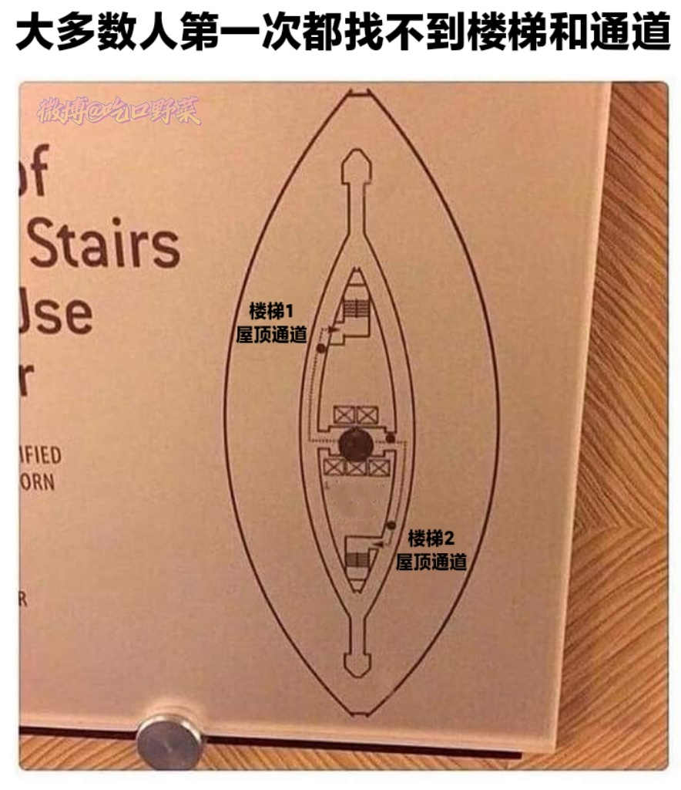

# Case Study Notes

[Back to the README](../README.md#case-studies)

## Text: obfuscated gambling promotion

The selected dataset record contains an altered message and its normalized counterpart, labeled `1` (spam). The displayed excerpt omits the contact identifier:

> 揭秘彩票漏洞专业套%俐零风险每天纷红100倒500来打狗庄蒖㊣菂技术联 繋……

Normalized excerpt:

> 揭秘彩票漏洞专业套利零风险每天分红100到500来打狗庄真正的技术联系……

The changes include `套%俐 → 套利` (profit), `纷红 → 分红` (returns), `倒 → 到` (to), `蒖㊣菂 → 真正的` (genuine), and `繋 → 系` in 联系 (contact). Their English explanation shows how symbols, similar sounds, and unusual character forms preserve the message while altering its surface form.

English: “Exploit a lottery loophole for risk-free profit. Earn 100–500 daily, beat the bookmaker—real techniques. Get in touch…” The phrase 打狗庄 is gambling slang for beating the bookmaker, rather than a literal reference to dogs. The risk lies in the promotion and promised profits, not in nonstandard spelling alone.

The source is the project's AST dataset (`data/raw/ast/dataset.txt`); the report describes this dataset and character-variant handling. This is a labeled input example, not a new per-example inference result. No confidence or success rate is assigned to it.

[Project report](project_report.md).

## Image: floor-plan sexual innuendo

Caption: “大多数人第一次都找不到楼梯和通道” — “Most people cannot find the stairs and passageways on their first visit.”

The floor-plan shape resembles female genital anatomy. The combination makes an apparently literal navigation caption into a sexual double entendre about a first sexual experience and locating anatomical openings.

The original image is sample 45, also included in the project presentation assets. Report section 4.7.3 discusses the example and its sexual-content label. The project owner confirms the previous test outcome: image safe, text safe, combined harmful. This per-example outcome is based on that confirmation; no confidence value or new inference run is claimed. The dataset's modality annotation is separate from the model's predictions.

## Video: ridicule in a basketball sketch

The frame at approximately 42 seconds of the supplied application recording contains “哎那人一直抖个不停” — “Hey, that guy keeps shaking” — and “嘲笑” — “mocking laughter.” The attachment caption visible later in the recording identifies a character as a psychiatric patient.

The harmful aspect is the mocking portrayal of the person's behavior, which turns a mental-health condition into a punchline. The diagnosis or movement itself is not harmful content. The English explanation interprets the visible sketch context; it is not a generated model rationale.

At approximately 48 seconds, the application shows that the video did not pass multimodal review. The screenshot demonstrates the content and the recording demonstrates rejection. The service combines frame, audio, speech-text, and facial features, but the recording does not expose separate predictions for those streams.

[Complete application recording](assets/demo.mp4). The example frames are extracted from this supplied recording; its original content is preserved.

## Evaluation remains separate

These case studies supplement the existing [evaluation section](../README.md#evaluation-results). They do not change its datasets, numbers, thresholds, or interpretation, and do not introduce another accuracy summary.
