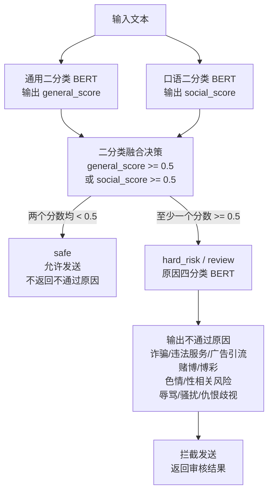

# 文本审核模型架构

当前文本审核后端由三个模型组成。业务逻辑上，两个二分类模型先决定是否允许发送，原因四分类模型只用于解释非安全结果；实际执行时，为了降低返回延迟，三个 BERT 会同时发起推理。

```text
输入文本
  ├─> 通用二分类模型 -> general_score
  └─> 口语二分类模型 -> social_score

general_score + social_score
  -> 三层融合决策 -> hard_risk / review / safe

最终审核结果：
  hard_risk / review -> 使用 reason_category，返回不通过原因
  safe               -> 允许发送，不返回 reason_category
```

## 架构图



上图表达的是业务决策顺序：二分类先决定“能不能发”，四分类再解释“为什么不能发”。实际推理为了更快返回，会同时启动通用二分类 BERT、口语二分类 BERT 和原因四分类 BERT；如果最终判定为 `safe`，原因四分类结果会被忽略，不返回给前端。

## 训练数据来源概览

三个 BERT 使用同一个 MacBERT backbone，但训练任务和数据不同：

```text
通用二分类 BERT：
  使用 social_binary_v3 大规模混合数据训练，包含正常聊天、垃圾短信、诈骗、博彩、辱骂、仇恨等文本。

口语二分类 BERT：
  在通用二分类 BERT 基础上继续训练，使用 social_intent_binary_v1 口语场景数据，补抓自然聊天、隐晦表达、变体表达。

原因四分类 BERT：
  使用前两类数据中的风险样本训练，把细标签合并为四个产品侧不通过原因。
```

详细数据来源、样本规模和标签合并方式见：[text_bert_data_sources.md](text_bert_data_sources.md)。

## 1. 通用二分类模型

通用二分类模型负责判断文本是否属于明确风险内容。

```text
模型输入：用户发送的文本
模型输出：general_score
```

`general_score` 表示文本属于风险文本的概率。

当：

```text
general_score >= 0.5
```

系统直接判定为 `hard_risk`，即明确违规。

## 2. 口语二分类模型

口语二分类模型负责补充识别自然聊天、隐晦表达、短文本口语中的风险。

```text
模型输入：用户发送的文本
模型输出：social_score
```

`social_score` 表示文本在自然口语场景下存在风险的概率。

当通用模型没有触发风险，但：

```text
general_score < 0.5 且 social_score >= 0.5
```

系统判定为 `review`，即疑似风险。

## 3. 三层融合决策

两个二分类模型并行处理同一条输入文本，然后将输出分数通过规则融合成三个审核状态：

```text
hard_risk:
  general_score >= 0.5

review:
  general_score < 0.5 且 social_score >= 0.5

safe:
  general_score < 0.5 且 social_score < 0.5
```

其中：

```text
hard_risk -> 不允许发送
review    -> 当前前端接入中也先拦截，不允许发送
safe      -> 允许发送
```

## 4. 原因四分类模型

原因四分类模型在业务逻辑上跟在二分类融合决策之后，只有当文本进入 `hard_risk` 或 `review` 时才需要返回原因。实际执行时它会和两个二分类模型并行推理；如果最终是 `safe`，它的输出不会被使用。

```text
模型输入：用户发送的文本
模型输出：reason_category
```

当前原因类别包括四类：

```text
financial_illegal_promotion  诈骗/违法服务/广告引流
gambling                     赌博/博彩
sexual_content               色情/性相关风险
abuse_hate                   辱骂/骚扰/仇恨歧视
```

`safe` 文本即使已经完成原因分类计算，也不会返回原因分类结果。

## 5. 最终输出

最终接口会输出：

```text
risk_level        审核等级：normal / suspicious / risk
decision          三层决策：safe / review / hard_risk
primary_category  不通过原因类别
reason            中文原因说明
scores            general_score 和 social_score
```

## 总结

整体架构可以理解为：

```text
通用二分类模型 ┐
口语二分类模型 ┘
        -> 融合决策层 -> 是否允许发送
        -> hard_risk / review 时使用原因四分类结果

safe               -> 不返回原因
hard_risk / review -> 返回原因
```

因此，业务逻辑上是“二分类决定能不能发，四分类解释为什么不能发”；工程执行上为了速度，三个 BERT 同时推理，但原因模型只在非安全结果中返回。
