# 从文本到多模态：现代社交媒体有害与违规信息检测系统

## 摘要

随着社交媒体内容形态不断变化，有害与违规信息已经从固定模板的垃圾短信，扩展到口语短句、谐音变体、隐晦攻击、广告图片、表情包和短视频等多种形式。围绕这一问题，本项目设计并实现了一套面向现代社交平台的多模态有害信息检测系统，将整体任务拆分为传统垃圾文本检测、深层语义文本审核、双层图片审核和视频语言风险检测四条研究路线。

在模型层面，本项目分别实现了TF-IDF+SVM、Rule-free CSN+LR、多专家MacBERT、DINOv3与ChineseCLIP双层图片模型，以及基于画面、音频、语音文本和人脸表情的四模态交叉注意力视频模型。四条路线分别处理显式垃圾、字符变体、隐晦口语攻击、图片与梗图风险、短视频贬损风险，并在各自数据集上取得了较好的检测效果。

在系统层面，采用FastAPI构建统一审核网关，接入文本、图片和视频模型服务，并通过React前端完成消息发送、审核反馈和风险原因展示。系统采用统一结果格式和Fail-closed策略，使模型能力能够真正进入聊天消息审核流程。最终项目形成了从数据处理、模型训练、实验评测到在线审核系统集成的完整闭环。

**关键词**：有害信息检测；垃圾文本分类；MacBERT；图文语义；视频多模态；交叉注意力；内容审核系统

## 目录

*   **一、 绪论与总体系统架构设计**
    *   1.1 现代社交媒体内容安全业务的演变与痛点
        *   1.1.1 垃圾短信与骚扰邮件的单模态历史特征
        *   1.1.2 现代社交平台多媒体交互的复杂业务演进
        *   1.1.3 碎片化口语、暗讽与冷暴力在社交生态中的渗透
    *   1.2 现有有害信息检测算法的技术局限与发展瓶颈
        *   1.2.1 既有检测长期侧重文本，难以覆盖图片与视频内容
        *   1.2.2 检测覆盖维度有限，对对抗性隐性内容的感知能力较弱
        *   1.2.3 语境适配存在偏差，碎片化短文本容易产生误判与漏判
    *   1.3 本系统的核心目标与“四路研究+统一网关”设计思路
        *   核心目标
        *   1.3.1 采用四条专家路线的原因
        *   1.3.2 四条专家路线的系统分工
        *   1.3.3 四条研究路线的总体路线图
    *   1.4 系统总体架构拓扑与数据通讯流转机制
        *   1.4.1 前端、网关与模型服务三层拓扑
        *   1.4.2 统一数据通讯规约与适配器设计
*   **二、 面向显式垃圾与变体文本的传统机器学习检测系统**
    *   2.1 业务背景与传统路线的项目目标
        *   2.1.1 显式垃圾与营销模板文本的检测需求
        *   2.1.2 同音、形近与拆分表达带来的变体逃逸
        *   2.1.3 强基线复现与课程方法实现的双重目标
    *   2.2 数据治理与特征工程
        *   2.2.1 AST数据集规模与分层划分
        *   2.2.2 数据读取、缺失值处理与文本清洗
        *   2.2.3 字符级1-3gram与高维稀疏特征
        *   2.2.4 字音、Unicode与通用字符编码
    *   2.3 两条独立传统模型的总体架构
        *   2.3.1 强统计基线路径：TF-IDF+SVM
        *   2.3.2 字符相似性学习路径：Rule-free CSN+LR
        *   2.3.3 独立对照定位与默认API模型
    *   2.4 核心算法机理与代码实现
        *   2.4.1 TF-IDF权重与Linear SVM分类边界
        *   2.4.2 基础字符嵌入与相似性网络构建
        *   2.4.3 邻居传播、注意力式池化与逻辑回归
    *   2.5 Rule-free设计与多视图字符表示
        *   2.5.1 不维护人工风险词和变体词表
        *   2.5.2 语料分布与字音编码的多视图结合
    *   2.6 实验结果与真实错误案例
        *   2.6.1 AST主实验与多数据集评测
        *   2.6.2 显式推广文本的端到端处理路径
        *   2.6.3 同音变体文本在CSN中的表示过程
        *   2.6.4 误报、漏检与模型能力边界
*   **三、 基于多专家MacBERT的深层语义审核系统**
    *   3.1 社交短文本的语义难点与数据体系
        *   3.1.1 阴阳怪气、冷暴力与隐晦攻击的语义特点
        *   3.1.2 7.1万条通用二分类语料的多源融合
        *   3.1.3 1600条社交口语边界数据的构造
        *   3.1.4 14074条风险文本与四类产品原因映射
    *   3.2 算法设计思路与三专家总体架构
        *   3.2.1 从单一分类器到专家分工
        *   3.2.2 明确风险、疑似风险与安全的分层路由
        *   3.2.3 单个MacBERT专家的内部设计
    *   3.3 字音字形融合与多任务训练
        *   3.3.1 字音字形分支的主体结构
        *   3.3.2 MacBERT语义与字音字形的门控融合
        *   3.3.3 拼音序列分支与最终融合层
        *   3.3.4 多任务损失与缺失标签处理
        *   3.3.5 动态字符替换在训练Collator中的实现
    *   3.4 三专家在线协作与工程输出
        *   3.4.1 分层状态在产品中的作用
        *   3.4.2 原因解释与统一API输出
    *   3.5 实验结果
        *   3.5.1 评测集合与统计口径
        *   3.5.2 完整系统最终指标
        *   3.5.3 专家组件完整指标
    *   3.6 结果分析
        *   3.6.1 完整系统总体性能分析
        *   3.6.2 分层审核机制的增益与代价
        *   3.6.3 典型边界样例分析
        *   3.6.4 专家模型性能与任务边界分析
        *   3.6.5 综合判断与改进方向
*   **四、 显式视觉风险与梗图语义的双层图片审核系统**
    *   4.1 聊天图片的复合风险与两类数据体系
        *   4.1.1 显式画面、图片文字与图文组合语义
        *   4.1.2 6500张SIMAS与PASS显式图片数据
        *   4.1.3 12000条ToxiCN_MM中文梗图数据
    *   4.2 双层图片审核的算法设计与总体架构
        *   4.2.1 从单一图片分类器到双层级联
        *   4.2.2 第一层三分支综合决策
        *   4.2.3 第二层图文语义决策
    *   4.3 第一层显式图片、OCR文字与规则检测
        *   4.3.1 DINOv3-Large七分类模型内部设计
        *   4.3.2 DINOv3微调与训练策略
        *   4.3.3 EasyOCR与MacBERT文本服务协作
        *   4.3.4 URL、联系方式、敏感词与二维码规则
        *   4.3.5 第一层优先级与路由结果
    *   4.4 第二层VLM描述增强与ChineseCLIP图文融合
        *   4.4.1 VLM描述器的职责边界
        *   4.4.2 ChineseCLIP四路输入编码
        *   4.4.3 描述门控与图文融合
        *   4.4.4 二分类、五分类与模态辅助三任务头
        *   4.4.5 第二层阈值与最终输出
    *   4.5 两层模型在线协作与API输出
        *   4.5.1 完整推理时序
        *   4.5.2 可解释检测结果
    *   4.6 实验结果
        *   4.6.1 评测集合与统计口径
        *   4.6.2 第一层DINOv3最终指标
        *   4.6.3 第二层ChineseCLIP最终指标
        *   4.6.4 真实API级联样例
    *   4.7 结果分析
        *   4.7.1 两层模型总体性能分析
        *   4.7.2 级联决策的作用与边界
        *   4.7.3 典型图片样例分析
        *   4.7.4 各检测分支的能力与任务边界
        *   4.7.5 综合判断与改进方向
*   **五、 基于四模态交叉注意力的视频语言风险检测系统**
    *   5.1 视频语言风险任务与四模态评测数据
        *   5.1.1 视频风险的时序与多模态特点
        *   5.1.2 normal/风险类别二分类任务边界
        *   5.1.3 715条完整标注与116条四模态可用子集
    *   5.2 四模态特征提取与融合总体架构
        *   5.2.1 画面、音频、语音文本与人脸表情四路输入
        *   5.2.2 异构特征维度与序列长度对齐
        *   5.2.3 normal/风险类别概率输出
    *   5.3 四路特征提取模型
        *   5.3.1 ViT画面帧特征
        *   5.3.2 40维MFCC音频特征
        *   5.3.3 Whisper与Chinese BERT语音文本特征
        *   5.3.4 MTCNN与FER-VT人脸表情特征
    *   5.4 MultiModalCrossAttention四模态融合
        *   5.4.1 模态内Transformer编码
        *   5.4.2 六组两两交叉注意力
        *   5.4.3 四路融合与二分类头
    *   5.5 Resident常驻推理与并行特征提取
        *   5.5.1 Subprocess兼容后端
        *   5.5.2 Resident内存常驻后端
        *   5.5.3 三主分支并行调度
        *   5.5.4 特征缓存与强制重算
    *   5.6 视频服务API与工程输出
        *   5.6.1 `/predict`请求与阈值覆盖
        *   5.6.2 普通结果与调试结果
        *   5.6.3 服务健康与繁忙保护
    *   5.7 实验结果
        *   5.7.1 评测集合与类别分布
        *   5.7.2 三组阈值完整指标
        *   5.7.3 推荐API阈值
        *   5.7.4 推理后端耗时结果
    *   5.8 结果分析
        *   5.8.1 四模态模型总体性能分析
        *   5.8.2 阈值变化的增益与代价
        *   5.8.3 多指标联合评价
        *   5.8.4 Resident并行推理效果
        *   5.8.5 综合判断与改进方向
*   **六、 统一审核网关与系统集成**
    *   6.1 FastAPI统一审核网关
        *   6.1.1 三类Adapter与统一结果模型
        *   6.1.2 多模态单点否决
        *   6.1.3 Fail-closed与文件处理
    *   6.2 三类消息的端到端流程
        *   6.2.1 文字与图片消息
        *   6.2.2 视频与混合消息
    *   6.3 前端审核反馈
        *   6.3.1 三态消息与审核记录
    *   6.4 系统验证与工程边界
        *   6.4.1 集成结果
        *   6.4.2 工业化扩展议题
*   **七、 项目总体结果与综合分析**
    *   7.1 全局评测原则与指标口径
        *   7.1.1 四条路线分别评测
        *   7.1.2 Accuracy、Macro F1、风险召回与AUC
        *   7.1.3 最终指标与中间指标的区分
    *   7.2 四条路线最终结果汇总
        *   7.2.1 传统机器学习文本路线
        *   7.2.2 多专家MacBERT文本路线
        *   7.2.3 双层图片审核路线
        *   7.2.4 四模态视频语言风险路线
    *   7.3 主要结果结论
        *   7.3.1 四条路线分别解决了不同类型的内容风险
        *   7.3.2 系统适合放在内容发送或发布之前
    *   7.4 适用场景
        *   7.4.1 未成年人聊天与儿童社交
        *   7.4.2 陌生人社交与平台私信
        *   7.4.3 直播弹幕与互动评论
        *   7.4.4 未成年人较多的网络游戏聊天
        *   7.4.5 短视频投稿、视频私信与内容复核
        *   7.4.6 推荐使用方式
    *   7.5 总体结论
*   **八、 项目创新、局限性与未来工作**
    *   8.1 四条研究路线与完整系统总结
        *   8.1.1 从传统文本到多模态内容审核
        *   8.1.2 从独立模型到可交互审核系统
    *   8.2 项目设计创新与工程实现亮点
        *   8.2.1 面向多层内容风险的分层专家化架构
        *   8.2.2 从单一分类到可执行审核的三专家文本决策链
        *   8.2.3 显式风险优先、隐式语义补充的双层图片审核机制
        *   8.2.4 面向异构模型的统一审核数据契约与安全聚合
    *   8.3 大数据项目实践中的方法认识
        *   8.3.1 垂直任务拆分有利于控制复杂度
        *   8.3.2 数据边界决定指标含义
        *   8.3.3 最终系统需要同时考虑召回、误伤与计算成本
    *   8.4 项目局限性
        *   8.4.1 模型结果具有时间边界
        *   8.4.2 跨平台使用需要重新配置审核标准
        *   8.4.3 真实部署需要配套隐私与模型治理
    *   8.5 未来工作
        *   8.5.1 数据与评测扩展
        *   8.5.2 模型与阈值优化
        *   8.5.3 系统工程升级

---

## 一、绪论与总体系统架构设计

### 1.1 现代社交媒体内容安全业务的演变与痛点

#### 1.1.1 垃圾短信与骚扰邮件的单模态历史特征

有害信息检测最早大规模**应用在垃圾邮件和垃圾短信过滤中**。早期风险内容通常带有非常明显的模板特征，例如重复出现的营销话术、贷款额度、博彩链接、电话号码、退订提示和联系方式。发送者为了批量触达用户，往往会反复使用相似句式，只替换金额、姓名、号码或网址。只要系统能够记住这些高频局部模式，就可以拦截相当一部分垃圾内容。

在这样的数据特点下，正则表达式、静态关键词表和黑名单曾经发挥过很大作用。规则系统的优势很直接：匹配过程容易理解，命中原因容易追踪，新增一条规则后也能立即生效。例如，当短信中出现固定域名、连续数字串或“回复某字退订”等结构时，系统可以快速给出判断。对于表达方式稳定、业务范围有限的垃圾信息，这类方法具有实现简单和计算开销低的特点。

不过，规则系统的效果依赖维护人员能否提前想到风险表达。**每当发送者更换一个同音字、插入一个符号或拆开一个联系方式，旧规则就可能失效。规则越积越多以后，不同规则之间还会产生重叠和冲突，正常文本也可能因为局部词语相同而被误判。**

#### 1.1.2 现代社交平台多媒体交互的复杂业务演进

随着微信私信、短视频评论、游戏聊天、直播弹幕和社群平台不断发展，用户发送的内容早已超出完整纯文本的范围。**一条现代社交消息可能只有两三个字，也可能同时包含文字、图片和视频。图片中可以出现广告、二维码、联系方式和截图文字；表情包会把画面与短句组合起来表达讽刺；视频还会同时包含连续画面、声音、语音内容和人物表情。**

这种变化给审核系统带来了一个很现实的困难：**风险信息可能出现在任何一个模态中。**只检查输入框文字，图片里的赌博网址和武器画面就可能直接通过；只检查图片画面，截图中的诈骗话术也容易被遗漏；只抽取视频中的某一帧，又可能看不到语音中的攻击内容和前后画面共同形成的语义。即使同一张表情包，单看图片和单看文字都可能显得正常，组合起来却带有明确的冒犯含义。

非结构化数据还带来了明显的处理差异。**文本可以直接分词或编码，图片需要进行视觉特征提取和OCR，视频还要完成解码、抽帧、音频提取、语音转写和人脸检测。**它们的输入格式、模型结构、推理耗时和返回结果都不一样。如果直接把所有能力塞进同一个推理过程，任何一个分支发生错误都可能影响整条消息的审核，也很难单独定位问题来自哪个模态。

#### 1.1.3 碎片化口语、暗讽与冷暴力在社交生态中的渗透

现代社交平台中的文本越来越短，也越来越口语化。**用户经常省略主语、标点和完整句法，只发送一个缩写、一串拼音首字母或带有特定语气的短句。很多攻击表达不会出现传统脏字，却能够通过反问、暗讽、贬低和冷暴力传递明确恶意。**例如，一句表面看起来像普通评价的话，在特定语气下可能是在否定对方能力；某些网络缩写只有放在社交语境中才能看出攻击含义。

这种内容对传统统计模型非常困难。字符n-gram擅长发现重复模板，但隐晦攻击的字面形式可能与正常文本高度相似。模型如果只记住少数敏感词，很容易漏掉没有显式风险词的句子，也容易把正常讨论误判成攻击。短文本提供的上下文又很少，一个词在不同语境中可能具有完全不同的含义，模型需要从有限线索中判断说话意图。

图片和视频进一步放大了这个问题。**表情包常常利用夸张表情、人物身份和短文字形成讽刺，短视频中的贬损态度还可能体现在说话语气、面部表情和镜头组合中。**青少年用户频繁接触这些内容时，长期的嘲讽、歧视和消极暗示会影响社群氛围，也会增加平台人工审核的压力。

### 1.2 现有有害信息检测算法的技术局限与发展瓶颈

#### 1.2.1 既有检测长期侧重文本，难以覆盖图片与视频内容


**早期有害信息检测主要围绕文本展开**，常见任务包括垃圾邮件过滤、垃圾短信识别、敏感词检测和评论文本分类。这类数据容易收集和标注，输入形式也比较统一，因此正则表达式、关键词词表、TF-IDF和文本分类模型得到了较为充分的研究与应用。

随着社交平台的内容形式不断丰富，图片、表情包和短视频逐渐成为日常交流中的重要内容。违规广告可以直接制作成图片，色情、暴力、武器和赌博内容也可能通过视觉画面传播；短视频则包含连续镜头、声音、语音和人物行为。**只具备文本检测能力的系统无法覆盖这些新增内容形式**，图片和视频需要建立各自对应的数据集、特征提取方法与分类模型。

不同内容形式的处理流程存在明显差异。文本可以直接进行字符或语义编码，图片需要完成视觉特征提取，视频还要面对连续帧、音频和较高计算开销。已有文本检测方法很难直接迁移到图片和视频任务中。如何在保留文本审核能力的基础上继续扩展图片与视频检测，已经成为现代社交媒体内容安全领域需要解决的重要问题。

#### 1.2.2 检测覆盖维度有限，对对抗性隐性内容的感知能力较弱


**文本中的对抗性表达具有很强的变化能力。**静态关键词过滤只能命中已经写入规则的内容，发送者可以使用同音字、形近字、拼音混排、数字替换、拆字和符号插入改变字面形式。联系方式也可以被拆成多个片段，使完全相等匹配失去作用。基于词袋、TF-IDF和普通字符统计的方法能够学习常见局部模式，但面对训练数据中很少出现的新式变体时，仍然会遇到特征稀疏和未登录字符问题。

**文本风险还可能隐藏在正常词语组成的句子中。**一句话没有任何明显违规词，却可以通过反问、暗讽、贬低和冷暴力表达攻击。深度预训练模型具备较强的上下文表示能力，其判断依然受到训练语料和社交语境覆盖范围影响。网络流行语更新速度很快，旧数据中学到的规律很难及时覆盖所有新表达。

**梗图和表情包中的恶意通常更加隐晦。**部分图片会通过裁剪、遮挡、文字变形、低清晰度和符号替换规避OCR或图像分类器。还有一些图片单看人物和场景并没有明显风险，配文也只包含普通词语，画面与文字组合后才形成讽刺、歧视、性暗示或针对性冒犯。只识别色情、暴力、武器等显式物体类别，容易漏掉依赖网络文化、人物身份和图文关系的语义风险。

**短视频的隐性风险还会利用时间过程和多种信息共同表达。**某一帧画面可能完全正常，连续镜头连接后才表现出羞辱、贬损或诱导含义；语音转写得到的文字可能比较中性，真正的恶意却体现在语气、背景声音和人物表情中。只抽取少量关键帧、只分析语音文字或只查看视觉画面，都可能丢失判断所需的线索。视频长度、镜头变化和音画不同步也会继续增加检测难度。

对抗性内容具有持续演化特点。规则系统需要反复维护，数据驱动模型需要不断补充新样本，大型视觉语言模型虽然可以处理更复杂的语义，也会带来推理成本、输出稳定性和幻觉风险。现有方法很难同时兼顾文本变体识别、梗图语义理解、视频时序分析、计算效率与结果可解释性。

#### 1.2.3 语境适配存在偏差，碎片化短文本容易产生误判与漏判


**通用文本分类模型通常在相对完整的语句上训练，而真实聊天中大量内容只有几个字符。**句子越短，可供判断的证据越少，模型越容易依赖某个局部词语做出决定。拼音首字母、网络缩写和新兴用语还会带来未登录表达，通用模型可能无法从字面编码中恢复真实意图。

社交语境还具有强烈的依赖性。**同一句话在朋友间玩笑、陌生人争吵和公开评论中可能表达完全不同的态度**，单条消息通常无法提供说话双方关系、前文对话和现实事件背景。缺少这些上下文时，模型只能根据有限字面线索推断意图，误判和漏判都很难完全避免。

数据标注标准同样会影响模型的语境适配能力。辱骂、讽刺、消极表达和普通批评之间缺少绝对清晰的边界，不同标注人员可能给出不同判断。公开数据集之间的标签定义也存在差异，一个数据集中的有害样本可能在另一个数据集中被划入普通负面情绪，这会限制模型跨平台迁移时的稳定性。

类别不平衡和评测方式还可能掩盖实际问题。当正常样本数量远高于风险样本时，模型把多数内容判为正常也能获得较高Accuracy，但真正重要的风险召回率可能很低。检测阈值越严格，漏检通常会减少，误判也可能随之增加。因此，现有研究需要同时考虑Macro F1、风险召回率、风险类别F1、AUC和真实错误案例，单一准确率很难完整反映审核能力。

### 1.3 本系统的核心目标与“四路研究+统一网关”设计思路

#### 核心目标

本项目的**核心目标是完成一套面向现代社交媒体的有害与违规信息检测系统**。

本项目**围绕文本、图片和视频三类实际内容，建立传统文本检测、深层文本审核、图片审核和视频检测四条研究路线，使系统能够识别显式垃圾与字符变体、隐晦口语攻击、图片及梗图风险和视频贬损性语言风险**；

随后将可以在线推理的文本、图片和视频能力接入统一审核网关与聊天前端，完成用户消息的自动审核、风险拦截、中文原因反馈和审核记录保存，最终形成从数据处理、模型训练和独立评测到实际消息发送控制的完整任务闭环。

#### 1.3.1 采用四条专家路线的原因

项目开始时，最初的方案是训练一个统一模型，同时接收文字、图片和视频，然后直接输出最终审核结果。但后面继续分析以后，进一步分析发现这条路线需要面对很高的数据和计算要求。四种任务的数据来源、标签定义与样本规模并不一致，文本垃圾分类、图片七分类、图文有害语义和视频语言风险检测也没有可以直接合并成同一标签空间的完整配对数据。

**各模态的计算流程同样存在很大差异。**文本推理主要完成分词和Transformer编码；图片审核需要图像分类、OCR、规则与语义模型；视频审核还要进行解码、抽帧、音频处理、语音识别和人脸表情提取。将这些流程绑定在一个大模型中，会增加训练难度、推理开销和故障定位成本。某个视频分支出现问题时，也可能影响原本可以正常工作的文本审核。

因此，**本项目采用“分而治之、统一汇总”的思路。**四条研究路线分别处理自己最擅长的问题，使用适合自身任务的数据、模型和指标。最终系统把能够在线运行的深层文本、图片和视频能力封装为三个独立服务，再由网关统一调用。传统机器学习路线作为完整的第一条研究路线单独保留，同时网关文本适配器保留TF-IDF+SVM兼容模式，便于进行后端切换和实验比较。

这种结构带来了几个直接好处。第一，每条路线都可以独立训练、测试和改进，不需要重新训练整个系统。第二，不同服务可以根据计算需求部署在不同硬件上。第三，网关能够将超时、服务繁忙和模型错误转换为统一的业务状态。第四，前端不需要了解底层模型细节，后续替换某个模型时只需保持接口契约稳定。

#### 1.3.2 四条专家路线的系统分工

四条路线面对的风险层次不同，它们共同构成了从显式模式到多模态语义的逐步扩展。

**路线一：面向显式垃圾与变体文本的传统机器学习检测。**  
这条路线实现TF-IDF+SVM与Rule-free CSN+LR两套方法。TF-IDF+SVM保留高维字符局部特征，在AST课程数据上形成效果很强的传统基线；CSN+LR按照字符相似性网络思路，从语料分布、字音编码和Unicode位置代理中学习字符关系。两套模型使用相同的训练测试划分，便于比较强统计特征与低维字符嵌入的差异。

**路线二：基于三个MacBERT专家的深层文本审核。**  
通用二分类专家负责识别常规风险，社交口语专家补充短句、缩写和隐晦攻击，原因四分类专家把非安全文本归纳为诈骗与违法推广、赌博、色情、辱骂与仇恨四类中文原因。三个专家在服务中完成并行推理，决策层再根据通用分数和口语分数生成`hard_risk`、`review`或`safe`结果。这条路线是最终系统默认使用的在线文本审核后端。

**路线三：显式视觉检测与图文语义检测结合的图片审核。**  
第一阶段使用DINOv3-Large识别色情、武器、赌博、毒品等显式视觉类别，同时使用EasyOCR提取图片文字，再调用文本服务，并补充网址、联系方式、敏感词和二维码规则。明确风险可以在第一阶段被拦截，存在疑点的结果进入复核状态。第一阶段判定安全的图片会继续进入ChineseCLIP语义模型，结合OCR文字、图像本身与视觉语言模型生成的描述，识别表情包和梗图中的组合语义。

**路线四：基于交叉注意力的视频多模态检测。**  
视频风险往往分散在不同时间和不同模态中。系统使用ViT提取连续画面特征，使用MFCC描述音频信号，使用Whisper完成语音转写并用BERT编码文本，还使用MTCNN定位人脸并通过FER-VT提取表情特征。四路特征经过维度对齐和自适应池化后，进入多模态交叉注意力网络，由六组两两注意力模块学习模态之间的联系，最终输出视频正常或贬损性语言风险的概率。

这四条路线形成了清晰的能力分层。传统文本方法擅长模板和局部统计模式，MacBERT专家负责现代聊天语义，图片路线覆盖视觉、文字、规则和图文组合，视频路线继续处理时间信息、语音和表情。系统按照任务边界安排每条路线的职责，让不同方法在适合自己的场景中发挥作用。

#### 1.3.3 四条研究路线的总体路线图

四条路线沿着“**传统显式文本识别—深层文本语义理解—静态图片审核—动态视频检测**”的方向逐步扩展，使研究对象从早期垃圾文本延伸到现代社交媒体中的图片、梗图和短视频。**图中的纵向箭头表示研究范围与检测能力的扩展关系**。四条路线分别完成数据处理、模型训练和独立评测，**在线系统不会按照图示顺序依次调用四个模型**。

```mermaid
flowchart TB
    A["核心任务<br/>面向现代社交媒体<br/>有害与违规信息检测"]

    subgraph P1["路线一：传统机器学习文本检测"]
        direction LR
        T1D["数据输入<br/>AST垃圾短信数据<br/>正常 / 垃圾二分类"]
        T1P["文本预处理<br/>字符切分<br/>保留英文与数字"]
        T1B{"两条<br/>实验分支"}
        T1M1["强统计基线<br/>字符级1-3 gram<br/>TF-IDF<br/>Linear SVM"]
        T1M2["Rule-free CSN<br/>语料统计 + SVD<br/>拼音 + Unicode编码<br/>近邻聚合 + LR"]
        T1O["路线输出<br/>正常 / 垃圾<br/>独立实验指标"]

        T1D --> T1P --> T1B
        T1B --> T1M1 --> T1O
        T1B --> T1M2 --> T1O
    end

    subgraph P2["路线二：三个MacBERT专家的深层文本审核"]
        direction LR
        T2D["多源文本数据<br/>通用风险语料<br/>社交口语语料<br/>原因四分类语料"]
        T2M["三个MacBERT专家<br/>通用风险二分类<br/>社交口语二分类<br/>风险原因四分类"]
        T2R["分层决策<br/>明确风险<br/>疑似风险<br/>安全"]
        T2O["路线输出<br/>风险等级<br/>风险概率<br/>中文风险原因"]

        T2D --> T2M --> T2R --> T2O
    end

    subgraph P3["路线三：显式检测与语义检测结合的两阶段图片审核"]
        direction LR
        I3D["图片输入<br/>显式违规图片<br/>截图与广告图<br/>表情包与梗图"]
        I3S1["第一阶段<br/>DINOv3视觉分类<br/>EasyOCR → 文本审核<br/>网址 / 联系方式<br/>敏感词 / 二维码规则"]
        I3Q{"第一阶段<br/>综合决策"}
        I3R["明确风险<br/>直接拦截<br/>可疑内容<br/>进入复核"]
        I3S2["安全图片<br/>进入第二阶段<br/>可选VLM生成描述<br/>ChineseCLIP<br/>图文语义融合"]
        I3O["路线输出<br/>normal / suspicious / risk<br/>风险类别<br/>风险来源"]

        I3D --> I3S1 --> I3Q
        I3Q -->|风险或可疑| I3R --> I3O
        I3Q -->|安全| I3S2 --> I3O
    end

    subgraph P4["路线四：基于交叉注意力的视频多模态检测"]
        direction LR
        V4D["视频输入<br/>连续画面<br/>音频与语音<br/>人物面部区域"]
        V4F["四路特征提取<br/>ViT画面特征<br/>MFCC音频特征<br/>Whisper + BERT文本特征<br/>MTCNN + FER-VT表情特征"]
        V4A["特征对齐<br/>统一到768维<br/>自适应池化<br/>统一到长度512"]
        V4M["MultiModalCrossAttention<br/>六组两两交叉注意力<br/>3层 / 8头<br/>均值池化 + Linear"]
        V4O["路线输出<br/>normal / 贬损性语言风险<br/>风险概率<br/>阈值判断"]

        V4D --> V4F --> V4A --> V4M --> V4O
    end

    S0["研究结果汇总<br/>路线一：独立传统实验基线<br/>路线二至四：在线模型能力"]
    S1["系统落地<br/>文本 / 图片 / 视频服务<br/>FastAPI统一审核网关<br/>React聊天前端"]
    S2["最终任务输出<br/>自动审核<br/>风险拦截<br/>中文原因反馈"]

    A --> T1D
    T1O -->|"能力扩展<br/>表面统计 → 深层语义"| T2D
    T2O -->|"模态扩展<br/>文本 → 静态图片"| I3D
    I3O -->|"时序扩展<br/>静态内容 → 短视频"| V4D
    V4O --> S0 --> S1 --> S2

    classDef goal fill:#E8F1FF,stroke:#3B6EA8,color:#172B4D,stroke-width:2px;
    classDef text1 fill:#EEF8EE,stroke:#4D8B4D,color:#173A17,stroke-width:1.5px;
    classDef text2 fill:#FFF4DB,stroke:#C58A24,color:#4A3210,stroke-width:1.5px;
    classDef image fill:#F4ECFF,stroke:#7B57A8,color:#302044,stroke-width:1.5px;
    classDef video fill:#FFECEC,stroke:#B85C5C,color:#4A2020,stroke-width:1.5px;
    classDef system fill:#E8F7F7,stroke:#328080,color:#143838,stroke-width:2px;

    class A goal;
    class T1D,T1P,T1B,T1M1,T1M2,T1O text1;
    class T2D,T2M,T2R,T2O text2;
    class I3D,I3S1,I3Q,I3R,I3S2,I3O image;
    class V4D,V4F,V4A,V4M,V4O video;
    class S0,S1,S2 system;
```

<p align="center"><b>图1-1 四条研究路线的总体路线图</b></p>

### 1.4 系统总体架构拓扑与数据通讯流转机制

#### 1.4.1 前端、网关与模型服务三层拓扑

最终系统可以从物理结构上划分为前端展示层、网关聚合层和模型推理层。

**第一层是React与Vite构建的聊天前端。**  
前端提供类似即时聊天软件的交互界面，用户可以输入文字、选择图片或上传MP4视频。消息发出后会先显示审核中状态，网关返回结果后再更新为已发送或发送失败。前端只调用统一网关，不直接保存任何底层模型地址。

**第二层是FastAPI统一审核网关。**  
网关接收`multipart/form-data`请求，校验文字与附件，暂存上传文件，识别图片和视频类型，并按照消息内容调用相应模型服务。它还负责超时控制、结果适配、中文原因映射、消息聚合、附件移动、JSON持久化和媒体访问路径生成。对于前端来说，网关是整个审核系统唯一需要交互的后端入口。

**第三层是文本、图片和视频三个在线模型服务。**  
文本服务默认加载三个MacBERT专家；图片服务内部包含DINOv3、EasyOCR、规则和ChineseCLIP语义模型，并会复用文本审核服务处理OCR结果；视频服务加载四路特征提取器与融合模型。三个服务具有独立健康检查接口，可以单独启动和定位问题。

四条研究路线与三个在线服务需要在这里明确区分。传统机器学习文本检测是完整的研究路线，代码与实验位于独立项目中；最终聊天系统默认接入MacBERT文本服务，因此在线模型服务数量为三个。这样的组织方式既保留了课程研究的完整性，也避免在系统说明中把研究模型数量与运行服务数量混为一谈。

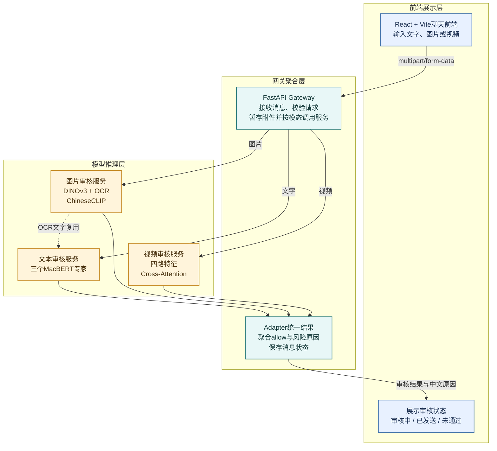

<p align="center"><b>图1-2 系统三层拓扑与消息审核数据流</b></p>

当前消息审核流程会先处理文字，再依次处理附件。服务健康检查可以并发执行，单条消息中的模型调用仍然遵循网关代码中的实际顺序。本项目在报告中保留这一真实实现，不把内部模型分支的并行优化扩大描述为整条消息的完全并发调度。

#### 1.4.2 统一数据通讯规约与适配器设计

三个模型服务均通过HTTP REST接口与网关通信。文本服务提供`/text/check`，图片服务提供`/image/check`，视频服务提供`/predict`。它们的原始返回字段并不相同，因此网关为每种模态实现独立Adapter，再统一转换为：

```text
ModalityReviewResult
```

该结构的核心字段包括：

| 字段 | 含义 |
| --- | --- |
| `modality` | 当前结果来自text、image或video |
| `allow` | 当前模态是否允许发送 |
| `risk_level` | normal、suspicious或risk等风险等级 |
| `category` | 统一后的主要风险类别 |
| `score` | 底层模型可提供时记录风险分数 |
| `summary` | 面向前端展示的中文摘要 |
| `reasons` | 一个或多个结构化风险原因 |
| `raw` | 保留底层服务原始返回，供调试使用 |

适配器设计解决了两个问题。第一，前端和消息存储不需要理解每个模型的全部字段。第二，底层模型发生调整时，只要Adapter仍然输出相同数据契约，网关的聚合逻辑就可以继续复用。例如，图片服务会返回图像模型、OCR、文本、规则和语义模型等多个检测器的结果，图片Adapter负责提取其中的风险等级与原因；视频服务当前只提供正常或异常结论，视频Adapter就不会虚构不存在的细粒度类别。

网关的核心消息接口为：

```text
POST /api/conversations/{conversation_id}/messages
```

请求可以同时包含`text`、一个或多个`files`、`client_message_id`与`sender_id`。上传文件先进入临时目录，审核完成后再移动到approved或rejected目录。当前MVP使用`storage/db/messages.json`保存消息，读写过程由线程锁保护。SQLite数据模型、异步任务队列和多用户审核后台属于后续扩展方向，当前实现不会提前描述成已经完成的功能。

通过统一规约，本项目将算法输出转换成了真实产品流程中的消息状态。模型关心的是概率、类别和特征，网关关心的是消息能否发送、文件应该保存在哪里、失败原因怎样展示。两者之间通过Adapter和`ModalityReviewResult`建立清晰边界，这也是整个项目能够从四条研究路线继续扩展成可交互系统的关键。

## 二、面向显式垃圾与变体文本的传统机器学习检测系统

传统机器学习文本检测是整个项目的第一条研究路线，代码单独保存在`text-detection-project-main`中。**这条路线面对的是最经典的中文垃圾文本检测问题，主要处理广告推广、贷款营销、兼职刷单、联系方式引流和使用同音字进行规避的变体文本。**本项目在同一份数据划分上实现了两套模型：一套是字符级TF-IDF与Linear SVM组成的强统计基线，另一套是按照课程思路实现的Rule-free字符相似性网络。两套模型独立训练、独立预测并使用相同测试集进行比较，没有在推理时组成级联或概率融合。

### 2.1 业务背景与传统路线的项目目标

#### 2.1.1 显式垃圾与营销模板文本的检测需求

垃圾短信和黑产推广通常具有较强的重复性。贷款、博彩、刷单、信用卡办理和广告引流等内容需要在很短的文本中快速说明收益、联系方式和参与方式，因此经常出现“点击链接”“私聊咨询”“加微信”“名额有限”“快速回本”等局部表达。电话号码、网址、数字金额和退订提示也会反复出现。

这类文本的完整句子可能不断变化，真正稳定的部分往往是几个相邻字符构成的局部片段。例如，“领取现金红包”和“点击领取优惠”不是同一句话，其中的“领取”“优惠”和动作引导仍然具有相似统计特征。对于这一类任务，模型不一定需要理解复杂上下文，只要能够从大量样本中找出与垃圾标签高度相关的局部组合，就可以建立有效的分类边界。

早期系统经常使用正则表达式和人工关键词表进行过滤。这种方式实现简单，但维护人员需要提前知道风险词和变体形式。正常通知中也可能出现电话、网址和金额，单条规则过宽时容易误报，规则过窄时又会漏掉稍作改写的垃圾信息。因此，该路线旨在先用数据驱动的传统机器学习方法建立一个稳定基线，让分类依据来自训练语料中的统计规律。

#### 2.1.2 同音、形近与拆分表达带来的变体逃逸

垃圾内容发送者会主动改变关键词的表面形式，例如把“微信”写成“薇信”，把联系方式拆成多个片段，或者在字符之间加入空格、括号和特殊符号。对于完全相等匹配，只要其中一个字符发生变化，原有规则就可能无法命中。

字符级n-gram能够缓解一部分问题。即使完整模板被打散，文本中仍可能保留“加我”“领取”“退订”等短片段，模型可以综合多个局部特征完成判断。不过，当关键字符被替换成训练中很少出现的新字符时，普通稀疏特征仍然可能把它视为完全不同的符号。

课程提出的字符相似性网络为这个问题提供了另一种思路。字符除了在语料中具有统计分布，还包含拼音、声母、韵母、声调和Unicode位置等通用信息。读音或编码位置接近的字符可以通过相似网络互相传递表示，使低频变体字符获得与相似字符有关的嵌入。本项目据此实现Rule-free CSN，并用它研究字符关系能否在不维护人工变体表的条件下参与垃圾文本分类。

#### 2.1.3 强基线复现与课程方法实现的双重目标

这条路线的核心任务是完成中文垃圾文本二分类，输入是一段文本，输出标签`0`或`1`：

| 标签 | 含义 |
| --- | --- |
| `0` | 正常文本 |
| `1` | 垃圾文本 |

围绕这个任务，本项目设定了两个相互补充的实验目标。TF-IDF+SVM用于建立结构清晰、容易复现的强基线，重点观察高维字符局部特征在模板型垃圾文本上的表现；Rule-free CSN+LR用于完整实现“字符编码—相似网络—字符嵌入—句子嵌入—分类器”的课程流程，重点研究通用字音编码和语料统计表示怎样共同形成文本向量。

两套方法都可以在CPU环境中训练和推理，也不需要加载大型预训练模型。项目没有记录严格的端到端延迟测试，因此本项目将这项特点表述为计算结构轻量、硬件要求较低，不使用“微秒级”或固定毫秒数描述实际速度。

### 2.2 数据治理与特征工程

> **对应代码文件**：
>
> `text-detection-project-main/src/tfidf_svm_baseline/experiment.py`、`text-detection-project-main/src/rule_free_csn/experiment.py`

#### 2.2.1 AST数据集规模与分层划分

主实验使用课程指定的AST对抗垃圾文本数据。项目实际读取并完成清洗后的可用样本为16007条，其中垃圾文本11007条，正常文本5000条。垃圾样本约占总数据的68.76%，存在一定类别不平衡。

<p align="center"><b>表2-1 AST主实验数据分布</b></p>

| 数据部分 | 总数 | 正常文本 | 垃圾文本 |
| --- | ---: | ---: | ---: |
| 完整可用数据 | 16007 | 5000 | 11007 |
| 训练集 | 11204 | 3500 | 7704 |
| 测试集 | 4803 | 1500 | 3303 |

两个模型都使用完全相同的70%/30%分层随机划分：

```python
train_x, test_x, train_y, test_y = train_test_split(
    data["text"],
    data["label"],
    test_size=0.3,
    random_state=42,
    stratify=data["label"],
)
```

`stratify=data["label"]`使训练集和测试集保持接近的类别比例，`random_state=42`保证重复运行时能够获得相同划分。这里需要强调，TF-IDF词表、SVD字符向量、字符近邻网络和分类器参数都只在训练集上拟合，测试集只参与最终预测与指标计算。两套模型共享同一个测试集合，因此它们的Accuracy、Spam F1以及错误数量可以直接比较。

#### 2.2.2 数据读取、缺失值处理与文本清洗

原始数据读取由`read_dataset()`完成。程序首先尝试使用Pandas按照TSV格式读取，如果列名不完整或文件中存在不规则制表符，就回退到`read_loose_tsv()`逐行解析。这一设计兼容整理后的`label/text`两列格式，也兼容课程原始文件中可能出现的宽松三列格式。

读取完成后，`normalize_dataset()`会删除标签或文本为空的样本，把`label`转换为整数，把`text`统一转换为字符串，并且只保留分类需要的两列。两套模型使用相同的清洗表达式：

```python
KEEP_PATTERN = re.compile(r"[^\u4e00-\u9fa5a-zA-Z0-9\s]")
SPACE_PATTERN = re.compile(r"\s+")

def clean_text(text: str) -> str:
    value = "" if text is None else str(text)
    value = KEEP_PATTERN.sub(" ", value.strip().lower())
    return SPACE_PATTERN.sub(" ", value).strip()
```

这一步会统一英文大小写，去除中文、英文、数字与空白之外的符号，再把连续空白合并。符号清洗可以减少大量无意义维度，也会损失一部分由特殊符号本身承载的信息。例如，某些垃圾文本会用星号和括号拆分联系方式，清洗后这些符号被替换为空格。后续模型能否恢复风险，取决于剩余字符和局部组合是否仍然提供足够证据。

两条路线在字符切分上存在一个细节差异。TF-IDF+SVM把中文逐字切分，同时将连续英文与数字保留为一个token；CSN为了给每个字符建立独立编码，会保留所有非空白字符，并把英文和数字也逐字符处理。这种差异与两个模型的表示目标有关：前者希望保留网址和数字串的局部结构，后者需要让每个字符都能进入相似性网络。

#### 2.2.3 字符级1-3gram与高维稀疏特征

TF-IDF+SVM通过`preprocess()`把切分后的token使用空格连接，再交给`TfidfVectorizer`构造1至3个token组成的n-gram。主要参数如下：

```python
TfidfVectorizer(
    preprocessor=preprocess,
    tokenizer=str.split,
    token_pattern=None,
    ngram_range=(1, 3),
    min_df=1,
)
```

1-gram保留单个字符或连续英文数字token，2-gram和3-gram进一步描述相邻局部结构。假设文本中出现“加 我 薇 信”，向量空间可以同时记录“加”“我”“薇”“信”“加 我”“我 薇”“薇 信”和三元组合。模型没有读取人工编写的“薇信”规则，分类依据来自训练数据中每个局部片段与垃圾标签共同出现的统计强度。

`min_df=1`会保留训练集中至少出现一次的特征，有利于覆盖低频变体，也会形成维度很高的稀疏矩阵。稀疏存储只记录非零位置，因此这种表示仍然适合线性分类器。它的优势是能够直接保存网址、号码和模板细节，局限是词表之外的新片段没有对应维度，跨平台表达变化也可能削弱原有统计关系。

#### 2.2.4 字音、Unicode与通用字符编码

Rule-free CSN为训练词表中的每个字符构造一个特征字典，再使用`DictVectorizer`映射成统一稀疏向量。对于中文字符，代码使用以下信息：

| 特征 | 代码形式 | 权重 |
| --- | --- | ---: |
| 字符类型 | `kind=chinese` | 1.0 |
| Unicode细分桶 | `ord(char) // 32` | 0.6 |
| Unicode粗分块 | `ord(char) // 256` | 0.4 |
| 完整拼音 | `pinyin=<full>` | 1.0 |
| 声母 | `initial=<initial>` | 0.8 |
| 韵母 | `final=<final>` | 0.8 |
| 声调 | `tone=<1-5>` | 0.3 |

数字、英文字母和其他字符使用`kind`与字符自身作为通用类别特征。所有特征字典经过`DictVectorizer(sparse=True)`后进入同一个特征空间，再进行向量归一化。字符间的余弦距离由这些通用编码决定。

这里的Unicode分桶是粗粒度编码位置代理，可以为部分位置接近的字符提供弱联系，但它不等于真实偏旁、笔画或图像字形。报告中不会把这部分写成“偏旁属性字典”。CSN对同音信息的描述更加直接，因为完整拼音、声母、韵母和声调都由`pypinyin`自动生成。

### 2.3 两条独立传统模型的总体架构

两套模型共享数据读取、清洗和训练测试划分，之后进入不同的特征学习路径。TF-IDF+SVM保留高维局部模板，Rule-free CSN+LR把字符压缩成低维嵌入再生成句子向量。它们最终各自输出正常或垃圾标签，并在同一测试集上比较结果。

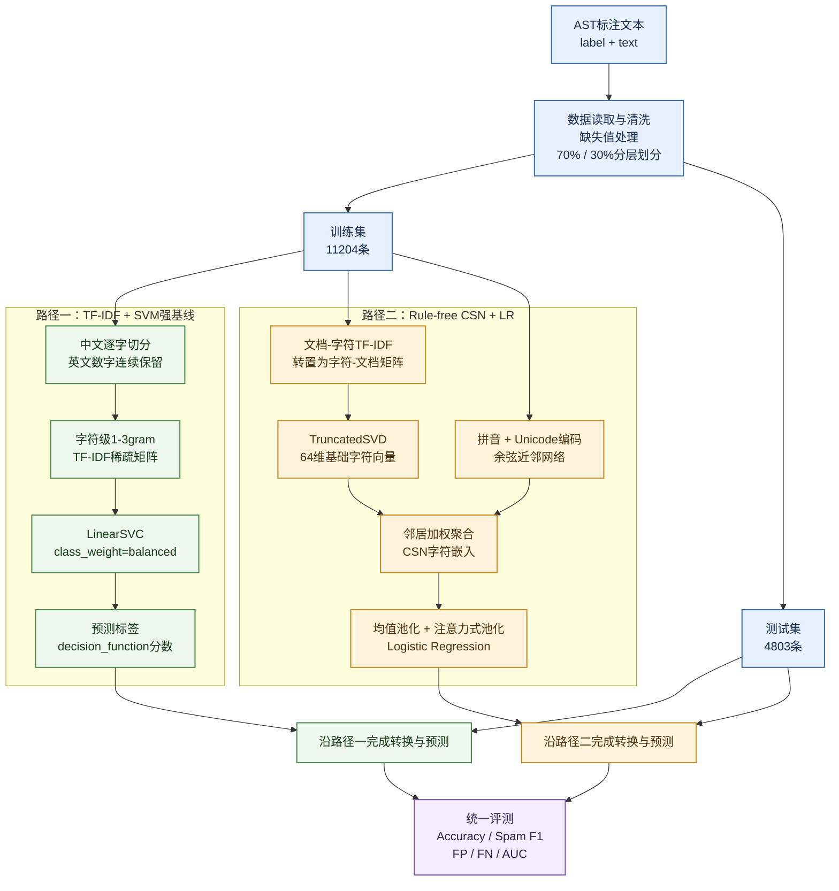

<p align="center"><b>图2-1 两条传统机器学习路线的独立训练与评测架构</b></p>

#### 2.3.1 强统计基线路径：TF-IDF+SVM

TF-IDF+SVM由Scikit-learn的`Pipeline`统一封装。训练时，`TfidfVectorizer`只在训练文本上建立词表和逆文档频率，转换结果直接送入`LinearSVC`。分类器设置`class_weight="balanced"`，根据类别频率自动调整正常类和垃圾类的损失权重，减少多数类样本对决策边界的过度影响。

预测时，同一个Pipeline会自动复用训练阶段的清洗方法、词表和TF-IDF权重。`predict()`给出0或1标签，`decision_function()`返回样本到线性分类面的有符号距离。距离分数可以用于ROC-AUC和PR-AUC计算，但它不是经过校准的概率。

这条路径非常适合模板型垃圾文本。网址、数字串、退订话术和营销短语都可以在高维空间中保留独立位置，SVM再利用大量正负特征共同确定分类边界。它的模型结构简单，实验结果也显示其误报和漏检数量都明显少于CSN版本。

#### 2.3.2 字符相似性学习路径：Rule-free CSN+LR

CSN是Character Similarity Network的缩写。这条路径先从训练语料学习基础字符表示，再利用通用字符编码构建近邻关系。语料表示回答“这个字符通常出现在哪些文本中”，拼音与Unicode编码回答“这个字符在通用属性上与哪些字符接近”，两种信息最后在CSN嵌入中汇合。

文本进入分类器前会被转换成固定长度的64维句子向量。转换过程中最多保留前120个字符，词表内字符从CSN嵌入矩阵中查表，训练词表外字符会被跳过。均值池化描述整段文本的整体方向，注意力式池化提高与全句中心方向更一致字符的权重，两者各占一半。

最后的`LogisticRegression`同样使用`class_weight="balanced"`。它可以通过`predict_proba()`输出垃圾类别概率，便于计算AUC类指标。与SVM路径相比，CSN路径压缩程度更高，表示更加紧凑，也更容易丢失长网址、数字串和局部格式细节。

#### 2.3.3 独立对照定位与默认API模型

这里需要明确，两条路径之间没有置信度路由、先后召回和概率融合。实际代码将它们实现为两套独立实验模型：

| 对比维度 | TF-IDF+SVM | Rule-free CSN+LR |
| --- | --- | --- |
| 主要目的 | 建立传统强基线 | 复现课程CSN流程 |
| 文本表示 | 高维稀疏字符n-gram | 低维CSN句子嵌入 |
| 分类器 | Linear SVM | Logistic Regression |
| 主要优势 | 保留模板、网址和数字细节 | 显式构建字符相似关系 |

> **对应代码文件**：
>
> `text-detection-project-main/src/tfidf_svm_baseline/api.py`

项目提供FastAPI接口`POST /predict`。API优先从`TEXT_DETECTION_MODEL`指定路径加载已保存的TF-IDF+SVM模型；模型文件不存在时，就读取`TEXT_DETECTION_DATA`或默认AST路径，在全量数据上训练一次并通过`lru_cache(maxsize=1)`缓存。

### 2.4 核心算法机理与代码实现

#### 2.4.1 TF-IDF权重与Linear SVM分类边界

> **对应代码文件**：`text-detection-project-main/src/tfidf_svm_baseline/experiment.py`

TF-IDF由词频TF和逆文档频率IDF组成。对于训练语料中的特征\(t\)和文本\(d\)，Scikit-learn默认平滑形式可以写为：

\[
\operatorname{idf}(t)=\log\left(\frac{1+N}{1+\operatorname{df}(t)}\right)+1
\]

\[
\operatorname{tfidf}(t,d)=\operatorname{tf}(t,d)\times \operatorname{idf}(t)
\]

其中，\(N\)表示训练文档总数，\(\operatorname{df}(t)\)表示包含特征\(t\)的文档数量。某个片段在当前文本中出现得越多，TF越高；它在所有训练文本中越少见，IDF越高。最终向量还会进行L2归一化，减少文本长度差异对特征规模的影响。

TF-IDF矩阵形成后，Linear SVM学习线性函数：

\[
f(\mathbf{x})=\mathbf{w}^{\mathsf{T}}\mathbf{x}+b
\]

当前`LinearSVC`默认使用平方合页损失，其核心优化目标可以表示为：

\[
\min_{\mathbf{w},b}\frac{1}{2}\|\mathbf{w}\|_2^2+
C\sum_{i=1}^{n}\max\left(0,1-y_i f(\mathbf{x}_i)\right)^2
\]

第一项限制权重规模并扩大分类间隔，第二项惩罚落在间隔内或被错误分类的样本。`class_weight="balanced"`会进一步根据类别频率调整不同类别样本的惩罚权重。

项目中的模型构建代码非常集中：

```python
def build_model() -> Pipeline:
    return Pipeline(
        steps=[
            (
                "tfidf",
                TfidfVectorizer(
                    preprocessor=preprocess,
                    tokenizer=str.split,
                    token_pattern=None,
                    ngram_range=(1, 3),
                    min_df=1,
                ),
            ),
            (
                "clf",
                LinearSVC(
                    class_weight="balanced",
                    max_iter=5000,
                    random_state=42,
                ),
            ),
        ]
    )
```

Pipeline保证训练和预测始终使用相同预处理流程，也避免人工分步调用时把测试集信息提前带入特征提取器。

#### 2.4.2 基础字符嵌入与相似性网络构建

> **对应代码文件**：`text-detection-project-main/src/rule_free_csn/experiment.py`

CSN首先把每条训练文本转换成空格分隔的字符序列，再使用1-gram TF-IDF形成文档—字符矩阵：

\[
\mathbf{M}\in\mathbb{R}^{N\times V}
\]

其中，\(N\)是训练文本数量，\(V\)是训练词表中的字符数量。代码将矩阵转置为字符—文档矩阵\(\mathbf{M}^{\mathsf{T}}\)，此时每一行描述一个字符在不同训练文档中的分布。随后使用`TruncatedSVD`进行降维：

\[
\mathbf{E}_{base}=\operatorname{Normalize}
\left(\operatorname{SVD}_{64}\left(\mathbf{M}^{\mathsf{T}}\right)\right)
\]

默认嵌入维度为64。如果字符数或文档数不足，实际维度会自动取`64`、`字符数-1`和`文档数-1`中的最小值，最低保留2维。归一化后的\(\mathbf{E}_{base}\)就是基础字符向量。

另一条分支对每个字符调用`character_code_features()`，生成拼音、声母、韵母、声调、Unicode分桶和字符类别特征。`DictVectorizer`将这些字典映射到公共稀疏空间后，`NearestNeighbors`使用余弦距离搜索近邻：

```python
RuleFreeCSNConfig(
    embedding_dim=64,
    similarity_threshold=0.52,
    max_neighbors=24,
    max_chars=120,
    random_state=42,
)
```

每个字符最多查询24个邻居，余弦相似度需要达到0.52才会保留。近邻搜索使用`algorithm="brute"`，直接在归一化字符编码上计算距离。实际邻居由训练词表和通用编码共同决定，报告不会预先指定某个变体字符一定连接到某个目标字符。

#### 2.4.3 邻居传播、注意力式池化与逻辑回归

CSN字符向量通过基础向量和近邻关系共同生成。设字符\(i\)的候选邻居集合为\(\mathcal{N}(i)\)，字符\(j\)在训练语料中的TF-IDF累计权重为\(c_j\)，编码余弦相似度为\(s_{ij}\)，代码中的邻居权重为：

\[
w_{ij}=c_j\cdot \max(s_{ij},10^{-3})
\]

聚合后的字符向量为：

\[
\mathbf{e}^{csn}_i=
\operatorname{Normalize}
\left(
\frac{\sum_{j\in\mathcal{N}(i)}w_{ij}\mathbf{e}^{base}_j}
{\sum_{j\in\mathcal{N}(i)}w_{ij}}
\right)
\]

如果没有满足阈值的近邻，代码会回退到字符自身。这样可以避免某个字符因为近邻为空而失去表示。

生成句子向量时，程序先取文本前120个字符，并跳过训练词表外字符。设查表后得到\(m\)个字符向量\(\mathbf{v}_1,\ldots,\mathbf{v}_m\)，均值向量为：

\[
\bar{\mathbf{v}}=\frac{1}{m}\sum_{k=1}^{m}\mathbf{v}_k
\]

每个字符的注意力分数由字符向量和均值向量的点积产生：

\[
a_k=\frac{\mathbf{v}_k^{\mathsf{T}}\bar{\mathbf{v}}}{\sqrt{d}},
\qquad
\alpha_k=\frac{\exp(a_k)}{\sum_j\exp(a_j)}
\]

注意力向量与最终句子向量分别为：

\[
\mathbf{v}_{att}=\sum_{k=1}^{m}\alpha_k\mathbf{v}_k
\]

\[
\mathbf{v}_{sent}=
\operatorname{Normalize}
\left(0.5\bar{\mathbf{v}}+0.5\mathbf{v}_{att}\right)
\]

这里的“注意力式池化”是根据当前句子内部向量相似度手工计算权重，没有额外训练一个神经注意力层。若一条文本没有任何词表内字符，程序返回全零向量。所有句子向量最后送入`LogisticRegression(class_weight="balanced", max_iter=1000)`完成二分类。

### 2.5 Rule-free设计与多视图字符表示

#### 2.5.1 不维护人工风险词和变体词表

Rule-free描述的是字符关系构建方式。模型没有人工敏感词表、人工垃圾词表、人工变体映射，也没有“出现某个词就直接判为垃圾”的硬匹配规则。字符相似性来自`pypinyin`生成的通用字音特征、Unicode位置和训练语料统计，最终分类依据来自有监督训练数据。

这种设计减少了逐条维护“微信—薇信—胃信”等变体映射的工作，也让训练词表中的低频字符有机会从通用属性相近的字符获得表示。新表达能否被识别仍然取决于字符是否进入训练词表、通用编码能否提供有效邻居、训练数据是否包含相近风险模式。Rule-free不代表无条件泛化，也不代表系统内部完全没有数据清洗和阈值设置。

#### 2.5.2 语料分布与字音编码的多视图结合

基础字符向量与字符编码描述的是两个不同视角。SVD从文档分布中学习字符的使用环境，相同主题和文本类型中的字符可能具有接近表示；拼音与Unicode编码描述字符自身的通用属性，不依赖垃圾词含义。CSN使用编码近邻决定信息从哪里传播，再使用语料权重和相似度决定传播强度。

这种组合让字符嵌入同时保留语料统计和字音联系，也构成了该路线相对于普通TF-IDF分类器最有特点的部分。Unicode位置只能作为较粗的字形代理，无法精确描述偏旁、笔画和视觉轮廓。若继续提升字形表达，可以加入真实字形图像编码、笔画序列或专门的汉字视觉模型，再通过严格对照实验验证增益。

### 2.6 实验结果与真实错误案例

#### 2.6.1 AST主实验与多数据集评测

AST测试集包含4803条样本，其中正常文本1500条、垃圾文本3303条。项目同时保留多数类基线和TF-IDF+LR基线，用于观察模型结构带来的实际提升。

<p align="center"><b>表2-2 AST测试集主要结果</b></p>

| 方法 | Accuracy | Spam F1 |
| --- | ---: | ---: |
| Majority baseline | 0.6877 | 0.8150 |
| TF-IDF+LR baseline | 0.9904 | 0.9930 |
| **TF-IDF+SVM** | **0.9940** | **0.9956** |
| Rule-free CSN+LR | 0.9715 | 0.9791 |


多数类基线把所有文本都预测为垃圾，因此Accuracy只有0.6877。它的Spam F1达到0.8150，看起来并不低，原因是测试集中垃圾样本本来就占多数。这个结果也说明，只看垃圾类F1或只看Accuracy都可能遗漏类别分布带来的影响，需要结合混淆矩阵和错误数量一起分析。

TF-IDF+SVM取得0.9940的Accuracy和0.9956的Spam F1，是AST同源划分上的最佳模型。Rule-free CSN+LR取得0.9715的Accuracy和0.9791的Spam F1，分数低于高维n-gram基线，但仍然完成了字符相似网络和句子嵌入的完整流程。

<p align="center"><b>表2-3 两个主要模型的错误数量</b></p>

| 方法 | 误报FP | 漏检FN | 正确识别正常TN | 正确识别垃圾TP |
| --- | ---: | ---: | ---: | ---: |
| TF-IDF+SVM | 13 | 16 | 1487 | 3287 |
| Rule-free CSN+LR | 50 | 87 | 1450 | 3216 |

SVM路径直接保留网址、号码和模板片段，最终只有13条误报和16条漏检。CSN将整段文本压缩为64维句向量，局部链接和数字模式容易在池化过程中被弱化，因此误报与漏检都更多。这个结果说明，在当前AST同源随机划分下，高维稀疏特征非常适合模板型垃圾检测；结构更复杂并不会自动带来更高分数。

同一套TF-IDF+SVM流程还在五个数据集内部进行了70%/30%分层评测：

<p align="center"><b>表2-4 TF-IDF+SVM多数据集内部评测</b></p>

| 数据集 | 总样本 | 测试样本 | Accuracy |
| --- | ---: | ---: | ---: |
| AST course | 16007 | 4803 | 0.9940 |
| Chinese SMS 20k | 20000 | 6000 | 0.9870 |
| FBS mixed | 10000 | 3000 | 0.9943 |
| HF chinese-spam | 9941 | 2983 | 0.9085 |
| HF conversation-spam | 7731 | 2320 | 0.9793 |


AST、FBS mixed和Chinese SMS 20k上的Accuracy都很高，HF chinese-spam下降到0.9085。这里的每个数字都来自各数据集内部的随机划分，表示模型在同源训练和测试条件下的表现。现有实验没有设置“在AST训练后迁移到其他数据集”的跨域评测，不同来源的文本长度、标签标准和表达风格也会显著影响传统统计特征。

#### 2.6.2 显式推广文本的端到端处理路径

项目README给出了API请求样例：

```json
{
  "text": "加我领取优惠，回T退订"
}
```

这条文本进入TF-IDF+SVM后会依次经历以下处理：

1. `clean_text()`统一英文大小写并去除逗号，得到“加我领取优惠 回t退订”。
2. `char_tokenize()`把中文逐字切分，把英文字母`t`保留为token。
3. `TfidfVectorizer`根据训练词表提取1-gram、2-gram和3-gram特征。
4. `LinearSVC`计算文本向量到分类超平面的距离并输出垃圾标签。
5. `/predict`把标签`1`转换为布尔值`true`返回。

这个样例包含动作引导、利益表达和退订话术，多个局部片段会共同影响SVM决策。模型没有执行“命中领取就拦截”的单条规则，最终结果来自训练数据中全部非零特征与线性权重的加总。

#### 2.6.3 同音变体文本在CSN中的表示过程

> 加我薇信，轻松月入过万，不上班也能赚钱

这条样例的标签为垃圾文本，其中“薇信”使用同音字符改变了常见联系方式表达。CSN首先去除标点和空白，再把文本逐字符切分。对于字符“薇”，`pypinyin`会生成完整拼音、声母、韵母和声调特征，Unicode分桶继续提供粗粒度编码位置；`DictVectorizer`将这些属性映射到字符编码空间。

随后，近邻搜索会在训练词表中寻找编码余弦相似度达到0.52的字符，最多保留24个。具体近邻集合由当前训练词表决定，不能在没有导出近邻结果时直接写成固定映射。近邻基础向量按照字符累计权重与编码相似度进行聚合，形成“薇”的CSN向量。整条文本最多取前120个字符，通过均值池化和注意力式池化生成句子向量，再由逻辑回归完成分类。

#### 2.6.4 误报、漏检与模型能力边界

本项目进一步检查了AST测试集中的真实错误样本。漏检主要集中在垃圾意图被长正常句子包裹、联系方式被分隔符打散、短链接占比较高以及营销通知接近正常服务通知等情况。

<p align="center"><b>表2-5 代表性漏检类型</b></p>

| 类型 | 样本文本片段 | 主要困难 |
| --- | --- | --- |
| 新闻话术包裹 | `广州天河北：z股未能迎来七月开门红...` | 长文本主体接近财经新闻，风险线索不集中 |
| 普通通知风格 | `香港寬頻:你的本地數據用量已達至每月用量上限...` | 表达形式接近真实运营商通知 |
| 联系方式打散 | `只要*有他的*号、码...请拨159...` | 分隔符削弱连续局部模式 |
| 短链接承载 | `总要热爱点什么... z9r.me/VKL...` | 主要垃圾入口集中在短链接 |

误报则主要来自论坛转发格式、正常电话名单、普通网页地址和长文本中的局部异常片段。

<p align="center"><b>表2-6 代表性误报类型</b></p>

| 类型 | 样本文本片段 | 主要困难 |
| --- | --- | --- |
| 论坛转发格式 | `发信人...标题...本日十大衷心祝福...` | ID、日期和结构化符号接近垃圾格式 |
| 名单统计 | `人数 amw 1 gg...` | 大量短token与数字形成异常局部模式 |
| 校园信息 | `报失：徐曼 135... IC卡...` | 正常联系电话与垃圾联系方式外观相似 |
| 医疗问答 | `深度近视是否应剖腹产...` | 长文本中的局部表达被模型放大 |

TF-IDF+SVM在当前数据上表现很强，它依然主要依赖表面统计模式。正常文本只要包含大量电话、网址和特殊格式，就可能靠近垃圾分类面；垃圾文本若使用全新模板或把风险意图隐藏在长文本中，也可能被漏掉。CSN增加了字符相似表示，同时付出了局部信息被压缩的代价。两套模型的对照让本项目更加清楚地看到，传统方法的高分来自数据分布与任务特征之间的良好匹配，其能力不能直接扩展到需要复杂语境理解的现代社交短文本。

## 三、基于多专家MacBERT的深层语义审核系统

**传统机器学习路线解决了模板型垃圾文本问题，现代社交聊天仍然需要更强的语义理解能力。**针对短句、口语攻击、隐晦讽刺、敏感词安全语境和字符规避表达，本项目设计了由通用二分类、社交口语二分类和原因四分类三个MacBERT专家组成的文本审核系统。三个专家具有不同的数据分工，同时共享MacBERT语义编码、字音字形表示、门控融合和任务分类框架，最终通过分层决策输出`hard_risk`、`review`或`safe`。

### 3.1 社交短文本的语义难点与数据体系

#### 3.1.1 阴阳怪气、冷暴力与隐晦攻击的语义特点

**社交场景中的风险经常隐藏在看起来完全正常的词语中。**“你可真聪明”“大家都看得很清楚”等句子在不同上下文中可能是普通表扬，也可能带有反讽和贬低。句子本身没有固定脏字，模型需要结合词语组合、语气倾向和训练中学到的表达模式判断真实意图。

**短文本进一步压缩了模型可以利用的语义线索。**聊天消息经常只有几个字，主语、宾语和上下文都可能被省略；网络缩写、拼音、数字替换和新兴流行语也会持续改变字面形式。传统n-gram可以发现局部共现，但很难稳定区分“包含敏感词的正常讨论”和“没有敏感词的隐晦攻击”。

**文本审核还必须同时控制漏检与误伤。**风险阈值过高时，口语化攻击可能被放行；阈值过低时，医学讨论、新闻引用和朋友间的正常聊天又可能被拦截。因此，本项目将任务分给三个专家：通用专家负责明确风险，口语专家补抓边界表达，原因专家解释非安全结果。

#### 3.1.2 7.1万条通用二分类语料的多源融合

**通用二分类专家使用71000条混合训练数据建立整体风险识别能力。**训练集包含36000条安全文本和35000条风险文本，类别数量接近均衡；数据内容同时覆盖正常聊天、垃圾短信、诈骗、博彩、色情服务、辱骂、仇恨和字符变体。

<p align="center"><b>表3-1 通用二分类模型训练数据来源</b></p>

| 数据来源 | 数量 | 在训练中的主要作用 |
| --- | ---: | --- |
| `normal_chat_lccc` | 22000 | 提供自然中文聊天和安全表达 |
| `social_risk_augmented` | 14000 | 补充社交短句与风险表达 |
| `spam_message` | 8000 | 垃圾短信、广告与诈骗 |
| `fbs` | 7000 | 广告、诈骗、赌博与违法服务 |
| `ast` | 6000 | 短信风险与字符变体 |
| `cold` | 6000 | 中文攻击与冒犯 |
| `chinese_offensive` | 5000 | 辱骂、性伤害和仇恨表达 |
| `toxicn` | 3000 | 仇恨、偏见与攻击 |
| **合计** | **71000** | **36000 safe / 35000 risk** |

**多源融合的价值在于让模型同时看到“安全聊天”和多种风险形态。**如果训练数据主要由垃圾短信组成，模型容易把电话号码和推广词当成全部风险；加入LCCC正常聊天、COLD、ToxiCN和中文冒犯数据后，MacBERT需要学习更加广泛的语义边界。

**统一数据结构为不同来源建立了共同的标签接口。**每条JSONL记录都包含文本、`risk_binary`、`primary_category`、`toxic_binary`和`camouflage_type`等字段；缺少某个任务标签时使用空值，后续训练再编码为`IGNORE_INDEX=-100`。数据构建脚本还会进行文本规范化、ID生成、去重、来源配额和类别平衡处理。

#### 3.1.3 1600条社交口语边界数据的构造

**口语专家使用1600条规模较小但边界更集中的社交语料继续训练。**该数据集名为`social_intent_synthetic_v1`，安全与风险样本各800条，训练起点来自通用二分类模型，使模型在保留基础风险知识的同时进一步适应自然聊天。

<p align="center"><b>表3-2 社交口语数据覆盖的样本类型</b></p>

| 样本类型 | 含义 | 标签方向 |
| --- | --- | --- |
| `risk_plain_social` | 直接口语风险表达 | risk |
| `risk_variant_social` | 谐音、拆字和变体表达 | risk |
| `risk_contextual_social` | 依赖语境理解的风险表达 | risk |
| `benign_sensitive_context` | 含敏感词但语义安全 | safe |
| `normal_short_chat` | 正常短句聊天 | safe |
| `normal_daily_context` | 正常日常表达 | safe |
| `hard_negative_boundary` | 容易被误判的安全边界 | safe |

**这套数据同时训练风险召回和安全边界。**前三类风险样本帮助模型识别口语攻击与变体表达，后四类安全样本防止模型看到敏感词就直接判定风险。安全边界样本尤其重要，因为它们迫使模型理解整句含义，而不是依赖某个局部词语。

**口语数据构造过程专门排除了与评测集和通用模型数据的归一化重复。**去重参考范围包括`golden_social_binary_v1`、`golden_social_binary_v2_diag`、`golden_social_binary_v2_sealed`以及`social_binary_v3`的train、dev和test，避免模型提前见到盲测或封存样本。

#### 3.1.4 14074条风险文本与四类产品原因映射

**原因专家只处理已经进入风险或复核状态的文本。**它不参加安全/风险二分类训练，训练数据全部来自通用数据和口语数据中的风险样本，共14074条，最终输出四类用户能够理解的不通过原因。

<p align="center"><b>表3-3 原因四分类训练集分布</b></p>

| 原因类别 | 数量 | 中文说明 |
| --- | ---: | --- |
| `financial_illegal_promotion` | 5000 | 诈骗/违法服务/广告引流 |
| `abuse_hate` | 5000 | 辱骂/骚扰/仇恨歧视 |
| `sexual_content` | 2172 | 色情/性相关风险 |
| `gambling` | 1902 | 赌博/博彩 |
| **合计** | **14074** |  |

**细标签聚合解决了研究标签过多、前端原因过碎的问题。**原始数据中的`fraud_phishing`、`illegal_service`、`spam_general`、`ad_promotion`、`loan_ad`、`review_spam`和`other_risk`统一归入诈骗/违法服务/广告引流；`porn_sexual`与`sex_harm`归入色情风险；`toxicity_abuse`与`hate_bias`归入辱骂、骚扰和仇恨歧视。

**四类原因保留了审核解释所需的主要差异。**用户可以知道消息因赌博、色情、攻击或违法推广被拒绝，网关也可以将英文类别稳定映射为中文提示，同时避免向前端暴露不同数据集内部不一致的细粒度标签。

### 3.2 算法设计思路与三专家总体架构

#### 3.2.1 从单一分类器到专家分工

**本项目的第一步思路是把检测重点从局部字符模式推进到完整语义理解。**MacBERT能够根据一句话中前后token的联系形成上下文表示，因此更适合处理没有固定垃圾词的短句、反讽、隐晦引流和敏感词安全语境。

**继续实验以后，进一步分析发现一个通用二分类模型很难同时处理三种目标。**大规模混合数据适合学习稳定的整体风险边界，小规模口语边界数据更关注短句和隐晦表达，原因解释又需要在风险样本内部区分诈骗、赌博、色情与辱骂。把所有目标压在一个输出头上，容易让数量较多的常规样本盖过少量但重要的社交边界样本。

**因此，本项目将文本审核拆成三个具有明确职责的MacBERT专家。**通用专家负责整体风险识别，口语专家负责补抓自然短句与隐晦表达，原因专家负责解释非安全文本。三个模型使用同一套MacBERT专家结构，训练数据和输出标签分别围绕各自任务组织。

<p align="center"><b>表3-4 三个文本专家及其任务</b></p>

| 专家 | Checkpoint | 输出 |
| --- | --- | --- |
| 通用二分类专家 | `social_binary_v3_macbert_binary_bs128_no_online_aug` | `general_score` |
| 社交口语二分类专家 | `social_intent_binary_v1_from_general` | `social_score` |
| 原因四分类专家 | `reason_category_v1_macbert` | `reason_category` |

**三专家设计同时兼顾了专业分工和推理效率。**`TieredTextReviewPredictor`使用`ThreadPoolExecutor`提交通用、口语和原因预测任务，默认同时开启`parallel_binary`与`parallel_reason`。业务上仍然由两个二分类专家先决定能否发送，原因专家只解释非安全结果。

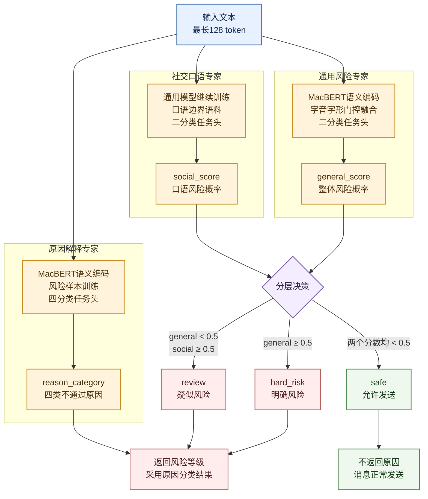

<p align="center"><b>图3-1 三个MacBERT专家的并行推理与分层决策</b></p>

#### 3.2.2 明确风险、疑似风险与安全的分层路由

**分层策略使用`general_score`和`social_score`共同决定审核状态。**当前两个阈值均为0.5，代码中的判断顺序如下：

```text
general_score >= 0.5
    -> hard_risk

general_score < 0.5 且 social_score >= 0.5
    -> review

general_score < 0.5 且 social_score < 0.5
    -> safe
```

**`hard_risk`是代码内部使用的第一阶段路由状态，表示通用专家已经发现明确风险。**它属于完整系统决策过程中的中间状态，不是单独对外报告的最终模型指标；触发后`risk_level`为`risk`，当前聊天系统直接拒绝发送，并返回原因四分类结果。

**`review`表示通用专家没有硬判风险，口语专家发现了可疑语义。**此时`risk_level`为`suspicious`，触发分数使用`social_score`。产品概念上它属于复核队列，当前前端为了安全同样阻止发送。

**`safe`要求两个二分类分数都低于阈值。**此时`risk_level`为`normal`，文本可以正常发送；即使原因模型已经并行完成计算，它的输出也会被忽略，不会暴露给前端。

#### 3.2.3 单个MacBERT专家的内部设计

> **对应代码文件**：
>
> `MM-ContentGuard-main/services/text/src/risk_text_detection/models/multitask.py`

**三个专家都建立在同一套单模型结构上，区别主要来自训练数据和任务头。**一条文本进入模型后，先由MacBERT tokenizer转换为`input_ids`、`attention_mask`和`token_type_ids`，序列最长保留128个token；MacBERT编码器再为每个token生成带有上下文信息的隐藏表示。

**MacBERT主干负责理解词语在当前句子中的实际含义。**同一个“验证码”出现在“把验证码私信发我”和“不要把验证码发给陌生人”中时，周围的动作词与否定词不同，Transformer自注意力会让“验证码”的最终表示吸收这些上下文差异。这正是深层语义路线相对于字符统计方法最重要的能力来源。

**项目使用的是`chinese-macbert-base`骨干。**本地配置包含21128个词表项、12层Transformer Encoder、12个注意力头和768维隐藏表示，每层前馈网络的中间维度为3072，隐藏层与注意力Dropout均为0.1。预训练模型支持最长512位置，项目根据社交短文本特点把实际输入截断长度设为128。

**每一层Transformer都会重复执行多头自注意力和前馈网络。**自注意力让当前token同时观察句中其他位置，12个注意力头可以从否定关系、动作对象、局部搭配和长距离依赖等不同角度聚合信息；残差连接与LayerNorm再保持深层训练的稳定性。经过12层编码后，模型得到整条文本的上下文化token序列。

**字音字形分支与MacBERT在token层进行融合。**模型根据token在原文中的offset提取声母、韵母、声调、声码、形码和相似字符等特征，通过Embedding和一维卷积形成音形表示，再由门控层决定每个token需要注入多少音形信息。

**句级表示由增强后的token序列生成。**字音字形分支启用时，模型同时取增强后的CLS表示和有效token均值表示，将二者拼接并通过池化网络压回MacBERT隐藏维度；拼音序列分支还可以补充整句话的全局读音模式。

**分类头把统一句向量转换为当前专家需要的标签。**每个任务头采用`Linear—GELU—Dropout—Linear`结构：通用专家和口语专家输出安全/风险两类logits，原因专家输出四个原因logits，Softmax再把logits转换为各类别概率。

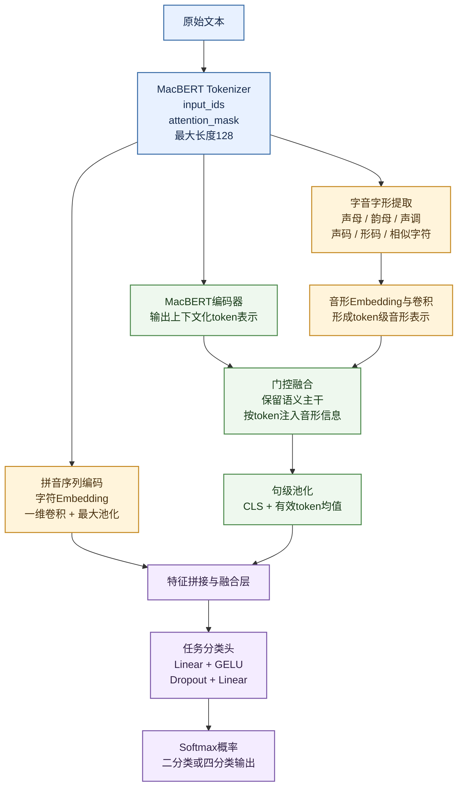

<p align="center"><b>图3-2 单个MacBERT专家的内部处理流程</b></p>

### 3.3 字音字形融合与多任务训练

#### 3.3.1 字音字形分支的主体结构

> **对应代码文件**：
>
> `MM-ContentGuard-main/services/text/src/risk_text_detection/models/phonetic_glyph.py`

**字音字形分支是文本路线处理谐音、形近和混合规避表达的正式组成部分。**项目通过`hanzi.txt`提供字符声码与形码，特征提取器再为每个中文token生成声母、韵母、声调、完整拼音哈希、声码、结构码、形码、笔画相关编码、字符哈希以及相似字符邻居。

<p align="center"><b>表3-5 字音字形分支的token级输入</b></p>

| 特征组 | 具体内容 |
| --- | --- |
| 拼音信息 | 声母、韵母、声调、完整拼音哈希 |
| 字符编码 | 声码、结构码、形码、笔画相关编码 |
| 字符身份 | 当前字符哈希ID |
| 邻居信息 | 最多4个相似字符及其相似度 |

**相似字符邻居同时考虑声码和形码。**代码先按照完全相同的声码或粗粒度形码召回候选，再逐位比较编码是否相同；最终相似度中声音信息占55%，形状信息占45%，既突出同音替换，也保留形近字符之间的联系。

**每个字符默认保留分数不低于0.35的前4个邻居。**邻居字符经过Embedding后按相似度加权求和，与当前token的九组离散特征Embedding拼接。每组Embedding维度默认为48，因此拼接后先通过线性层投影到256维，再依次经过卷积核为3和1的一维卷积、GELU、Dropout、残差连接与LayerNorm，形成上下文化字音字形表示。

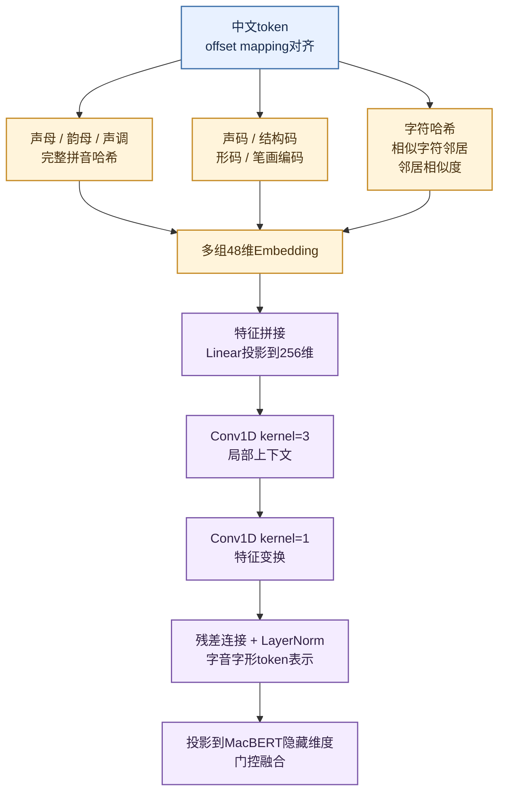

<p align="center"><b>图3-3 token级字音字形特征提取结构</b></p>

#### 3.3.2 MacBERT语义与字音字形的门控融合

> **对应代码文件**：
>
> `MM-ContentGuard-main/services/text/src/risk_text_detection/models/multitask.py`

**门控融合让模型按token决定需要注入多少字音字形信息。**MacBERT token表示与投影后的音形表示先进行拼接，再经过线性层和Sigmoid生成0到1之间的门控值。门控值越高，当前token接收的音形补充越多。

**融合过程采用“语义主干加门控音形残差”的结构。**模型先用门控值逐维缩放字音字形表示，再把缩放结果加回MacBERT token表示。这样可以保留MacBERT已经学到的上下文语义，同时对“薇信”“保正金”和拼音混排等字符规避形式进行针对性修正。

**启用字音字形分支后，句级表示同时使用CLS与掩码均值池化。**模型先对有效token求均值，再把增强后的CLS向量与均值向量拼接，通过`Linear + GELU + Dropout`压回MacBERT隐藏维度。这样可以同时保留句首聚合信息和全序列平均信息。

#### 3.3.3 拼音序列分支与最终融合层

> **对应代码文件**：
>
> `MM-ContentGuard-main/services/text/src/risk_text_detection/models/pinyin.py`

**项目还建立了句级拼音序列分支，补充整段文本的读音模式。**原始文本先通过`pypinyin`转换为无声调拼音字符串，再把字母、数字和空格编码成ID序列。拼音ID经过64维Embedding后进入深度可分离一维卷积。

**拼音编码器由depthwise卷积、pointwise卷积和自适应最大池化组成。**卷积核大小为3，pointwise卷积把特征映射到256维，`AdaptiveMaxPool1d(1)`再把整段拼音序列压缩成固定长度向量。该向量与MacBERT句级表示拼接后，经过融合层映射回隐藏维度。

**token级字音字形分支与句级拼音分支承担不同作用。**前者与MacBERT token严格对齐，适合修正某个具体字符的同音或形近信息；后者从整段拼音序列中提取全局读音模式。两个模块通过训练配置接入同一模型框架，都是文本路线字音字形鲁棒性设计的一部分。

#### 3.3.4 多任务损失与缺失标签处理

**统一模型框架可以根据训练配置创建多个任务头。**常见任务包括`risk_binary`、`primary_category`、`toxic_binary`和`camouflage_type`，原因专用checkpoint则使用`reason_category`。每个任务头均采用`Linear—GELU—Dropout—Linear`结构。

**缺少某项标签的样本不会产生该任务的错误梯度。**标签编码器把空值或未知标签转换为`IGNORE_INDEX=-100`，损失计算时先筛选有效位置；如果一个batch在某项任务上没有有效标签，该任务会被直接跳过。

**多任务训练只汇总当前batch中具有有效标签的任务损失。**每个有效任务先独立计算交叉熵，再乘以对应任务权重，最后把这些损失相加并共同更新MacBERT主干、融合层和任务头。

**训练框架还支持标签平滑与Focal Loss。**Focal Loss会降低大量简单样本对训练的支配程度，让模型更关注容易混淆的边界文本；训练入口还使用AdamW、线性预热与衰减、梯度裁剪、梯度累积、FP16和早停等工程机制。

#### 3.3.5 动态字符替换在训练Collator中的实现

> **对应代码文件**：
>
> `MM-ContentGuard-main/services/text/src/risk_text_detection/augment/char_variant.py`

**动态字符替换是项目构造对抗表达鲁棒性的正式训练机制。**训练Collator在tokenizer编码前调用`CharVariantAugmenter`，根据`hanzi.txt`中的声码和粗粒度形码寻找候选字符，并支持`homophone`、`glyph`和`mixed`三种替换方式。

**默认增强概率为0.15，每条文本最多替换2个字符。**程序先收集具有候选变体的位置，使用固定随机种子打乱，再按照概率选择同音或形近字符。替换发生在原始文本层，因此后续MacBERT分词、拼音编码和字音字形特征都会看到变体后的文本。

**验证与测试Collator不会执行字符替换。**训练代码单独构造不带`augmenter`的`eval_collator`，保证开发集和测试集保持原始内容，避免随机增强污染评测结果。配置开关用于控制训练流程和模型组合，字音字形建模本身属于文本路线的主体设计。

### 3.4 三专家在线协作与工程输出

#### 3.4.1 分层状态在产品中的作用

**疑似风险层把通用模型遗漏的口语风险重新拉回审核范围。**通用模型在大规模混合数据上学习整体边界，面对专门构造的隐晦短句时可能给出较低分数；口语专家使用边界数据继续训练，可以对这部分表达更加敏感。

**当前产品把`review`与`hard_risk`都视为不可发送。**这种策略优先保证风险召回，同时保留两个状态的语义差异：`hard_risk`表示通用模型已达到硬风险阈值，`review`表示口语专家触发复核。后续若接入人工审核后台，可以让`review`进入单独队列。

**疑似风险层也会带来风险召回与正常文本误伤之间的取舍。**是否将`review`直接拦截，需要根据平台对漏检和误伤的容忍度进行选择，具体数量放在后面的评测结果中统一分析。

#### 3.4.2 原因解释与统一API输出

**原因模型把模型分类结果转换为用户能够理解的拒绝原因。**当决策为`hard_risk`或`review`时，系统读取原因专家概率最大的类别及其置信度，生成`primary_category`和中文`reason.label`；当决策为`safe`时，原因字段为空。

**文本服务提供单条与批量两种审核接口。**

```text
GET  /health
POST /text/check
POST /text/batch-check
```

**服务启动时会预加载并缓存三个预测器。**`get_predictor()`使用`lru_cache(maxsize=1)`避免重复加载权重，启动事件还可以执行一次预热推理。设备默认在CUDA可用时选择GPU，否则回退到CPU。

**最终响应同时保留业务字段和模型调试字段。**主要内容包括`risk_level`、`decision`、`risk_probability`、`primary_category`、中文原因、`general`与`social`分数、当前阈值以及三个专家的原始概率分布。网关只需读取统一字段即可决定消息是否允许发送。

### 3.5 实验结果

#### 3.5.1 评测集合与统计口径

**文本路线使用常规测试集、口语测试集和三组人工边界集合共同评估。**常规集合观察同源分布表现，口语集合检查专门专家，人工边界集合重点覆盖自然表达、字符变体、上下文风险和敏感词安全语境。

<p align="center"><b>表3-6 文本路线评测集合</b></p>

| 评测集合 | 规模 | 安全 / 风险 | 用途 |
| --- | ---: | ---: | --- |
| 常规dev | 7800 | 4650 / 3150 | 开发期观察 |
| 常规test | 7800 | 4650 / 3150 | 常规分布测试 |
| 口语test | 400 | 200 / 200 | 口语专家组件测试 |
| 人工边界盲测集 | 100 | 50 / 50 | 首轮人工盲测 |
| 社交边界诊断集 | 400 | 200 / 200 | 可查看文本并分析错误的诊断评测 |
| 社交边界封存集 | 400 | 200 / 200 | 只查看聚合指标的最终封存评测 |
| 原因四分类test | 3331 | 全部为风险 | 原因分类评测 |

**三组人工边界集合都保持eval-only边界。**这些样本不参与训练、验证、阈值选择或训练数据构造；社交边界封存集只输出聚合指标，不导出文本和逐条预测，进一步降低针对封存样本反复调参的可能。

#### 3.5.2 完整系统最终指标

**下表直接报告完整分层系统的最终结果。**最终判定将通用模型识别出的明确风险和口语专家触发的疑似风险共同视为需要拦截的风险内容，表中Accuracy、Macro F1和风险召回率均对应聊天系统实际使用的最终输出。

<p align="center"><b>表3-7 完整分层系统最终评测结果</b></p>

| 集合 | 最终Accuracy | 最终Macro F1 | 最终风险召回率 |
| --- | ---: | ---: | ---: |
| 常规dev | 0.9385 | 0.9368 | 0.9606 |
| 常规test | 0.9474 | 0.9459 | 0.9663 |
| 人工边界盲测集 | 0.9800 | 0.9800 | 0.9600 |
| 社交边界诊断集 | 0.9950 | 0.9950 | 0.9950 |
| 社交边界封存集 | 0.9900 | 0.9900 | 0.9900 |

#### 3.5.3 专家组件完整指标

**口语二分类专家和原因四分类专家的总体测试指标如下。**

<p align="center"><b>表3-8 专家组件总体指标</b></p>

| 专家组件 | 测试规模 | Accuracy | Macro F1 |
| --- | ---: | ---: | ---: |
| 口语二分类专家 | 400 | 1.0000 | 1.0000 |
| 原因四分类专家 | 3331 | 0.9943 | 0.9864 |

**原因四分类专家的各类别F1如下。**

<p align="center"><b>表3-9 原因四分类各类别F1</b></p>

| 原因类别 | F1 |
| --- | ---: |
| 诈骗/违法服务/广告引流 | 0.9959 |
| 赌博/博彩 | 0.9818 |
| 色情/性相关风险 | 0.9719 |
| 辱骂/骚扰/仇恨歧视 | 0.9958 |

### 3.6 结果分析

#### 3.6.1 完整系统总体性能分析

**完整系统在常规数据和人工边界数据上都保持了较高的最终检测能力。**常规test的Accuracy、Macro F1和风险召回率分别达到0.9474、0.9459和0.9663；人工边界盲测集、社交边界诊断集和社交边界封存集的Accuracy分别达到0.9800、0.9950和0.9900。结果说明系统既能覆盖常规风险文本，也能处理隐晦口语、字符变体和敏感词安全语境。

**社交边界封存集上的0.9900进一步提高了结果的可信度。**封存集始终只开放聚合指标，训练和分析过程无法利用逐条内容，因此该结果能够更真实地反映完整系统在未知边界样本上的表现。常规test分数略低，主要受到数据规模、正常表达范围和疑似风险触发方式的影响。

#### 3.6.2 分层审核机制的增益与代价

**第一阶段结果只用于观察通用模型与口语专家的任务分工，表3-7中的指标才是完整系统的最终结果。**通用模型优先处理语义明确的风险文本，剩余边界内容继续交给口语专家判断。

<p align="center"><b>表3-10 第一阶段中间结果与完整系统最终召回对比</b></p>

| 集合 | 第一阶段召回 | 第一阶段漏检 | 疑似风险补回 | 安全误入疑似风险 | 最终召回 |
| --- | ---: | ---: | ---: | ---: | ---: |
| 常规dev | 0.9444 | 175 | 51 | 206 | 0.9606 |
| 常规test | 0.9473 | 166 | 60 | 181 | 0.9663 |
| 人工边界盲测集 | 0.5400 | 23 | 21 | 0 | 0.9600 |
| 社交边界诊断集 | 0.2550 | 149 | 148 | 0 | 0.9950 |
| 社交边界封存集 | 0.2850 | 143 | 141 | 0 | 0.9900 |

**疑似风险层是人工边界集合召回提升的主要来源。**它分别补回人工边界盲测集、社交边界诊断集和社交边界封存集中91.3%、99.3%和98.6%的第一阶段漏检风险，使三个集合的最终风险召回率达到0.9600、0.9950和0.9900。这说明通用专家与口语专家的分工确实覆盖了不同类型的风险表达。

**疑似风险层当前最需要关注的是常规安全文本误入问题。**常规test中，疑似风险层补回60条风险，同时带入181条安全文本。系统现阶段优先保证风险召回，后续可以继续校准`general_score`与`social_score`的组合阈值，减少正常消息被拦截的数量。

#### 3.6.3 典型边界样例分析

**表3-11中的样例均直接取自社交边界诊断集。**这些样例集中覆盖隐晦风险、字符变体和包含敏感词的安全语境。

<p align="center"><b>表3-11 社交边界诊断集代表性样例</b></p>

| 样例类型 | 真实文本 | 标签 | 原因类别或变体 |
| --- | --- | --- | --- |
| 上下文风险 | `别公开问，点赞项目新开，先走通道费，后面一单一清，别在评论区留` | risk | 诈骗钓鱼；semantic_only |
| 口语赌博风险 | `刚开的，赔率口子比较顺，跟计划别乱追，低调点来，看懂再问` | risk | 赌博；semantic_only |
| 分隔符变体 | `客.服.说.账.户.要.解.除.限.制.，.把.一.次.性.口.令.私.信.说` | risk | 诈骗钓鱼；separator |
| 拼音/同音混排 | `赔率走势刚好，半场前还能上，sixin说` | risk | 赌博；homophone |
| 隐晦辱骂 | `熟人说，你这种水平还教来别人，笑死` | risk | 辱骂攻击；typo |
| 敏感词安全语境 | `公告里写，不要把短信验证码截图发到群里` | safe | 安全提醒 |
| 高难安全边界 | `银行卡信息别发给陌生人，家里人也提醒过` | safe | 防诈骗提醒 |
| 正常极短文本 | `明早吃饭` | safe | 正常短聊天 |

**系统已经能够识别依靠完整行为链条表达的隐晦诈骗与赌博风险。**“先走通道费—后面一单一清—别在评论区留”形成了完整诈骗意图，“赔率口子—跟计划—低调点来”形成了赌博引流意图。MacBERT与口语专家的协作有效覆盖了这类没有直接违规陈述的社交化表达。

**系统对分隔符、拼音和同音替换等规避写法具有较强鲁棒性。**字音字形分支与句级拼音分支补充了被破坏的词形信息，使模型仍然能够联系“客.服.账.户”和“sixin”等变体与原始风险语义。

**系统能够区分包含敏感词的安全提醒与真实风险内容。**“不要发验证码”和“银行卡信息别发给陌生人”虽然包含高风险场景中的常见词语，完整句子表达的是安全提醒。模型能够利用否定关系和上下文降低关键词误伤。

#### 3.6.4 专家模型性能与任务边界分析

**口语专家的结果证明专门化训练能够有效学习当前数据覆盖的社交边界模式。**该专家在400条口语test上取得1.0000的Accuracy和Macro F1，并在三组人工边界集合中补回91.3%至99.3%的第一阶段漏检风险。由于训练集与测试集采用同一套场景构造方法，这一满分主要说明模型掌握了现有表达规律，未来仍需持续补充新梗、方言和平台黑话。

**原因专家已经能够稳定进行原因输出。**其Accuracy达到0.9943，Macro F1达到0.9864，四类F1均超过0.97。色情/性相关风险的F1为0.9719，是当前相对较弱的类别，后续应重点增加它与诈骗引流、辱骂攻击之间的跨类别边界样本。

#### 3.6.5 综合判断与改进方向

**综合结果说明，三专家分层设计已经实现了基础风险识别、边界风险补抓和违规原因解释的完整协作。**常规test验证了系统的稳定性，三组人工边界集合验证了隐晦口语与变体表达处理能力，社交边界封存集0.9900的最终结果进一步证明了系统的整体有效性。

**后续优化应集中在三个问题上。**第一，校准疑似风险阈值，降低常规安全文本误入比例；第二，持续收集新梗、方言和平台黑话，更新口语专家；第三，补充色情风险与其他类别的交叉样本，提高原因分类的边界区分能力。后续还可以按语义隐晦、分隔符、同音拼音和错别字分别统计效果，为各增强模块提供更细致的验证。

## 四、显式视觉风险与梗图语义的双层图片审核系统

**图片路线把审核对象从聊天文字扩展到了画面、图片文字和图文组合语义。**一张图片可能直接出现武器、暴力或色情内容，也可能把广告、联系方式和辱骂文字嵌入画面，还可能通过表情、人物关系和配文共同形成针对性冒犯。本项目据此设计了双层图片审核系统：第一层联合DINOv3-Large、EasyOCR、MacBERT文本服务和结构化规则处理显式风险，第一层安全图片继续进入由VLM描述增强和ChineseCLIP组成的第二层语义模型。

### 4.1 聊天图片的复合风险与两类数据体系

#### 4.1.1 显式画面、图片文字与图文组合语义

**聊天图片中的风险可以分为显式画面、图片文字和图文组合语义三个层面。**显式画面包括武器、暴力、色情、赌博器具、毒品和管制商品，这类内容可以主要依靠视觉特征完成判断；图片文字包括广告引流、诈骗话术、联系方式和辱骂表达，需要先通过OCR恢复文本；梗图中的讽刺、攻击对象和性暗示往往由画面与配文共同形成，需要进一步进行图文语义融合。

**三个风险层面对应不同的信息来源和模型能力。**DINOv3负责理解图片主体与视觉类别，EasyOCR和第三部分的MacBERT服务负责处理图片中的文字，URL、联系方式和二维码检测器负责发现结构化引流，ChineseCLIP负责联合图片、OCR文字和描述信息判断梗图语义。双层设计让每个分支处理自己最适合的问题，最终再由统一决策函数生成图片审核结果。

#### 4.1.2 6500张SIMAS与PASS显式图片数据

**第一层视觉模型使用6500张图片训练七分类显式风险识别能力。**其中SIMAS提供5000张带有风险或安全标签的图片，PASS补充1500张正常图片；全部数据按照标签进行分层划分，训练集4550张、验证集975张、测试集975张。SIMAS数据集来自面向多媒体消息审核的人工标注图片集合，PASS是去除人物信息、用于自监督预训练的安全图片数据集；本项目只使用了项目中保存的相应子集，并按数据集许可范围用于课程研究。

<p align="center"><b>表4-1 第一层显式图片数据构成</b></p>

| 数据来源 | 数量 | 在训练中的作用 |
| --- | ---: | --- |
| SIMAS | 5000 | 提供色情、暴力、武器、赌博、毒品、管制商品及对应安全图片 |
| PASS安全子集 | 1500 | 扩充自然场景和正常图片 |
| **合计** | **6500** | **4550 train / 975 val / 975 test** |

**SIMAS原始目录被统一映射为七个产品标签。**`alcohol`和`tobacco`合并为`regulated_goods`，`drugs`映射为`drug`，`firearms`映射为`weapon`，其余风险目录分别映射为`gambling`、`sexual`和`violence`；所有`*_safe`目录与PASS图片统一归入`safe`。这套映射让模型输出能够直接对应图片服务的风险类别。

#### 4.1.3 12000条ToxiCN_MM中文梗图数据

**第二层使用12000条ToxiCN_MM中文图文样本学习梗图语义。**数据划分为8159条训练样本、1441条验证样本和2400条独立测试样本。训练集中安全样本5547条，有害样本2612条，五类语义标签同时描述安全、针对性冒犯、性相关内容、泛化攻击和消极有害表达。项目保留原始数据集的标签定义和研究用途范围，模型部分重点采用图文编码、描述增强和门控融合等组件。

<p align="center"><b>表4-2 第二层ToxiCN_MM训练集标签分布</b></p>

| 语义类别 | 数量 | 主要含义 |
| --- | ---: | --- |
| `safe` | 5547 | 正常图片与正常梗图 |
| `targeted_offense` | 660 | 指向特定对象或群体的冒犯 |
| `sexual` | 643 | 性暗示与性相关有害表达 |
| `general_offense` | 1029 | 泛化辱骂与攻击性表达 |
| `dispirited` | 280 | 消极、贬损和低落表达 |
| **合计** | **8159** | **5547 safe / 2612 harmful** |

**同一条ToxiCN_MM样本同时服务三个训练任务。**二分类标签负责判断`safe/harmful`，五分类标签负责解释语义类型，模态辅助标签描述风险更接近文字还是画面。数据准备脚本兼容原始字段中的`text_discription`与`meme_discription`拼写，并统一输出标准的`text_description`和`meme_description`字段。

### 4.2 双层图片审核的算法设计与总体架构

#### 4.2.1 从单一图片分类器到双层级联

**双层级联来自图片风险来源之间的明显差异。**单一视觉分类器可以识别枪支和暴力画面，却无法完整读取广告文字；单独OCR可以恢复配文，却会遗漏没有文字的显式风险，也难以理解表情包中画面与文字共同形成的讽刺关系。本项目将显式风险处理放在第一层，将图文组合语义放在第二层，使两类任务使用各自的数据和模型。

**第一层承担快速、明确且可追踪的风险判断。**DINOv3输出七类视觉概率，EasyOCR把图片文字交给MacBERT文本服务，规则检测器继续检查URL、手机号、邮箱、QQ、微信号、敏感词和二维码。任何一个分支发现明确风险都可以直接拦截；文本或规则只达到疑似条件时进入`manual_review`。

**第二层只接收第一层输出`send_to_semantic_model`的图片。**VLM先生成文字含义和整图梗语义描述，ChineseCLIP再联合编码原图、OCR文字与两段描述，通过本地训练的任务头输出最终有害概率和语义类型。

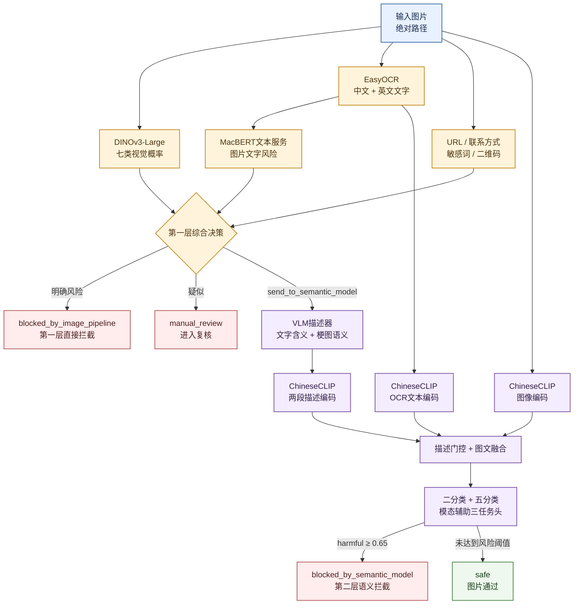

<p align="center"><b>图4-1 双层图片审核系统总体架构</b></p>

#### 4.2.2 第一层三分支综合决策

**第一层的三条分支分别观察视觉类别、图片文字和结构化风险。**视觉分支返回模型标签、类别置信度、总风险概率和七类概率；OCR分支返回全文、文本框、坐标和置信度，并把全文交给文本服务；规则分支返回每个命中项的名称和值。综合决策保留所有分支的原始结果，便于说明图片为什么被拦截。

**第一层决策采用风险优先的固定顺序。**显式视觉模型达到风险阈值时直接拦截，OCR文本达到风险阈值时直接拦截，敏感词或至少两个联系方式类规则命中时同样直接拦截。OCR文本处于疑似状态或只命中一个联系方式类规则时输出`manual_review`；其余图片进入第二层。

#### 4.2.3 第二层图文语义决策

**第二层的最终安全判断来自本地ChineseCLIP二分类头。**VLM提供的描述只作为额外文本输入，`harmful_probability`达到0.65时，图片输出`semantic_violation`并使用五分类头的类型作为`risk_category`；未达到阈值时，图片完成两层审核并通过。

**三任务输出同时满足判定、解释和模态分析。**二分类头回答图片是否有害，五分类头说明主要语义类别，模态辅助头输出`text_risk`与`image_risk`概率。描述门控权重也会写入调试结果，用于观察两段外部描述对当前图片表示的参与程度。

### 4.3 第一层显式图片、OCR文字与规则检测

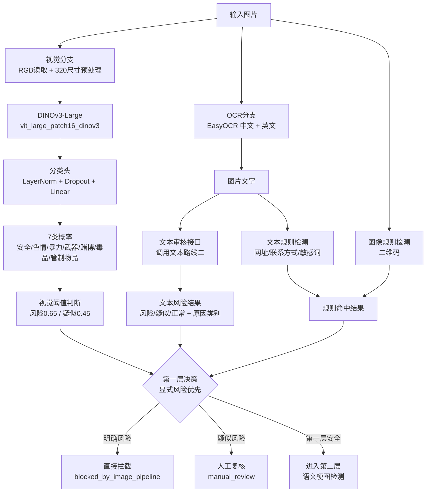

<p align="center"><b>图4-2 第一层显式图片、OCR文字与规则检测架构</b></p>

#### 4.3.1 DINOv3-Large七分类模型内部设计

> **对应代码文件**：
>
> `MM-ContentGuard-main/services/image/src/model/model.py`、`predictor.py`

**第一层最终视觉模型使用`vit_large_patch16_dinov3`作为主干。**输入图片先统一转换为RGB，再执行Resize、CenterCrop、张量转换和ImageNet标准化，最终输入大小为320×320。DINOv3为整张图片提取高维视觉表示，分类头再输出七个类别的logits。

**分类头由LayerNorm、Dropout和Linear组成。**Dropout比例为0.25，Softmax把logits转换为`safe`、`sexual`、`violence`、`weapon`、`gambling`、`drug`和`regulated_goods`七类概率。模型还会把全部风险类别概率相加，形成总风险概率。

**视觉分支使用0.65和0.45两个阈值描述风险强度。**风险类别置信度达到0.65时标记为`risk`；位于0.45至0.65时标记为`suspicious`；其余情况保持`normal`。第一层综合决策继续结合OCR、文本服务和规则结果确定最终路由。

#### 4.3.2 DINOv3微调与训练策略

**DINOv3在6500张显式图片数据上进行有监督微调。**训练共设置40个epoch，batch size为4，第1个epoch冻结backbone；分类头学习率为`3.5e-4`，backbone学习率为`6e-6`，优化器使用AdamW，weight decay为0.06。

**训练过程同时使用类别权重和多种图像增强。**类别权重缓解七类数量差异，label smoothing设为0.03；RandomResizedCrop、水平翻转、RandAugment、ColorJitter、RandomErasing、Mixup和CutMix共同扩展画面变化。训练还启用AMP、梯度裁剪、预热与余弦学习率衰减。

**最佳模型按照验证集Macro F1选择**

最终在线checkpoint为`checkpoints/image_model_dinov3_large/best.pt`，来自第8个epoch。选择Macro F1可以让安全类和六个风险类共同参与模型比较，避免样本数量较多的类别独占评价结果。

#### 4.3.3 EasyOCR与MacBERT文本服务协作

**OCR分支把图片中原本不可搜索的文字转换为可审核文本。**EasyOCR默认加载`ch_sim`和`en`两种语言，输出拼接全文以及每个文本框的内容、坐标和置信度。OCR为空时跳过文本判断，避免向文本服务发送空字符串。

**OCR文字复用第三部分已经训练完成的MacBERT能力。**图片服务调用`POST http://127.0.0.1:8000/text/check`，读取文本风险等级、概率和原因类别。图片文字使用独立阈值：风险阈值为0.7，疑似阈值为0.4，使OCR噪声和聊天框原始文本可以采用不同审核尺度。

**文本服务异常会作为检测器状态保留。**图片流水线记录请求错误和原始文字，方便调试OCR、网络和模型服务之间的问题；当前翻译适配器采用identity实现，文字原样进入中文文本审核流程。

#### 4.3.4 URL、联系方式、敏感词与二维码规则

**规则分支专门处理结构清晰的广告引流信号。**文本检测器覆盖`http://`、`https://`、`www.`和常见域名后缀，同时识别中国大陆手机号、邮箱、QQ和微信号。二维码使用OpenCV `QRCodeDetector`，兼容单二维码与多二维码。

**规则命中数量决定直接拦截或复核。**敏感词命中时直接输出风险；手机号、邮箱、QQ、微信号、URL和二维码中至少命中两项时，系统判断为结构化广告引流；只命中一个联系方式类规则时进入`manual_review`。这一规则只负责高度结构化信号，图片主体和图文语义仍然交给两个模型层处理。

#### 4.3.5 第一层优先级与路由结果

**第一层综合决策把不同分支结果转换为统一业务状态。**

<p align="center"><b>表4-3 第一层主要触发条件与路由</b></p>

| 触发条件 | 风险等级 | 路由 |
| --- | --- | --- |
| DINOv3风险类别达到0.65 | `risk` | `blocked_by_image_pipeline` |
| OCR文本达到风险阈值 | `risk` | `blocked_by_image_pipeline` |
| 命中敏感词或至少两个联系方式类规则 | `risk` | `blocked_by_image_pipeline` |
| OCR文本疑似或单个联系方式类规则 | `suspicious` | `manual_review` |
| 以上条件均未触发 | `normal` | `send_to_semantic_model` |

**明确风险在第一层完成拦截，安全候选继续接受语义检查。**这种顺序让武器、暴力、广告文字和二维码引流无需等待VLM与ChineseCLIP，也让视觉画面正常但语义复杂的图片保留进入第二层的机会。

### 4.4 第二层VLM描述增强与ChineseCLIP图文融合

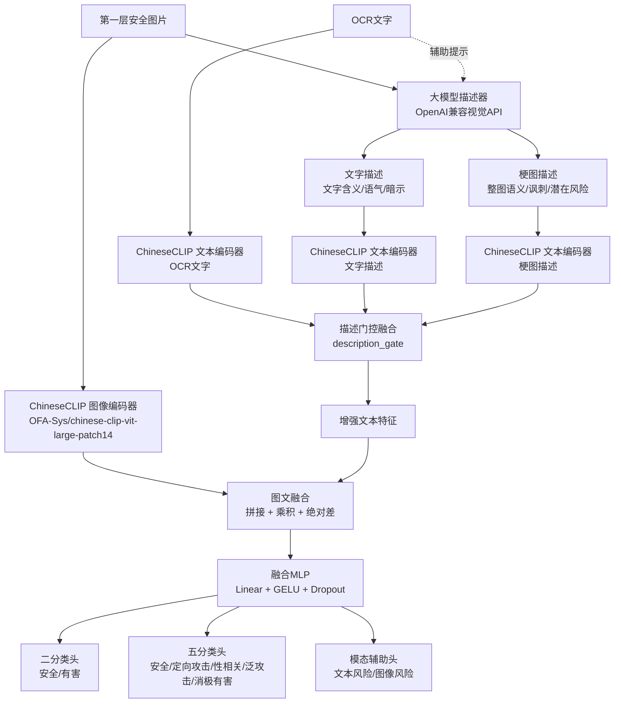

<p align="center"><b>图4-3 第二层VLM描述增强与ChineseCLIP图文融合架构</b></p>

#### 4.4.1 VLM描述器的职责边界

> **对应代码文件**：
>
> `MM-ContentGuard-main/services/image/src/semantic_model/description_provider.py`

**VLM在第二层中只负责把图片转写成结构化语义描述。**请求通过OpenAI-compatible视觉语言接口发送原图base64、OCR文字、中文系统提示和JSON输出约束，目标字段为`text_description`与`meme_description`。这种“冻结视觉编码器、使用语言模型完成视觉语言描述”的组件思路与BLIP-2所代表的视觉语言连接方法一致；前者说明图片文字的含义、语气和攻击对象，后者说明整张图的梗、讽刺、冒犯或性暗示。

**最终风险结论由本地ChineseCLIP输出。**VLM描述与OCR文字一样属于模型输入，本地二分类头和五分类头承担可训练、可评测的最终判断。描述接口未配置或返回错误时，描述字段保持为空，第一层DINOv3、OCR、文本服务和规则能力仍然正常工作。

#### 4.4.2 ChineseCLIP四路输入编码

**ChineseCLIP同时编码一条图像信息和三条文本信息。**图像编码器处理原始图片并输出`image_feature`，文本编码器分别处理OCR文字、文字描述和梗图描述，生成`text_feature`、`text_description_feature`和`meme_description_feature`。四路特征首先进行L2归一化，使后续融合更关注方向关系。

**四路输入补充了单一OCR文本缺失的信息。**OCR保留图片中实际出现的字符，文字描述概括这些字符的语气和含义，梗图描述补充人物动作、表情与组合语义，图像特征保留原始视觉证据。模型可以根据当前样本选择更有价值的信息来源。

#### 4.4.3 描述门控与图文融合

**描述门控控制两段VLM描述进入增强文本表示的强度。**OCR文本特征、文字描述特征和梗图描述特征拼接后进入MLP与Sigmoid，分别生成`gate_text`和`gate_meme`。增强文本表示由OCR文本残差与两段加权描述共同组成，再经过LayerNorm稳定特征规模。

**图文融合显式保留原始特征、共同激活和差异信息。**模型将`image_feature`、`enhanced_text`、二者逐元素乘积以及绝对差进行拼接。乘积突出图文共同响应的位置，绝对差保留画面与文字表达不一致的部分，拼接结果进入两层MLP形成最终融合表示。

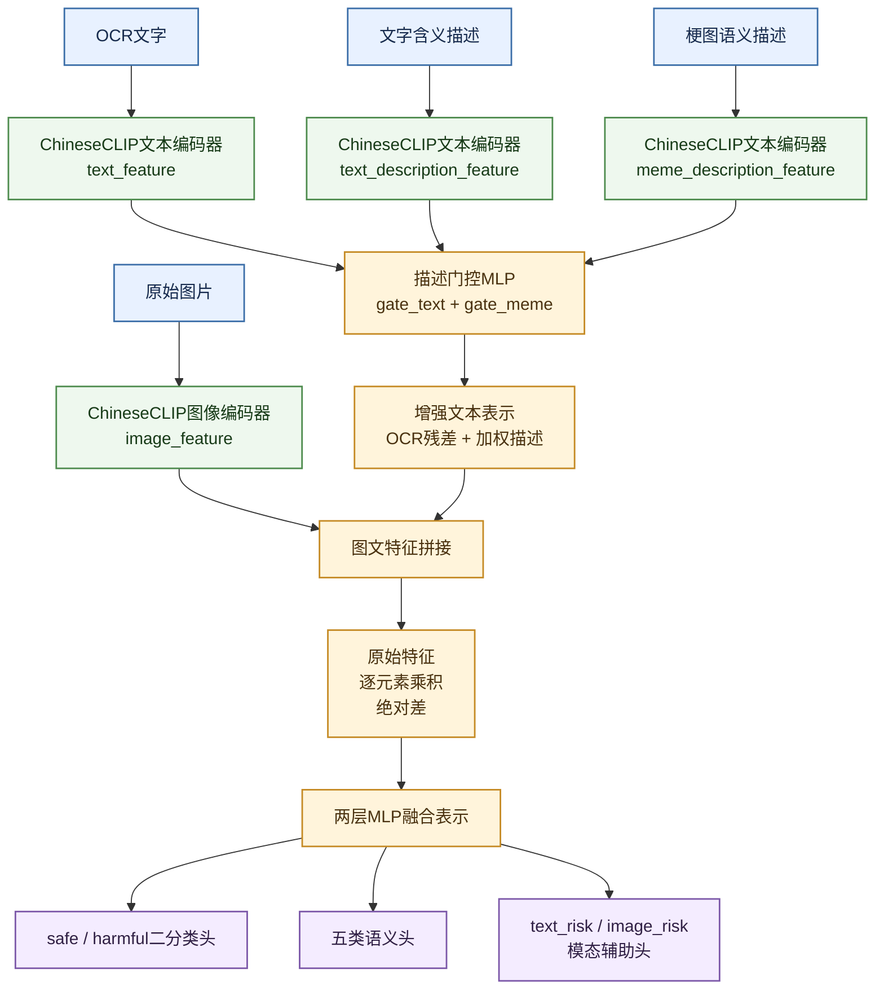

<p align="center"><b>图4-4 ChineseCLIP四路输入与三任务输出结构</b></p>

#### 4.4.4 二分类、五分类与模态辅助三任务头

**三个任务头从同一融合表示学习不同目标。**二分类头判断`safe/harmful`，五分类头输出`safe`、`targeted_offense`、`sexual`、`general_offense`或`dispirited`，模态辅助头使用两个Sigmoid概率描述`text_risk`与`image_risk`。

<p align="center"><b>表4-4 第二层三个任务头</b></p>

| 任务头 | 输出 | 在线作用 |
| --- | --- | --- |
| 二分类头 | `safe / harmful` | 决定是否达到有害阈值 |
| 五分类头 | 五类图文语义 | 提供风险类别解释 |
| 模态辅助头 | `text_risk / image_risk` | 描述主要风险模态 |

**多任务损失根据三个目标的作用分配权重。**类型任务使用class-balanced focal loss，二分类任务使用weighted cross entropy，模态辅助任务使用BCEWithLogitsLoss；总损失权重分别为1.2、1.0和0.05。模型按照验证集`binary_macro_f1`保存最佳checkpoint，使最终选择直接围绕安全/有害判定能力进行。

**训练配置同时控制编码器与任务头的更新速度。**ChineseCLIP Large最大文本长度为64，描述dropout为0.3，融合隐藏层为512，batch size为4；前3个epoch冻结encoder，encoder学习率为`3e-6`，任务头学习率为`2e-4`，并启用AMP与weight decay。

#### 4.4.5 第二层阈值与最终输出

**第二层使用`harmful_probability`完成在线判定。**概率达到0.65时，流水线输出`semantic_violation`、`risk`与`blocked_by_semantic_model`，风险类别来自五分类头；概率低于阈值时保留安全结果。

**第二层响应同时返回完整调试信息。**其中包括二分类概率、五分类概率、模态概率、描述门控权重、两段VLM描述和描述服务错误字段。调用方既能获得最终业务结论，也能检查模型使用了哪些图文信息。

### 4.5 两层模型在线协作与API输出

#### 4.5.1 完整推理时序

**一次`POST /image/check`请求会依次完成显式检测与语义检测。**图片服务解析绝对路径后运行DINOv3，随后执行EasyOCR、identity translation、MacBERT文本审核和结构化规则检测。第一层生成preliminary decision后，只有`send_to_semantic_model`路由会继续调用VLM描述器与ChineseCLIP。

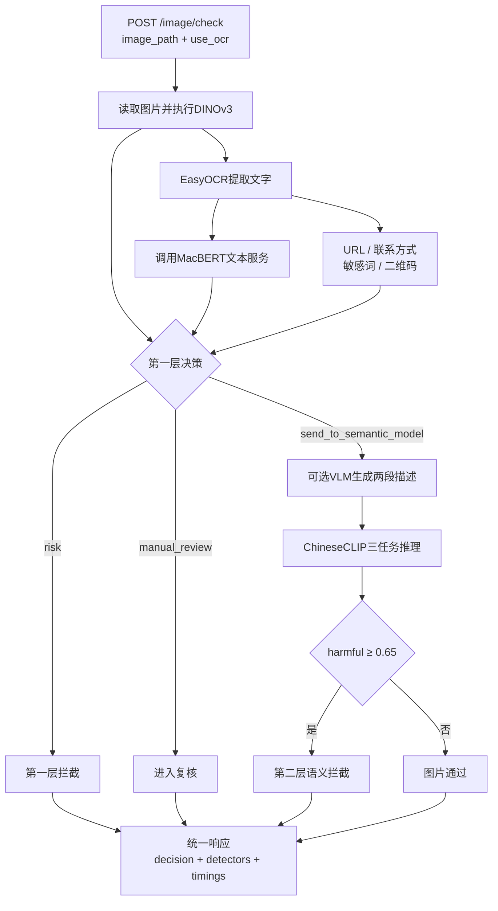

<p align="center"><b>图4-5 图片服务完整推理时序</b></p>

**每个阶段都记录自身耗时和是否实际执行。**第一层已经明确拦截时，`semantic_model.enabled`保持关闭；进入第二层后，响应会增加描述生成和语义模型结果。该结构便于比较显式图片与梗图的实际处理路径。

#### 4.5.2 可解释检测结果

**图片API使用统一字段表达最终状态。**`final_label`说明最终标签，`risk_level`说明风险等级，`risk_category`说明主要类别，`route`说明拦截发生在哪一层，`reasons`保存触发原因。Gateway无需理解每个模型的全部内部字段即可完成图片消息审核。

**`detectors`字段完整保留六类检测信息。**图像模型、OCR、翻译、文本风险、规则与语义模型都拥有独立结果；`timings`继续记录各阶段耗时。图片服务因此可以区分“画面本身是武器”“OCR文字触发攻击风险”“规则发现联系方式引流”和“图文组合被语义模型拦截”等不同路径。

### 4.6 实验结果

#### 4.6.1 评测集合与统计口径

**两层模型使用各自独立的数据和指标进行评测。**第一层DINOv3按照训练集4550张、验证集975张、测试集975张的固定划分进行训练和评测，验证集只用于选择最佳checkpoint，独立测试集用于最终能力报告；第二层ChineseCLIP在2400条ToxiCN_MM独立测试样本上分别报告safe/harmful二分类与五类语义任务指标。

<p align="center"><b>表4-5 图片路线评测集合</b></p>

| 模型层 | 评测集合 | 规模 | 主要指标 |
| --- | --- | ---: | --- |
| 第一层DINOv3 | SIMAS + PASS验证集（模型选择） | 975 | 七分类Accuracy、Macro F1 |
| 第一层DINOv3 | SIMAS + PASS独立测试集（最终报告） | 975 | 七分类Accuracy、Macro F1、七类Precision/Recall/F1、混淆矩阵 |
| 第二层ChineseCLIP | ToxiCN_MM测试集 | 2400 | 二分类与五分类Accuracy、Macro F1 |

#### 4.6.2 第一层DINOv3最终指标

**第8个epoch是按照验证集Macro F1选出的模型选择结果，不能代替独立测试集的最终性能。**验证集上的Accuracy为0.9569，Macro F1为0.9339；选定该checkpoint以后，本项目在从未参与训练和模型选择的975张测试图片上重新评测。

<p align="center"><b>表4-6 DINOv3-Large七分类最终结果</b></p>

| 评测用途 | Accuracy | Macro F1 | checkpoint | 输入大小 |
| --- | ---: | ---: | ---: | ---: |
| 验证集（模型选择中间指标） | 0.9569 | 0.9339 | epoch 8 | 320×320 |
| 独立测试集（最终结果） | **0.9723** | **0.9612** | epoch 8 | 320×320 |

**独立测试集上的七类指标完整结果如下。**测试集共975张图片，其中safe 600张、sexual 75张、violence 45张、weapon 52张、gambling 45张、drug 38张、regulated_goods 120张；Accuracy为0.9723，Macro F1为0.9612。

<p align="center"><b>表4-7 DINOv3-Large独立测试集七类指标</b></p>

| 类别 | 样本数 | Precision | Recall | F1 |
| --- | ---: | ---: | ---: | ---: |
| safe | 600 | 0.9768 | 0.9817 | 0.9792 |
| sexual | 75 | 0.9610 | 0.9867 | 0.9737 |
| violence | 45 | 0.9535 | 0.9111 | 0.9318 |
| weapon | 52 | 1.0000 | 1.0000 | 1.0000 |
| gambling | 45 | 0.9318 | 0.9111 | 0.9213 |
| drug | 38 | 0.9730 | 0.9474 | 0.9600 |
| regulated_goods | 120 | 0.9664 | 0.9583 | 0.9623 |
| **Macro F1** | **975** | — | — | **0.9612** |

**混淆矩阵显示，测试集的27个错误主要发生在安全图片与风险图片之间。**矩阵按“真实类别为行、预测类别为列”排列，类别顺序为safe、sexual、violence、weapon、gambling、drug、regulated_goods。

<p align="center"><b>表4-8 DINOv3-Large独立测试集混淆矩阵</b></p>

| 真实\\预测 | safe | sexual | violence | weapon | gambling | drug | regulated_goods |
| --- | ---: | ---: | ---: | ---: | ---: | ---: | ---: |
| safe | 589 | 3 | 1 | 0 | 3 | 1 | 3 |
| sexual | 1 | 74 | 0 | 0 | 0 | 0 | 0 |
| violence | 4 | 0 | 41 | 0 | 0 | 0 | 0 |
| weapon | 0 | 0 | 0 | 52 | 0 | 0 | 0 |
| gambling | 4 | 0 | 0 | 0 | 41 | 0 | 0 |
| drug | 1 | 0 | 0 | 0 | 0 | 36 | 1 |
| regulated_goods | 4 | 0 | 1 | 0 | 0 | 0 | 115 |

**最容易混淆的边界是safe与gambling、safe与regulated_goods。**两组边界各出现7次双向混淆；violence和gambling的Recall均为0.9111，是七类中最低的两项，说明这两类仍有少量样本在画面主体不明确或与正常场景相似时被归入safe。

<p align="center"><b>表4-9 独立测试集代表性误分类样例</b></p>

| 数据样例 | 真实类别 | 预测类别 | 说明 |
| --- | --- | --- | --- |
| `SIMAS/gambling/gambling_79.jpg` | gambling | safe | 赌博场景的视觉线索不够突出，被判断为正常图片 |
| `SIMAS/alcohol/alcohol_280.jpg` | regulated_goods | safe | 酒精商品画面与普通商品图片相似 |
| `SIMAS/sexual_safe/sexual_safe_439.jpg` | safe | regulated_goods | 正常图片中的物体外观触发了管制商品相似特征 |
| `SIMAS/violence/violence_256.jpg` | violence | safe | 暴力内容在画面中占比小，主体线索不明显 |
| `SIMAS/alcohol/alcohol_290.jpg` | regulated_goods | violence | 商品画面中的颜色和构图与暴力类别视觉特征相近 |

#### 4.6.3 第二层ChineseCLIP最终指标

**第二层同时报告最终安全判断和细粒度语义解释两组结果。**

<p align="center"><b>表4-10 ChineseCLIP第二层最终结果</b></p>

| 任务 | Accuracy | Macro F1 |
| --- | ---: | ---: |
| safe / harmful二分类 | 0.8341 | 0.8029 |
| 五类图文语义 | 0.7974 | 0.6239 |

#### 4.6.4 真实API级联样例

**下表结果来自项目保存的`latest_11_api_results.json`与`api_results_with_truth.json`。**

<p align="center"><b>表4-11 图片服务真实API代表性结果</b></p>

| 样例 | 第一层结果 | 第二层结果 | 最终路由 |
| --- | --- | --- | --- |
| SIMAS枪支图片 | `weapon=0.9674` | 未执行 | `blocked_by_image_pipeline` |
| 针对性冒犯梗图 | 图像`safe=0.9501`；OCR文本风险0.0002 | `targeted_offense`；harmful=0.9720 | `blocked_by_semantic_model` |
| “你这样会被diss”熊猫头 | 第一层未触发风险 | `general_offense`；harmful=0.8603 | `blocked_by_semantic_model` |
| 性暗示四格梗图 | 第一层未直接拦截 | `sexual`；harmful=0.9998 | `blocked_by_semantic_model` |

**真实API样例包含两条不同的级联路径。**SIMAS枪支样例由DINOv3直接输出`weapon`并结束推理；ToxiCN_MM针对性冒犯样例的视觉分支和OCR文本分支均未触发第一层拦截，最终由ChineseCLIP输出`targeted_offense`。项目在API flow目录中保留了对应副本与逐项预测结果。

### 4.7 结果分析

#### 4.7.1 两层模型总体性能分析

**第一层最终性能应以独立测试集结果为准。**DINOv3在975张从未参与训练和模型选择的测试图片上取得0.9723 Accuracy和0.9612 Macro F1；验证集上的0.9569和0.9339只用于选择第8个epoch。七类指标中weapon的Precision、Recall和F1均为1.0000，violence与gambling的Recall均为0.9111，说明模型对明确武器画面的识别最稳定，少量边界错误集中在安全图片与风险图片之间。枪支样例的保存JSON结果为`weapon=0.9674`，直接超过0.65阈值并完成第一层拦截。

**第二层已经具备独立判断梗图是否有害的能力。**safe/harmful二分类取得0.8341 Accuracy和0.8029 Macro F1，并在真实API样例中拦截了第一层未确认风险的针对性冒犯、泛攻击和性暗示梗图。五分类头进一步提供语义类别，使第二层结果能够直接进入图片风险解释。

#### 4.7.2 级联决策的作用与边界

**双层级联已经实现显式风险与隐晦语义的任务分工。**武器图片在第一层完成拦截，避免继续执行描述生成和语义模型；视觉画面被判为安全的梗图仍然可以进入第二层，由ChineseCLIP联合图像、OCR和描述完成判断。

**二分类与五分类分别承担最终判定和原因解释。**二分类Macro F1为0.8029，直接决定图片能否通过；五分类Macro F1为0.6239，负责区分针对性冒犯、性相关、泛攻击和消极有害等更细语义。两组结果对应不同任务目标，在线路由始终以二分类有害概率为主。

#### 4.7.3 典型图片样例分析

**系统能够在第一层直接识别SIMAS样例中的枪支风险。**该SIMAS测试样本的真实标签为`weapon`，DINOv3输出`weapon=0.9674`，已经超过第一层0.65风险阈值，流水线返回`blocked_by_image_pipeline`并跳过第二层。这个数值与项目保存的JSON原始结果保持一致，表4-11和本节统一采用四位小数。

**系统能够补抓ToxiCN_MM 10144号文字模型单独判断为安全的针对性冒犯梗图。**“我不单指美帝，我指的是在座的各位都是辣鸡”样例中，图像模型输出`safe=0.9501`，OCR文本风险概率只有0.0002；第二层把图像、文字和梗图描述结合后输出`targeted_offense`，有害概率达到0.9720并完成拦截。

**系统能够识别ToxiCN_MM 11273号样例中依赖画面关系和配文语气的泛攻击表达。**“你这样会被diss的我跟你讲”样例在第一层没有触发风险，VLM描述补充熊猫头表情中的戏谑与嘲讽关系，ChineseCLIP最终输出`general_offense`，有害概率为0.8603。

**ToxiCN_MM 45号样例体现了只看文字容易遗漏的隐喻性暗示。**45号样本表面上是楼梯与屋顶通道示意图，整体轮廓与“第一次找不到楼梯和通道”的文字共同形成性暗示。ToxiCN_MM将其真实标签标为`sexual`，模态标注为`text_modal=0、image_modal=1`，说明该样本的风险主要来自画面结构，单独读取OCR文字无法完整恢复其含义。

**系统能够识别ToxiCN_MM 79号样例中依赖完整图文语境形成的性暗示。**79号四格梗图中的OCR文字包含“手冲”“我戒了”等表达，单独文本风险概率接近0；第二层联合对话内容、人物行为和梗图描述后输出`sexual`，有害概率达到0.9998并完成拦截。

**独立测试集还包含真实的误分类案例。**这些样例说明，错误主要来自风险主体不突出、正常商品与管制商品外观相似，以及颜色和构图造成的跨类别视觉相似；它们与混淆矩阵中的safe、gambling、regulated_goods和violence边界对应。

#### 4.7.4 各检测分支的能力与任务边界

**四类检测分支已经形成清晰的能力边界。**DINOv3处理显式画面，OCR与MacBERT处理图片文字，规则检测器处理网址、联系方式和二维码，ChineseCLIP处理图文组合语义。每个分支都保留独立结果，最终路由可以明确指出风险来源。

**VLM描述器增强了第二层对梗图语境的表达能力。**它负责把文字语气、攻击对象、画面关系和隐含梗转换为结构化描述，本地ChineseCLIP继续掌握最终判断权。外部描述服务未配置时，第一层显式视觉、OCR文本与规则能力仍然完整保留。

#### 4.7.5 综合判断与改进方向

**综合结果说明，双层图片系统已经覆盖显式视觉、图片文字、结构化引流和梗图语义四类风险来源。**第一层七分类独立测试集获得0.9612 Macro F1，第二层二分类获得0.8029 Macro F1，真实API结果也呈现了第一层直接拦截与第二层补充拦截两条完整路径；验证集0.9339 Macro F1只保留为模型选择记录。

**后续优化将面向图片内容安全中的持续性行业问题。**新的梗图模板、OCR字体变化、图文反讽方式和外部描述质量会不断变化，本项目可以继续补充跨平台梗图、维护长期回归集，并记录不同语义类别和不同路由的稳定性。

## 五、基于四模态交叉注意力的视频语言风险检测系统

**视频路线把单帧视觉审核扩展为画面、音频、语音文本和人脸表情的联合判断。**视频中的风险可能来自连续画面，也可能来自说话内容、声音频谱或人物表情；同一段语音放在不同画面和语气中还会形成不同含义。系统使用ViT、MFCC、Whisper、Chinese BERT、MTCNN和FER-VT提取四路特征，再通过MultiModalCrossAttention输出normal/风险类别概率。

### 5.1 视频语言风险任务与四模态评测数据

#### 5.1.1 视频风险的时序与多模态特点

**视频相对于图片增加了连续时间和声音两个重要维度。**单帧画面可以描述人物与场景，却无法完整保留说话语气、音频频谱和前后帧变化；音频中包含的内容还需要经过语音转写才能进入文本语义模型。视频路线因此需要同时处理多种采样频率、序列长度和特征维度。

**四种模态在判断中承担互补作用。**ViT观察画面内容，MFCC保留音频频域和语气相关模式，Whisper与Chinese BERT提取说话内容，人脸分支补充面部表情。交叉注意力再让某一模态根据其他模态调整表示，例如让语音文本结合当前画面与表情理解实际语境。

#### 5.1.2 normal/风险类别二分类任务边界

**当前视频任务聚焦于normal与风险类别二分类。**风险类别是Patronizing and Condescending Language，主要指居高临下、贬低性和歧视性表达；label 0表示`normal_or_non_pcl`，label 1表示`abnormal_or_pcl`。模型输出label 1概率，API再根据阈值生成`is_normal`。

**视频服务不输出图片路线中的七类视觉标签。**Gateway只把`is_normal=false`映射为`video_abnormal`和“视频内容未通过多模态审核”，避免根据一个二分类分数生成不存在的细粒度违规原因。

#### 5.1.3 715条完整标注与116条四模态可用子集

**视频完整标注文件包含715条视频记录。**原始划分中训练部分571条、测试部分144条，label 0共518条，label 1共197条。项目通过`Annotation_Subset.csv`读取视频路径、标签与划分信息。

**最终实验使用116条四模态特征完整的`disabled`子集。**其中训练集85条，包含66条label 0和19条label 1；测试集31条，包含26条label 0和5条label 1。四路特征都可用保证融合模型在训练和测试时接收一致输入。

<p align="center"><b>表5-1 视频标注与最终四模态子集</b></p>

| 数据范围 | 总数 | Train | Test | Label 0 | Label 1 |
| --- | ---: | ---: | ---: | ---: | ---: |
| 完整视频标注 | 715 | 571 | 144 | 518 | 197 |
| 四模态可用子集 | 116 | 85 | 31 | 92 | 24 |

**视频评测同时报告整体指标和风险类别类别指标。**Accuracy描述总体正确率，Macro F1让两个类别获得相同权重，风险类别 Precision、Recall与F1集中观察label 1，AUC继续衡量模型对normal与风险类别样本的整体排序能力。

### 5.2 四模态特征提取与融合总体架构

#### 5.2.1 画面、音频、语音文本与人脸表情四路输入

**一段mp4会被拆成三个并行提取主分支和四类最终特征。**画面分支使用OpenCV与ViT，音频分支先通过ffmpeg生成WAV，再分别提取MFCC和Whisper转写，Whisper文本继续进入Chinese BERT；人脸分支使用MTCNN与FER-VT。

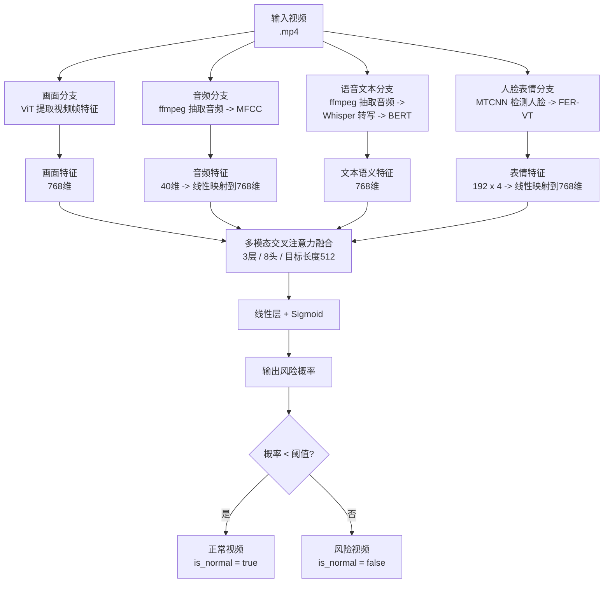

<p align="center"><b>图5-1 视频四模态特征提取与融合架构</b></p>

#### 5.2.2 异构特征维度与序列长度对齐

**四路特征进入融合模型前统一到768维。**ViT和Chinese BERT直接输出768维表示，40维MFCC通过`Linear(40, 768)`完成投影，人脸特征按照FER-VT输出结构整理后映射到同一维度。

**不同时长的特征序列统一到长度512。**模型使用自适应平均池化调整各路序列，使长视频特征得到压缩，较短序列也能形成固定形状。统一后的张量可以进入相同Transformer层并执行两两交叉注意力。

#### 5.2.3 normal/风险类别概率输出

**融合模型最终输出label 1的概率分数。**三层交叉注意力完成后，文本、音频、画面和人脸输出相加，再对序列维度求均值；`Linear(768, 1)`生成logit，Sigmoid将其转换为0到1之间的风险 score。

**API阈值把连续分数转换为`is_normal`。**score低于阈值时返回`true`，达到阈值时返回`false`。同一个模型可以通过调整阈值选择整体准确率策略或高风险召回策略，无需重新训练权重。

### 5.3 四路特征提取模型

#### 5.3.1 ViT画面帧特征

**画面分支使用Google ViT Base提取每帧视觉语义。**OpenCV按照视频配置完成解码与抽帧，帧图像转换为RGB PIL Image后送入`ViTFeatureExtractor`和预训练ViT。模型输出`last_hidden_state`，再对图像token进行均值池化，形成每帧768维特征。ViT的图像分块与Transformer编码结构参考视觉Transformer原始工作。

**Resident模式对视频帧进行批量推理。**默认ViT batch size为16，多帧一次进入视觉模型，减少逐帧调用带来的额外开销。最终特征按时间顺序保存，供融合模型观察连续画面变化。

#### 5.3.2 40维MFCC音频特征

**MFCC分支把原始声音转换为40维频域序列。**ffmpeg先从视频中分离44.1kHz双声道WAV，随后执行预加重、分帧、汉明窗、FFT功率谱、Mel滤波器组、对数和DCT。输出保留随时间变化的声学模式。

**音频分支补充了文字转写之外的信息。**Whisper主要恢复说话内容，MFCC继续保留频率分布和声音变化；融合模型中的线性投影把40维声学特征映射到768维，使其可以与文本、画面和人脸特征共同参与注意力计算。

#### 5.3.3 Whisper与Chinese BERT语音文本特征

**语音文本分支先转写内容，再提取中文语义。**Whisper large/large-v3处理WAV并生成中文或多语言文本，Chinese BERT tokenizer将文本截断到最长512个token，BERT的CLS表示形成768维全局语义特征。Whisper采用大规模弱监督语音识别模型的公开方法。

**Whisper与BERT在执行顺序上存在明确依赖。**音频文件准备后，MFCC与Whisper可以并行；BERT需要等待Whisper文本生成后才能执行。这一依赖关系也被保留在Resident并行调度中。

#### 5.3.4 MTCNN与FER-VT人脸表情特征

**人脸分支使用MTCNN定位人脸，再由FER-VT提取表情表示。**Resident配置默认最多采样8帧，FER-VT通过forward hook获取中间表情特征，并整理为融合模型需要的时序矩阵。MTCNN采用级联检测与关键点定位方法，FER-VT对应视觉Transformer表情识别路线的公开研究。

**未检测到人脸时使用全零特征完成结构兜底。**无人脸视频仍然可以依靠画面、音频和语音文本完成推理，四模态张量形状保持一致。该处理避免人脸缺失直接中断整段视频审核。

<p align="center"><b>表5-2 视频四路特征及其作用</b></p>

| 模态 | 提取模型或算法 | 原始维度 | 主要信息 |
| --- | --- | ---: | --- |
| 画面 | Google ViT Base | 768 | 连续帧视觉语义 |
| 音频 | 40维MFCC | 40 | 声音频谱与时序变化 |
| 语音文本 | Whisper + Chinese BERT | 768 | 说话内容与文本语义 |
| 人脸表情 | MTCNN + FER-VT | 192×4 | 人脸与表情动态 |

### 5.4 MultiModalCrossAttention四模态融合

#### 5.4.1 模态内Transformer编码

> **对应代码文件**：
>
> `MM-ContentGuard-main/services/video/src/models/fusion_model.py`

**每层融合先学习四种模态各自的内部时序关系。**文本、音频、画面和人脸分别进入TransformerEncoderLayer，模型维度为768，注意力头数为8，dropout为0.5。模态内编码让每一路先形成稳定表示，再与其他模态交换信息。

**融合网络共堆叠3层相同结构。**第一层建立基础跨模态联系，后续层继续在更新后的表示上重复自注意力与交叉注意力，使四类特征逐步吸收其他模态提供的上下文。

#### 5.4.2 六组两两交叉注意力

**每层计算六组两两模态交叉注意力。**具体组合为text-audio、text-video、text-face、audio-video、audio-face和video-face，覆盖四种模态之间的全部无重复配对。

**交叉结果以残差方式回写相关模态。**文本可以吸收语气、画面和表情信息，音频可以参考说话内容与人物画面，视觉分支也能结合语音和表情更新表示。残差连接保留原始模态信息，dropout继续控制训练过程中的特征依赖。

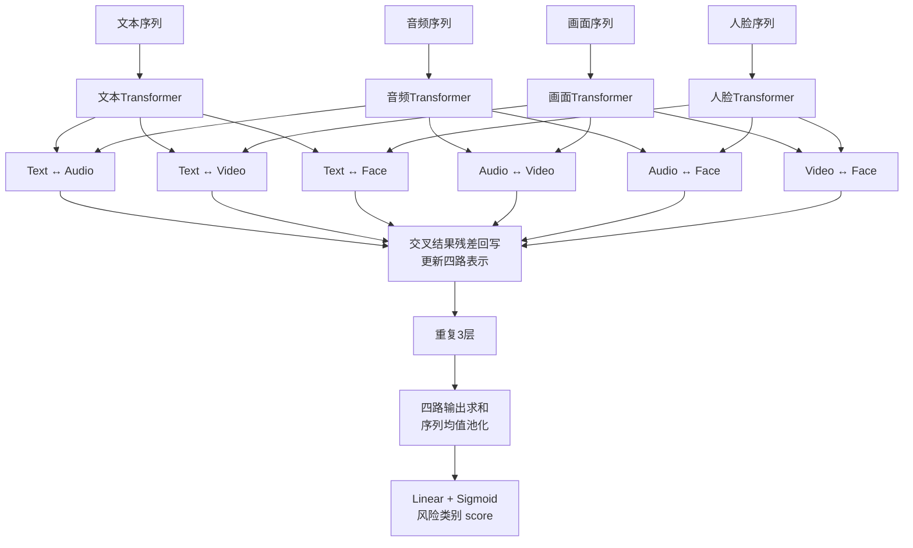

<p align="center"><b>图5-2 单层六组交叉注意力与最终融合</b></p>

#### 5.4.3 四路融合与二分类头

**三层编码结束后，四路输出使用加法完成最终汇合。**相加结果保留统一的768维形状，序列均值池化再把512个时间位置压缩为一个视频向量，最后通过线性层输出二分类logit。

**模型模块命名保持与检查点结构兼容。**这一兼容设计支持加载现有state dict，同时保留明确的前向传播、特征维度和输出接口。

### 5.5 Resident常驻推理与并行特征提取

#### 5.5.1 Subprocess兼容后端

**Subprocess后端保留了接近官方脚本的完整处理路径。**每次请求依次调用`extract_video_vit.py`、`extract_audio_wav.py`、`MFCC.py`、`extract_audio_text.py`、`BERT.py`和`extract_face_fervt.py`，适合作为兼容回退方案。

**重复进程启动和权重加载构成Subprocess的主要时间开销。**约10秒短视频在串行Subprocess模式下参考耗时约65秒；把独立分支并行后，参考耗时下降到约47秒。

#### 5.5.2 Resident内存常驻后端

**Resident后端在API启动时一次性加载全部模型。**ViT、Whisper、Chinese BERT、MTCNN、FER-VT和融合模型常驻内存，每次请求直接复用已经初始化的对象，避免重复读取大权重。

**Resident并行是最终演示使用的默认方案。**约10秒短视频的参考耗时下降到约7.4秒，配置通过`PCLMM_API_FEATURE_BACKEND=resident`与`PCLMM_API_EXTRACTION_MODE=parallel`启用。

#### 5.5.3 三主分支并行调度

**并行调度以ViT、音频和Face/FER-VT组成三个主分支。**音频准备完成后，MFCC与Whisper继续并行运行，BERT在Whisper完成后执行。这个调度顺序同时保留任务依赖和可并行部分。

**互斥锁保证同一视频服务实例只执行一个重型预测。**服务繁忙时返回HTTP 429，Gateway再向用户显示“视频审核服务正忙，请稍后重试”。该机制防止多个大模型请求同时占用同一套运行资源。

#### 5.5.4 特征缓存与强制重算

**四路特征按照`file_id`保存到cache。**重复请求可以直接使用已有特征，每个阶段同时记录是否命中缓存和实际耗时；`force_recompute=true`用于忽略旧缓存并重新生成特征。

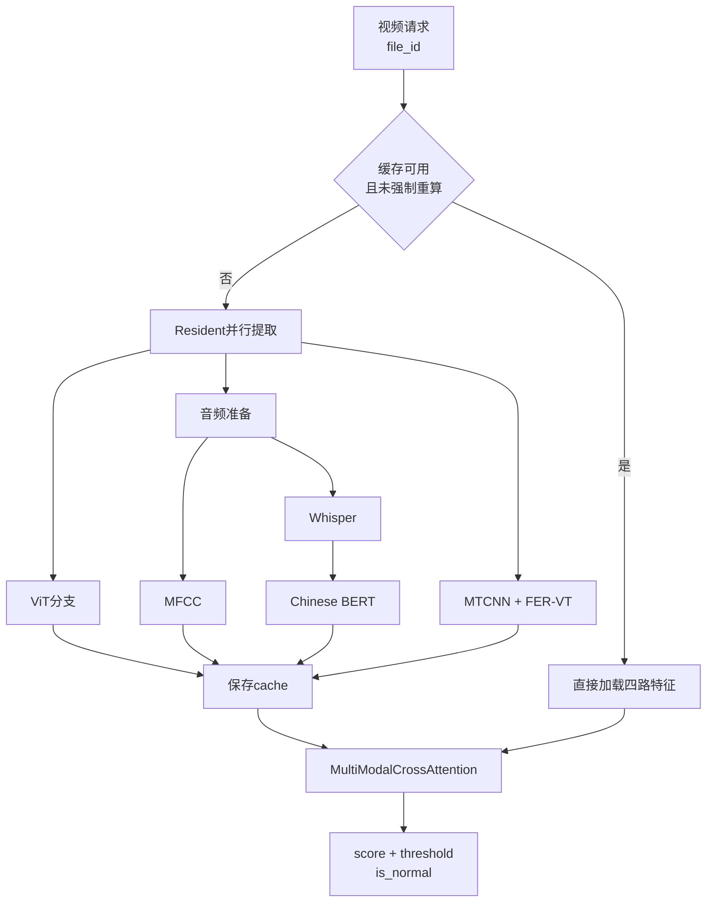

<p align="center"><b>图5-3 Resident并行提取与特征缓存流程</b></p>

### 5.6 视频服务API与工程输出

#### 5.6.1 `/predict`请求与阈值覆盖

**视频服务通过multipart接收mp4文件。**`POST /predict`的必填字段为`file`，可选字段包括`threshold`、`file_id`、`debug`和`force_recompute`。调用方可以使用默认阈值，也可以在单次请求中覆盖。

**默认API阈值设置为0.32。**该阈值来自31条测试样本上的三组结果比较，在当前数据上取得最高Accuracy，并在正常视频通过和风险类别召回之间保持相对平衡。

#### 5.6.2 普通结果与调试结果

**普通响应只返回业务需要的`is_normal`。**Gateway根据布尔结果决定视频能否发送，不向前端暴露复杂模型结构。

**调试响应提供完整模型与工程信息。**开启`debug`后，服务返回score、threshold、prediction、file id、四路特征路径、各阶段耗时、backend、extraction mode和缓存策略，便于定位特征提取与融合推理过程。

#### 5.6.3 服务健康与繁忙保护

**`GET /health`用于检查视频服务与模型状态。**Gateway把该结果纳入综合健康检查，前端可以显示整个审核系统当前是否在线。

**繁忙保护与Fail-closed策略形成完整衔接。**视频服务返回429时，Gateway生成不可发送结果并展示服务繁忙提示，请求不会作为安全视频放行。

### 5.7 实验结果

#### 5.7.1 评测集合与类别分布

**最终结果来自31条四模态特征完整的测试样本。**其中normal 26条、风险类别 5条，所有阈值都使用同一组模型分数计算，因此不同阈值的Accuracy、Macro F1和风险类别指标可以直接比较。

**AUC在三组阈值下保持0.8846。**AUC由连续分数排序决定，阈值只改变离散标签，因此三行结果中的AUC相同；其他分类指标会随阈值变化。

#### 5.7.2 三组阈值完整指标

**三组阈值的全部测试指标如下。**

<p align="center"><b>表5-3 视频模型三组阈值测试结果</b></p>

| 阈值 | 样本数 | Accuracy | Macro F1 | 风险类别 Precision | 风险类别 Recall | 风险类别 F1 | AUC |
| ---: | ---: | ---: | ---: | ---: | ---: | ---: | ---: |
| 0.500 | 31 | 0.8387 | 0.5974 | 0.5000 | 0.2000 | 0.2857 | 0.8846 |
| **0.320** | **31** | **0.8710** | **0.7130** | **0.6667** | **0.4000** | **0.5000** | **0.8846** |
| 0.008 | 31 | 0.8387 | 0.7567 | 0.5000 | 0.8000 | 0.6154 | 0.8846 |

#### 5.7.3 推荐API阈值

**0.32是当前API默认使用的推荐阈值。**该阈值取得三组结果中最高的Accuracy 0.8710，Macro F1为0.7130，风险类别 Precision为0.6667，风险类别 Recall为0.4000。

**0.008对应更积极的风险类别召回策略。**阈值降低后，风险类别 Recall提高到0.8000，风险类别 F1提高到0.6154，Macro F1提高到0.7567。项目保留这组结果，用于展示不同业务策略怎样使用同一个连续分数。

#### 5.7.4 推理后端耗时结果

**Resident常驻与并行提取显著缩短了视频处理时间。**

<p align="center"><b>表5-4 约10秒短视频的后端参考耗时</b></p>

| 特征后端 | 提取方式 | 参考耗时 |
| --- | --- | ---: |
| Subprocess | 串行 | 约65秒 |
| Subprocess | 并行 | 约47秒 |
| Resident | 并行 | 约7.4秒 |

### 5.8 结果分析

#### 5.8.1 四模态模型总体性能分析

**四模态模型已经具备较好的normal/风险类别排序能力。**测试AUC达到0.8846，说明风险类别样本在整体分数排序中通常高于normal样本。推荐阈值0.32下，Accuracy达到0.8710，模型能够把四路异构特征转换为有效的二分类结果。

**多模态融合让视频判断同时使用内容与表现方式。**ViT提供连续画面，MFCC描述声学模式，Whisper与BERT提供说话内容，FER-VT补充表情信息；六组交叉注意力把四路特征放入统一时序表示，最终分数综合完整视频，不依赖某一帧或某一句话。

#### 5.8.2 阈值变化的增益与代价

**0.32适合作为当前整体准确率策略。**它取得最高Accuracy 0.8710，同时把风险类别 Precision保持在0.6667。对于默认聊天审核，系统使用这一阈值生成`is_normal`。

**0.008适合更关注风险召回的审核场景。**该阈值把风险类别 Recall从0.4000提高到0.8000，Macro F1和风险类别 F1也分别达到0.7567和0.6154。两组结果说明视频服务可以根据平台审核目标切换阈值，无需改变四模态模型结构。

#### 5.8.3 多指标联合评价

**Accuracy、Macro F1、风险类别指标和AUC共同给出了完整结论。**Accuracy观察全部31条样本，Macro F1平衡两个类别，风险类别 Precision、Recall与F1集中描述风险类别，AUC继续观察阈值变化前的连续排序。多项指标结合后，可以同时评价总体判断和风险类别识别。

#### 5.8.4 Resident并行推理效果

**Resident并行后端已经解决了重复加载大模型带来的主要等待。**约10秒短视频从串行Subprocess的约65秒下降到约7.4秒，参考耗时缩短约88.6%；并行Subprocess约47秒的结果也说明，模型常驻带来的收益明显高于只调整脚本并行顺序。

**特征缓存进一步减少重复请求的计算。**相同`file_id`再次出现时，服务可以直接加载已有四路特征并进入融合模型；调试结果继续记录缓存状态和各阶段耗时，使性能变化能够被追踪。

#### 5.8.5 综合判断与改进方向

**综合结果说明，视频路线已经完成四模态特征提取、交叉注意力融合、阈值决策和在线API的完整闭环。**AUC 0.8846验证了模型排序能力，三组阈值展示了不同审核策略，Resident并行把约10秒短视频的参考处理时间降低到约7.4秒。

**后续工作将面向视频内容安全中的长期行业问题。**长视频会带来更大的时序计算量，不同平台的视频剪辑、语音风格和人脸可见度也持续变化。本项目可以继续扩展跨平台视频覆盖，引入分段聚合、任务队列与多实例推理，并持续记录各类视频在不同阈值下的稳定性。

## 六、统一审核网关与系统集成

### 6.1 FastAPI统一审核网关

#### 6.1.1 三类Adapter与统一结果模型

**统一审核网关已经把文本、图片和视频服务接入同一个消息接口。**前端只向FastAPI Gateway发送一次`multipart/form-data`请求，网关根据消息内容调用Text、Image和Video三类Adapter。三个模型服务继续保持独立部署，分别使用8000、8010和8020端口，网关在8080端口完成业务编排、结果转换和消息可见性判断。

> **对应代码文件**：
>
> `MM-ContentGuard-main/backend/gateway/app/adapters/`
>
> `MM-ContentGuard-main/backend/gateway/app/models/review.py`
>
> `MM-ContentGuard-main/backend/gateway/app/api/messages.py`

**三类Adapter解决了底层接口和返回字段不一致的问题。**文本Adapter默认调用MacBERT服务的`/text/check`，并保留切换至TF-IDF+SVM `/predict`接口的能力；图片Adapter把本地图片路径和OCR开关传给`/image/check`；视频Adapter通过multipart上传mp4文件并调用`/predict`。每个Adapter只理解对应模型的原始输出，再统一转换为`ModalityReviewResult`。

<p align="center"><b>表6-1 三类审核Adapter的输入输出映射</b></p>

| Adapter | 下游接口 | 主要原始字段 | 统一判断依据 |
| --- | --- | --- | --- |
| Text Adapter | `POST /text/check` | `risk_level`、`risk_probability`、`primary_category` | 仅`normal`允许发送 |
| Image Adapter | `POST /image/check` | `risk_level`、`risk_category`、`reasons`、`detectors` | 仅`normal`允许发送 |
| Video Adapter | `POST /predict` | `is_normal`、`score`、`threshold` | `is_normal=true`允许发送 |

**统一结果完整保留了业务判断、中文解释和模型原始证据。**`ModalityReviewResult`包含`modality`、`allow`、`risk_level`、`category`、`score`、`summary`、`reasons`和`raw`字段。普通用户看到的是“武器相关内容”“广告/垃圾信息”等中文原因，调试记录继续保存底层模型概率、检测分支和路由结果，模型能力没有在统一转换过程中被压缩成一个简单布尔值。

#### 6.1.2 多模态单点否决

**整条消息只有在全部模态审核通过后才会正式发送。**网关使用`all(result.allow for result in results)`汇总文本和所有附件的审核结果。文字、任意一张图片或任意一个视频只要出现风险、疑似状态或服务错误，整条消息都会进入`rejected`状态，并保持`visible_to_others=false`。

**单点否决保留了混合消息中每个模态的独立结果。**当前实现先审核文字，再按照附件顺序调用图片或视频服务，所有结果都会写入`review.results`，各模态的原始返回分别保存在`review.raw`中。因此，一条同时包含文字、两张图片和一个视频的消息可以形成四项审核记录，最终可见性仍由统一规则一次决定。

**统一网关让三种模型判断形成了稳定的产品状态。**底层服务使用`normal`、`risk`、`suspicious`、`is_normal`和不同类别名称表达结果，网关将它们收敛为`approved`与`rejected`两种正式状态。前端无需了解DINOv3、MacBERT或四模态模型的内部字段，即可准确显示消息是否发出以及拒绝原因。

#### 6.1.3 Fail-closed与文件处理

**审核服务异常时，系统默认拒绝消息并返回明确的服务状态。**文字、图片或视频请求发生连接错误、响应异常和超时时，网关生成`allow=false`、`risk_level=error`的统一结果；视频服务返回HTTP 429时，系统进一步显示“审核服务正忙，请稍后重试”。这一机制阻止了底层服务暂时不可用时未经审核的内容直接进入聊天记录。

**上传文件在审核前后具有清晰的存储边界。**图片和视频首先进入`storage/uploads/tmp/`，审核通过后移动到`approved/{conversation_id}/{message_id}/`，审核失败后移动到对应的`rejected`目录。正式附件使用重新生成的`attachment_id`命名，消息记录继续保存原始文件名、MIME类型、文件大小和最终路径。

**文件入口同时执行格式、大小与名称处理。**系统支持jpg、jpeg、png、webp和bmp图片以及mp4视频，默认限制图片不超过10MB、视频不超过200MB；文件名会去除目录成分并替换特殊字符。无法识别的文件类型返回400，超过大小限制返回413，使模型推理只接收系统已经确认的媒体格式。

### 6.2 三类消息的端到端流程

**统一消息接口把前端状态、模型审核和文件存储串成了一条完整路径。**

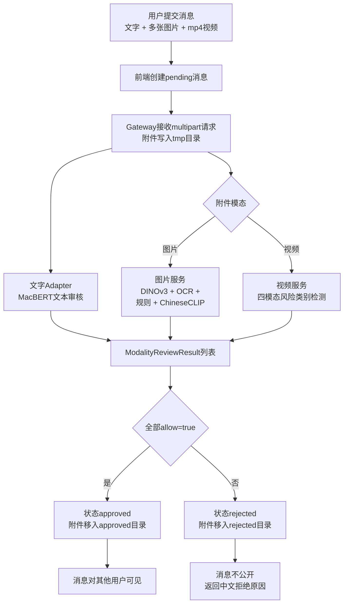

<p align="center"><b>图6-1 多模态消息从提交到审核结果的端到端流程</b></p>

#### 6.2.1 文字与图片消息

**文字消息通过统一入口直接获得MacBERT分层审核结果。**网关将消息文字与风险阈值发送到文本服务，读取风险等级、风险概率和主要原因类别。`normal`结果进入通过流程，`suspicious`与`risk`均会阻止消息发出，原因Adapter再把底层标签转换为用户可读的中文提示。

**图片消息完整执行双层图片审核路线。**Gateway先保存图片，再把绝对路径传给图片服务；图片依次接受DINOv3显式视觉分类、EasyOCR文字提取、MacBERT文本审核、URL与二维码规则检测，并在第一层安全时进入VLM描述增强和ChineseCLIP语义判断。图片Adapter保留`risk_category`、`reasons`与`detectors`，网关可以区分武器画面、图片文字风险、联系方式引流和梗图语义风险。

**文字和图片可以在同一条消息中共同参与决策。**消息正文安全但图片含有风险时，图片结果否决整条消息；图片安全但正文进入风险或疑似状态时，文本结果同样完成否决。最终响应同时返回两项结果，使发送失败的来源能够被直接定位。

#### 6.2.2 视频与混合消息

**视频消息通过Gateway上传至四模态视频服务。**Video Adapter发送文件、0.32默认阈值和调试开关，服务返回`is_normal`与风险类别连续分数。`is_normal=true`被转换为允许发送，风险视频统一映射为“视频内容未通过多模态审核”，系统没有在缺少细分类模型输出时增加未经模型判断的具体原因。

**混合消息可以包含文字、多个图片和视频附件。**网关逐项执行对应Adapter，并把全部结果保存在同一条`MessageRecord`中。审核通过的混合消息连同全部附件一起进入`approved`目录，任何一项未通过时，所有附件统一进入`rejected`目录，消息保持仅发送者侧可见。

**前端pending状态覆盖了视频审核所需的等待时间。**用户点击发送后，本地消息立即进入审核中状态，媒体缩略图显示进度动画；Gateway完成同步审核后，前端再将其更新为`approved`或`rejected`。用户在视频推理期间仍然可以看到消息位置和审核进度，最终状态与网关返回保持一致。

### 6.3 前端审核反馈

#### 6.3.1 三态消息与审核记录

**前端使用pending、approved和rejected三种状态表达一次完整发送过程。**pending消息尚未对其他用户可见，approved消息转为正常聊天气泡，rejected消息显示红色警示和中文原因。三种状态直接对应“正在审核、已经发出、未能发出”，用户无需理解模型阈值和内部类别结构。

**被拒绝的消息会进入独立审核记录。**审核记录展示失败时间、消息内容、附件摘要和结构化原因，并保留“重新编辑”入口。用户可以修改原文字后再次发送，新的请求重新经过完整审核流程，原拒绝记录继续保留用于追踪。

**前端承担交互反馈，审核结论始终来自统一网关。**图片预览、视频封面、拖拽上传和进度动画改善了发送体验；消息能否公开、拒绝原因和附件最终目录均由Gateway确定。这种边界使界面调整不会改变模型判断与安全策略。

### 6.4 系统验证与工程边界

#### 6.4.1 集成结果

**保存的集成记录验证了三个模型服务、统一网关和前端代理的完整连接。**Gateway健康检查返回`text.ok=true`、`image.ok=true`和`video.ok=true`，消息接口已经覆盖安全文本、风险文本、武器图片和视频样例四种端到端路径。

<p align="center"><b>表6-2 统一系统端到端集成结果</b></p>

| 验证对象 | 输入或检查内容 | 实际结果 |
| --- | --- | --- |
| Gateway健康检查 | 文本、图片、视频三个下游服务 | 三项`ok`均为`true` |
| 安全文本 | 普通聊天文字 | `approved`，返回“审核通过” |
| 风险文本 | 广告与垃圾信息样例 | `rejected`，返回“发送失败：广告 / 垃圾信息” |
| 风险图片 | SIMAS武器图片 | `rejected`，返回“发送失败：武器相关内容” |
| 视频消息 | mp4演示样例 | `approved`，成功调用视频`/predict` |
| 前端代理 | 页面、健康检查与消息接口 | `/`、`/api/health`和消息POST均已连通 |

**集成结果说明独立模型已经转化为可交互的消息审核系统。**模型输出能够继续影响消息状态、对外可见性、附件目录和用户提示；风险内容在模型判断后进入拒绝路径，安全内容进入正式聊天记录，前端显示与后端存储保持一致。

**一键启停与健康检查脚本补齐了系统运行入口。**项目提供文本、图片、视频、Gateway和前端的独立启动脚本，也提供`start_all.sh`、`stop_all.sh`与`check_services.sh`。五项服务可以按照固定端口启动和检查，模型依赖、审核网关与页面入口形成统一的项目交付结构。

#### 6.4.2 工业化扩展议题

**当前系统已经完成课程项目所需的同步审核与本地记录闭环。**FastAPI Gateway、JSON消息存储、隔离附件目录和React前端共同支撑文字、图片、视频与混合消息演示，三类模型服务仍可独立维护和替换。

**大规模内容平台普遍需要进一步建设任务调度与服务治理能力。**视频长任务可以进入异步队列，消息与审核记录可以迁移至关系型数据库，对象存储可以支持多节点共享媒体文件；多实例推理、熔断限流、指标监控和请求追踪能够支撑更高并发的持续运行。

**模型版本与审核标准的长期管理属于内容安全系统的共同工程任务。**后续可以为每次结果记录模型版本、阈值版本和数据规则版本，建立灰度发布与回滚机制，并将人工复核结果重新汇入评测集。统一结果模型已经为这些扩展预留了原始结果、类别、分数和原因字段。

## 七、项目总体结果与综合分析

### 7.1 全局评测原则与指标口径

#### 7.1.1 四条路线分别评测

**四条研究路线分别使用与自身任务一致的数据集和评价标准。**传统机器学习路线处理显式垃圾与推广文本，MacBERT路线处理通用风险和社交口语边界，图片路线分别评测显式七分类与梗图语义任务，视频路线评测normal/风险类别二分类。数据来源、类别数量、正负样本比例和任务难度均有差异，因此各项指标用于说明对应路线是否完成自己的检测目标。

**跨路线分析关注能力覆盖和模型分工。**本项目观察每条路线识别了哪类内容、哪些样本需要专门模型以及阈值如何影响最终决策，并结合统一网关验证四条研究路线怎样进入真实消息流程。不同任务的Accuracy不进行数值排名，避免数据边界差异掩盖指标本身的含义。

#### 7.1.2 Accuracy、Macro F1、风险召回与AUC

**四类核心指标从整体正确率、类别平衡、风险漏检和连续排序四个角度评价模型。**

<p align="center"><b>表7-1 全局评价指标及其主要作用</b></p>

| 指标 | 观察内容 | 在本项目中的主要用途 |
| --- | --- | --- |
| Accuracy | 全部样本中预测正确的比例 | 观察模型总体判断结果 |
| Macro F1 | 各类别F1的等权平均 | 降低类别数量差异对评价的影响 |
| 风险召回率 | 真实风险样本中被识别的比例 | 观察风险内容的漏检情况 |
| AUC | 不固定阈值时的正负样本排序能力 | 评价视频连续风险类别分数 |

**每条路线选择最能反映任务目标的指标组合。**垃圾文本同时报告Accuracy与Spam F1，MacBERT完整系统重点报告Macro F1与风险召回，图片七分类与语义分类重点报告Macro F1，视频样本类别不平衡，因此联合报告Accuracy、Macro F1、风险类别 Precision、风险类别 Recall、风险类别 F1和AUC。

#### 7.1.3 最终指标与中间指标的区分

**总体汇总只使用最终模型、完整系统或明确业务阈值下的结果。**传统路线保留两个独立完成的最终模型，MacBERT使用三专家分层系统，图片分别使用第一层DINOv3与第二层ChineseCLIP最终checkpoint，视频使用四模态交叉注意力模型的测试集结果。

**训练过程指标用于说明模型选择，不进入最终能力结论。**候选backbone、训练epoch、组件诊断集、阈值搜索过程和中间checkpoint仍然保存在各路线实验记录中，它们帮助解释架构演进与参数选择；第七部分使用最终测试或验证口径，确保汇总结果与前文一致。

### 7.2 四条路线最终结果汇总

**四条路线均已形成可复现的最终模型结果和对应API能力。**

<p align="center"><b>表7-2 四条研究路线最终结果汇总</b></p>

| 路线 | 最终评测对象 | 评测数据 | 主要结果 |
| --- | --- | --- | --- |
| 传统机器学习文本 | TF-IDF+SVM | AST分层测试集，4803条 | Accuracy 0.9940；Spam F1 0.9956 |
| 传统机器学习文本 | Rule-free CSN+LR | AST分层测试集，4803条 | Accuracy 0.9715；Spam F1 0.9791 |
| 多专家MacBERT | 完整分层系统 | 常规test | Accuracy 0.9474；Macro F1 0.9459；风险召回0.9663 |
| 多专家MacBERT | 完整分层系统 | 社交边界封存集 | Accuracy、Macro F1、风险召回均为0.9900 |
| 双层图片审核 | DINOv3七分类 | SIMAS+PASS独立测试集 | Accuracy 0.9723；Macro F1 0.9612 |
| 双层图片审核 | ChineseCLIP语义层 | ToxiCN_MM测试集 | 二分类Accuracy 0.8341、Macro F1 0.8029；五分类Accuracy 0.7974、Macro F1 0.6239 |
| 四模态视频风险类别 | 交叉注意力融合模型 | 31条四模态测试样本 | AUC 0.8846；阈值0.32时Accuracy 0.8710、Macro F1 0.7130 |

#### 7.2.1 传统机器学习文本路线

**TF-IDF+SVM完成了显式垃圾文本的高精度识别。**模型在AST分层测试集上取得0.9940 Accuracy和0.9956 Spam F1，4803条测试样本中出现13条误报与16条漏检。字符级1-3gram能够稳定捕捉推广模板、联系方式、营销用语和局部字符组合。

**Rule-free CSN+LR验证了字音、字形和统计邻居联合表示的可行性。**该模型取得0.9715 Accuracy和0.9791 Spam F1，并通过语料统计自动建立字符相似网络，没有维护人工风险词表。两套模型分别给出了强统计基线和课程算法实现，默认API使用指标更高的TF-IDF+SVM，CSN保留为独立研究路线。

#### 7.2.2 多专家MacBERT文本路线

**三专家分层系统已经具备稳定的通用文本风险识别能力。**常规test上的Accuracy为0.9474，Macro F1为0.9459，风险召回达到0.9663，说明系统能够识别大多数真实风险文本，并在正常类与风险类之间保持均衡表现。

**社交边界专家显著补充了隐晦口语风险。**完整系统在社交边界封存集上的Accuracy、Macro F1和风险召回均达到0.9900，口语专家自身取得1.0000 Accuracy与Macro F1。原因专家取得0.9943 Accuracy和0.9864 Macro F1，使文本拒绝结果可以进一步映射到诈骗违法推广、赌博、色情和辱骂仇恨四类原因。

#### 7.2.3 双层图片审核路线

**DINOv3已经在独立测试集上完成显式图片七分类。**测试集Accuracy达到0.9723，Macro F1达到0.9612，安全、色情、暴力、武器、赌博、毒品和管制物品七类均进入统一概率输出。验证集的0.9569 Accuracy和0.9339 Macro F1只承担第8个epoch的模型选择作用；最终汇总采用测试集指标。明确视觉风险可以在第一层直接拦截，减少后续语义处理。

**ChineseCLIP已经具备对梗图有害性的独立判断能力。**safe/harmful二分类取得0.8341 Accuracy和0.8029 Macro F1，并在真实API样例中识别出第一层未确认的针对性冒犯、泛攻击和性暗示。五分类取得0.7974 Accuracy和0.6239 Macro F1，为有害结果补充具体语义类别。

#### 7.2.4 四模态视频语言风险路线

**四模态交叉注意力模型取得0.8846 AUC。**该结果说明模型输出的连续风险类别分数已经形成较好的正负样本排序，画面、MFCC、语音文本和人脸表情能够共同参与视频判断。

**0.32阈值给出了当前默认API的整体准确率方案。**该阈值下Accuracy为0.8710，Macro F1为0.7130，风险类别 Precision为0.6667，风险类别 Recall为0.4000，风险类别 F1为0.5000。面向风险召回的0.008阈值把风险类别 Recall提高到0.8000，Macro F1提高到0.7567，风险类别 F1提高到0.6154，模型可以通过阈值切换适配不同审核目标。

### 7.3 主要结果结论

#### 7.3.1 四条路线分别解决了不同类型的内容风险

**传统机器学习路线适合承担严格聊天审核中的第一类文本过滤任务。**TF-IDF+SVM取得0.9940 Accuracy，可以快速识别私信和群聊中的广告推广、联系方式引流与固定垃圾模板；Rule-free CSN进一步处理同音字、形近字和字符变体。

**MacBERT路线最适合识别现代社交软件中的短文本和隐晦表达。**它能够处理辱骂攻击、阴阳怪气、冷暴力和隐晦引流，可以用于直播弹幕、评论区、游戏聊天和社交私信。

**图片路线能够同时审核图片本身、图片文字和梗图含义。**显式的武器、暴力、毒品等内容在第一层直接拦截，表情包和梗图继续进入图文语义模型，适合聊天图片、论坛贴图和图片评论。

**视频路线能够从画面、声音、语音文字和人物表情共同判断贬损性语言风险。**它适合短视频投稿、视频私信和视频审核后台，在视频正式发布或发送前给出审核结果。

#### 7.3.2 系统适合放在内容发送或发布之前

**项目最适合用作社交软件中的发送前审核系统。**用户点击发送后，文字、图片和视频先进入对应模型，全部通过后消息才会真正发出；任何一种内容存在风险，整条消息都会被拒绝。

**这种使用方式能够覆盖真实社交软件中的常见规避行为。**用户无法用图片绕过文字审核，也无法用正常配文掩盖风险梗图或视频。系统还会返回具体原因，让用户知道需要修改文字、删除图片或更换视频。

### 7.4 适用场景

**本系统面向审核标准严格、风险内容需要在传播前被阻断的应用。**核心场景集中在未成年人聊天、陌生人私信、直播互动、网络游戏交流和短视频内容审核。

#### 7.4.1 未成年人聊天与儿童社交


**未成年人聊天是本系统最主要的适用场景。**具体可以用于QQ和微信中的未成年人交流场景、钉钉班级群、企业微信家校群、学习通讨论区，以及小天才电话手表等儿童终端的聊天功能。系统能够拦截广告诈骗、赌博引流、辱骂仇恨、低俗梗图、显式违规图片和风险类别视频。

**嵌入时应把统一Gateway放在所有消息发送接口之前。**文字、图片、表情包和视频必须先完成审核，全部安全后才允许送达；明确风险直接拒绝，疑似内容保持不可见并进入人工复核，模型服务异常时同样停止发送。

#### 7.4.2 陌生人社交与平台私信


**陌生人社交和平台私信需要严格处理骚扰、引流与隐晦攻击。**具体可以用于Soul、陌陌等陌生人社交软件，也可以用于抖音、快手、B站、微博和小红书的用户私信、创作者私信与粉丝消息。系统可以同时检查正文、聊天图片、表情包和视频附件，阻止用户通过附件绕过文本审核。

**嵌入时应由Gateway接管原有私信发送接口。**客户端提交消息后先显示“审核中”，网关逐项调用文本、图片和视频服务；全部结果通过后消息才送达接收者，任一模态触发风险时整条私信停止发送，并向发送者显示具体原因。

#### 7.4.3 直播弹幕与互动评论


**直播弹幕和互动评论适合重点使用MacBERT文本路线。**具体可以用于抖音直播、快手直播、B站直播、斗鱼和虎牙的弹幕、直播评论与主播互动区，识别辱骂攻击、阴阳怪气、冷暴力、赌博引流和变体广告。

**嵌入时应在弹幕或评论进入直播间之前调用文本审核服务。**安全文本正常显示，明确风险立即拦截，疑似风险内容可以进入平台复核队列；带图评论继续调用图片服务，避免低俗梗图和二维码引流进入公开互动区。

#### 7.4.4 未成年人较多的网络游戏聊天


**网络游戏聊天适合使用文本审核与严格的发送前拦截。**具体可以用于《王者荣耀》《和平精英》《蛋仔派对》《元梦之星》等游戏的世界频道、组队频道、公会聊天和玩家私聊，处理辱骂、骚扰、赌博广告、账号交易与联系方式引流。

**嵌入时应把文本服务接入游戏聊天服务器。**玩家消息先发送到审核接口，安全内容再广播给其他玩家；风险内容只向发送者返回失败提示。支持图片或语音视频社区的游戏，可以继续通过统一Gateway调用图片与视频服务。

#### 7.4.5 短视频投稿、视频私信与内容复核


**四模态视频路线适合用于风险要求较高的短视频审核。**具体可以用于抖音、快手、B站、微信视频号和西瓜视频的投稿审核、视频私信、举报复核与青少年内容专区，识别带有贬低、歧视和攻击倾向的风险类别视频。

**嵌入时应在视频上传完成和正式公开之间调用`/predict`。**前端保持“审核中”，正常视频完成发布或发送，风险视频保持不可见并进入拒绝或复核流程；直播平台也可以把连续直播切分为短片段后交给视频模型周期性检查。

#### 7.4.6 推荐使用方式

**这套系统适合成为高保护等级平台的发送前安全门。**未成年人聊天和陌生人私信使用完整多模态单点否决，直播弹幕与游戏聊天重点使用实时文本审核，短视频平台使用上传后审核。各场景都在内容对其他用户可见之前完成检测，使风险信息无法先传播再处理。

### 7.5 总体结论

**项目已经完成从传统垃圾文本到现代多模态内容的完整扩展。**四条路线分别覆盖垃圾与变体文本、隐晦社交文本、违规图片与梗图、风险类别视频，最终接入同一个聊天审核系统。

**项目得到的直接结论是，现代社交软件需要按照内容类型调用对应的审核模型。**文字交给文本模型，图片交给双层图片模型，视频交给四模态视频模型，统一网关负责汇总结果。安全内容正常发送，风险内容被阻止，用户可以看到不通过原因。

**这套系统最适合用于未成年人聊天、陌生人私信、直播弹幕、游戏聊天和短视频内容审核。**这些场景都需要在内容传播前执行严格判断，完整系统可以作为后台安全门，通过单点否决、疑似复核和失败关闭控制文字、图片与视频是否允许发送。

## 八、项目创新、局限性与未来工作

### 8.1 四条研究路线与完整系统总结

#### 8.1.1 从传统文本到多模态内容审核

回过头来看，四条研究路线其实对应了本项目在项目中一步步遇到的四类问题。**最开始需要解决的是最常见的垃圾文本和广告推广。**这类内容通常带有固定模板、联系方式或局部字符规律，所以本项目先用TF-IDF+SVM建立强基线，再按照课程中的字音字形思路实现Rule-free CSN，处理同音字、形近字和字符变体。

传统机器学习路线完成以后，本项目很快发现，现代聊天中的很多风险已经没有固定模板了。一句很短的“你可真厉害”，放在不同语气中可能是正常夸奖，也可能是在阴阳怪气；辱骂、冷暴力和隐晦引流同样依赖上下文。**因此第二条路线继续向深层语义推进，使用三个MacBERT专家分别处理通用风险、社交口语和不通过原因。**

文本问题解决之后，审核对象又从消息正文扩展到了图片、表情包和梗图。图片本身可能包含武器、暴力和毒品，图片里还可能藏有文字、二维码或联系方式，很多梗图则需要把画面和配文放在一起理解。**所以第三条路线采用双层结构，先处理显式风险，再处理图文组合语义。**

视频带来的问题更加复杂。一段视频中的风险可能出现在连续画面、说话内容、声音状态或人物表情中，单独查看其中一项都可能遗漏重要信息。**第四条路线最终把画面、音频、语音文本和人脸表情放进同一个交叉注意力模型中，完成normal/风险类别判断。**

**这样一来，本项目的研究对象就从传统垃圾文本逐步扩展到了短文本、图片、梗图和视频。**这个过程并非简单增加几个模型，它反映的是社交媒体内容从单一文字向多种媒体形式发展的真实变化。

#### 8.1.2 从独立模型到可交互审核系统

**训练和评测完成以后，本项目还需要解决模型怎样真正进入聊天软件的问题。**做完四条路线以后，本项目继续搭建FastAPI Gateway和React聊天前端，把文本、图片和视频服务接入同一个消息发送流程。

**现在用户点击发送后，消息会先进入审核状态。**Gateway保存临时附件，按照内容类型调用对应服务，再把不同模型的输出转换成统一结果。全部内容安全时消息才会正式发出；文字、图片或视频中只要有一项触发风险，整条消息都会停止发送。

审核失败以后，系统还会显示具体原因并保留审核记录。用户可以看到是广告引流、辱骂、武器图片、低俗梗图还是视频风险，也可以修改内容后重新发送。**至此，项目完成了从模型训练、实验评测到发送前审核和用户反馈的完整闭环。**

### 8.2 项目设计创新与工程实现亮点

#### 8.2.1 面向多层内容风险的分层专家化架构

**本项目最主要的设计创新，是按照风险表现层次和内容模态建立分层专家化架构。**现代社交平台中的风险内容缺少统一的数据形式和标签空间：显式垃圾文本主要表现为固定模板和局部字符规律，隐晦攻击依赖社交语境，图片还可能同时包含视觉画面、截图文字和图文组合含义，视频则进一步涉及连续画面、语音、音频状态和人物表情。面对这些差异，本项目分别建立传统文本、深层语义文本、双层图片和四模态视频四条研究路线，让每类模型处理与自身数据特点相符的任务。

**这套架构在纵向上逐步扩展风险理解层次，在横向上完成不同内容模态之间的职责划分。**纵向路线从显式模板和字符变体出发，继续处理隐晦文本语义、图文联合语义和视频时序语义；横向路线则让文本、图片和视频分别使用独立的数据、标签、模型与评测指标。四条路线共同覆盖从局部统计模式到多模态语义的风险内容，同时保留了清楚的任务边界。

**各条路线可以独立训练、评测和更新，在线阶段再由统一网关完成业务层汇总。**文本模型增加新的网络表达时，不需要重新训练图片和视频模型；图片服务更换视觉分类器时，前端和消息流程也不需要随之改变。这种组织方式避开了异构数据强行共用标签空间带来的训练困难，也使不同计算成本的模型能够按照内容类型独立部署和扩展。

#### 8.2.2 从单一分类到可执行审核的三专家文本决策链

**三专家文本决策链将单一安全二分类扩展成了风险识别、边界复核和原因解释三个分工明确的协同环节。**普通分类模型只给出安全或风险标签，很难同时覆盖明显违规、隐晦口语和面向用户的原因反馈。本项目据此训练通用风险、社交口语和风险原因三个MacBERT专家，并为三个专家安排了不同的审核职责。

**通用风险专家负责覆盖常规有害内容，社交口语专家重点处理阴阳怪气、冷暴力、网络缩写、碎片化短句和隐晦攻击，原因专家负责生成可以展示给用户的风险类别。**原因输出包括诈骗与违法推广、赌博、色情、辱骂与仇恨，使系统在拦截消息以后仍能说明主要风险来源。三个专家分别观察内容安全中的不同问题，避免单个二分类分数承担过多含义。

**在线决策层通过专家分工形成明确风险、疑似风险和安全三种审核语义。**明确风险可以直接阻止发送，分数处于边界区间的内容进入疑似风险状态，安全内容继续进入消息发送流程；原因专家的结果只在非安全状态下转化为中文提示和审核记录。三态路由把模型概率转换成了可以直接执行的产品行为，也为自动拦截与人工复核保留了清楚的接口。

**单个MacBERT专家内部还联合使用上下文语义、token级字音字形特征和句级拼音序列。**门控机制根据当前文本调节增强特征的参与程度，使正常语义理解、同音替换和形近字符变体能够在同一模型中完成判断。最终文本路线同时具备语义识别、变体感知、分层决策和风险原因输出四项能力。

#### 8.2.3 显式风险优先、隐式语义补充的双层图片审核机制

**双层图片审核机制按照风险的显式程度安排模型路由，先处理证据明确的内容，再补充复杂的图文组合语义。**图片风险可能直接来自色情、武器、赌博、毒品等视觉画面，也可能隐藏在截图文字、网址、联系方式、二维码和表情包配文中。单一图像分类结果难以完整覆盖这些风险来源，因此本项目将图片审核划分为显式风险层和隐式语义层。

**第一层联合DINOv3视觉分类、EasyOCR文字提取、MacBERT文本审核和结构化规则，优先拦截具有明确证据的图片。**DINOv3负责识别七类视觉内容，OCR分支提取图片中的文字并复用深层文本服务，规则分支继续检查网址、联系方式、敏感词和二维码。任一分支发现明确风险时，服务直接保留对应类别、分数和证据，并结束后续语义推理。

**第一层判定安全的图片继续进入ChineseCLIP语义层，重点处理表情包、梗图和隐晦冒犯内容。**第二层同时编码原图、OCR文字、文字含义描述和梗图描述，描述门控调节VLM辅助信息的参与程度，再由本地训练的ChineseCLIP完成最终语义判断。VLM在这条链路中负责补充图片描述，是否拦截仍由具有固定权重、阈值和评测结果的本地模型决定。

**风险类型驱动的级联使图片审核同时覆盖画面、文字、结构化引流和图文组合含义。**前层提供快速拦截和清楚的风险证据，后层补充复杂语义判断；计算量较大的描述与图文融合集中用于第一层未发现风险的图片，也使不同推理成本的模型具有明确的调用顺序。

#### 8.2.4 面向异构模型的统一审核数据契约与安全聚合

**统一审核数据契约解决了异构模型结果怎样转化为同一种消息审核行为的问题。**文本、图片和视频服务在模型结构、标签定义、推理耗时和返回字段方面存在明显差异：文本服务输出风险等级和原因，图片服务包含视觉、OCR、规则与语义分支，视频服务主要输出normal/风险类别概率。本项目为三类服务分别实现Adapter，再将结果统一转换为`ModalityReviewResult`。

**统一结果完整保留了业务决策和后续追踪需要的信息。**其中包括模态来源、是否允许发送、风险等级、类别、分数、中文摘要、结构化原因和底层原始结果。前端只需要识别统一状态，模型服务仍可保留各自的详细输出；后续替换某个模型时，只需维持Adapter和数据契约稳定。

**网关在统一数据之上实施多模态单点否决，正文和全部附件均通过审核后，消息才会正式发送。**一条请求可以同时包含文字和多个附件，Gateway分别调用对应服务并聚合全部结果；任一模态触发风险，整条消息立即停止发送，同时保存风险来源、中文原因和原始审核记录。这一机制把多个独立预测结果转化成了唯一、清楚的消息状态。

**Fail-closed策略进一步保证了系统在异常状态下仍然保持严格审核边界。**模型服务离线、超时、繁忙、返回异常或文件无法解析时，网关会生成统一拒绝结果，防止未经审核的内容因技术故障进入发送流程。数据契约、Adapter、单点否决和失败关闭共同组成了跨模态审核的安全聚合机制，使文本、图片和视频三类在线模型能力进入一套可以运行的发送前审核系统。

### 8.3 大数据项目实践中的方法认识

#### 8.3.1 垂直任务拆分有利于控制复杂度

刚开始设计整个项目时，很容易想到用一个大模型统一处理所有内容。但真正查看数据以后进一步分析发现，垃圾短信、聊天短句、梗图和视频在输入形式、标签和风险来源上都相差很大。**把任务拆成四条垂直路线以后，每条路线需要学什么、用什么数据、怎样评测都变得清楚了。**

这种拆分也给后续修改带来了很大方便。文本模型可以单独补充新的聊天表达，图片模型可以增加新梗图，视频模型可以扩展四模态数据，Gateway仍然按照原来的接口调用。**模型之间保持独立，系统层再负责组合，是本项目在整个项目中反复验证后得到的一条重要经验。**

#### 8.3.2 数据边界决定指标含义

项目中的几个Accuracy看起来都可以放在同一张表里，但它们背后的任务完全不同。AST是垃圾文本的同源分层测试，MacBERT还包含专门的社交边界封存集，图片分成显式七分类和梗图语义任务，视频测试集则只有31条四模态完整样本。**如果离开数据来源和标签范围单独讨论一个数字，这个数字就很容易被理解错。**

所以本项目在报告结果时同时保留Accuracy、Macro F1、风险召回、Precision和AUC。Accuracy观察总体正确率，Macro F1平衡不同类别，风险召回直接反映漏掉多少风险内容，AUC继续观察视频分数的排序能力。**数据边界先确定指标能回答什么问题，指标才有真正的解释价值。**

#### 8.3.3 最终系统需要同时考虑召回、误伤与计算成本

离线指标达到预期以后，项目仍然没有结束。真正放进聊天软件时，本项目还要考虑正常消息会不会被拦截、视频要等多久、服务异常时消息怎样处理。**一个模型能取得高分，只代表算法完成了第一步；它还需要合适的阈值、路由和运行方式才能进入真实系统。**

严格审核场景更关注风险召回，但正常用户也需要稳定的发送体验，所以系统保留风险、疑似风险和安全三种状态。轻量文本模型适合高频入口，图片第一层先处理明确风险，语义层补抓梗图，视频服务通过Resident与缓存降低等待。**召回、误伤和计算成本需要一起考虑，这三项共同决定了最终系统怎样使用模型。**

### 8.4 项目局限性

**这里的项目局限性主要指系统的适用边界和真实部署时需要继续配套的条件。**前面已经完成的模型能力和实验结果仍然成立，下面讨论的是系统长期使用时会面对的外部变化。

#### 8.4.1 模型结果具有时间边界

内容安全有一个很明显的特点：模型训练完成以后，网络语言还会继续变化。今天常见的谐音写法可能很快被新的缩写替代，旧梗图会出现新的配文，视频也会通过剪辑、变声和字幕继续改变表达方式。**因此，本项目的实验结果对应当前数据范围和当前网络表达，模型在长期使用中需要继续接收新样本。**

**这一边界来自网络表达本身持续变化。**实际平台可以把人工复核和用户申诉中的新案例重新整理成时间切片数据，定期检查已有模型对新表达的覆盖情况，再决定补充训练、调整阈值或增加结构化规则。

#### 8.4.2 跨平台使用需要重新配置审核标准

同一句话出现在朋友私聊、陌生人私信、未成年人群聊和公开直播间中，实际影响可能完全不同。未成年人聊天需要更严格的保护，直播弹幕传播速度更快，游戏交流又经常带有口语化情绪。**本项目给出了统一的严格审核流程，接入具体平台时仍然需要按照用户群体和社区规则重新选择阈值。**

**Gateway已经为不同平台调整处置方式保留了完整接口。**风险等级、类别、阈值和原因字段都可以继续配置；未成年人聊天可以扩大疑似风险范围，直播弹幕需要快速处理明确风险，短视频投稿可以留出更长的审核时间。这些变化属于平台审核标准的配置，并不改变四条模型路线的主体结构。

#### 8.4.3 真实部署需要配套隐私与模型治理

本项目重点完成了算法研究、模型服务和消息审核闭环，而真实平台还需要为用户数据建立完整的管理制度。多模态审核会接触文字、图片、语音和视频，**正式部署时需要明确数据保存周期、访问权限、脱敏方式和删除流程。**

模型长期更新以后，平台还需要记录每条结果使用的checkpoint、阈值、规则和Adapter版本，才能追踪内容为什么被拦截，并在不同版本之间进行比较和回滚。**隐私保护、人工复核和版本审计属于真实平台必须配套的治理机制，也构成了本项目从课程系统继续走向实际应用时的范围边界。**

### 8.5 未来工作

#### 8.5.1 数据与评测扩展

**后续本项目首先想继续补充与严格审核场景直接相关的数据。**其中包括未成年人聊天、陌生人私信、直播弹幕、游戏交流和短视频评论中的新表达；文本中可以增加新的谐音和缩写，图片中可以增加新的梗图模板，视频中可以增加不同语速、画面风格和人物状态。

**这些数据最终需要组成一套长期回归集。**每次模型更新以后，系统都重新测试垃圾与变体文本、隐晦社交文本、显式图片、梗图和风险类别视频，同时检查混合消息的最终状态、拒绝原因和附件处理结果。这样才能知道一次修改究竟提升了哪部分能力，又是否影响了原来已经稳定的功能。

#### 8.5.2 模型与阈值优化

不同应用对漏检和误伤的要求并不相同。未成年人聊天和陌生人私信更关注风险召回，直播弹幕和游戏聊天还要兼顾实时性，视频投稿可以在自动拦截与人工复核之间留出更细的分数区间。**后续可以为不同场景分别选择阈值，让同一套模型形成不同的审核策略。**

#### 8.5.3 系统工程升级

**视频和复杂图片的处理时间明显长于文本，下一步可以把这些任务放入异步队列。**用户提交媒体后先获得审核任务编号，后台GPU实例完成推理，再通过轮询或WebSocket更新状态。多个视频实例还可以按照GPU资源分配任务，避免单个重型请求长期占用发送接口。

**消息与审核记录还可以迁移到关系型数据库和对象存储。**消息、附件、模型结果、人工复核和申诉记录分别保存以后，可以进一步支持多用户会话、管理员审核后台、长期统计和更严格的访问权限。

最后，本项目还希望补充容器化、服务监控和模型版本管理。文本、图片、视频和Gateway分别维护运行环境，系统持续记录请求量、响应时间、超时率、拒绝率和疑似风险比例。**完成这些工程升级以后，当前原型就可以继续向长期运行、持续更新的严格内容审核系统发展。**

## 数据使用说明

**数据许可证与使用范围说明：**SIMAS数据集页面标注为CC BY-NC 4.0，PASS数据集采用CC-BY并提供来源归属信息，图文梗图数据和视频数据均按照原始资源仓库的研究用途限制使用。本文只在课程项目中使用已经保存的本地数据和模型结果，不将原始有害内容作为独立数据包再次发布；若系统继续面向真实平台部署，还需要按照各数据集许可证、原始图片来源和平台隐私政策重新完成授权核验。
